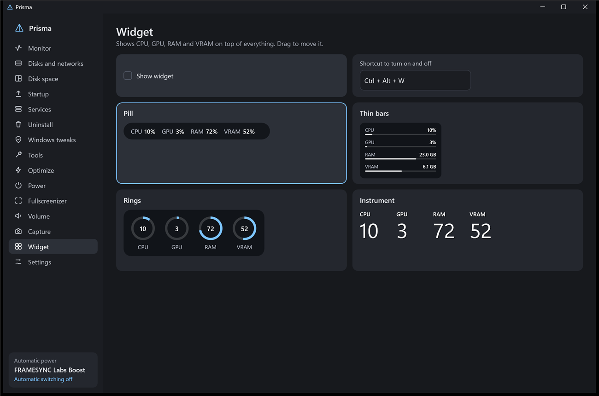
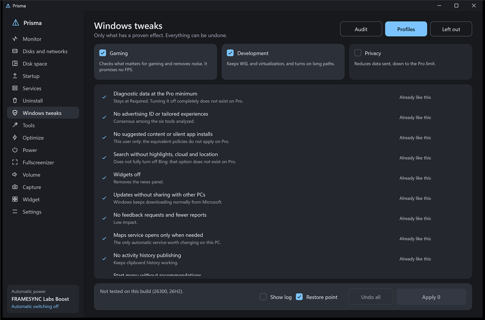

# Prisma

[English](README.md) · [Português (Brasil)](README.pt-BR.md) · **Español** · [Русский](README.ru.md) · [简体中文](README.zh-CN.md)

Una utilidad ligera para Windows 11, escrita entera en Rust sin framework de interfaz. Vive en la bandeja, carga solo lo que está en uso y cabe en un único archivo de 2 MB. Sustituye al Administrador de tareas y reúne las pequeñas herramientas que quien juega en PC suele juntar una a una.

**[Descargar la última versión](https://github.com/maliquem/Prisma/releases/latest)** · **[Guía: cada función explicada (en inglés)](docs/guide/GUIDE.md)**

[](https://ko-fi.com/maliquem)



## Primeros pasos

Prisma es un solo archivo, `Prisma.exe`. La primera vez Windows puede avisar de un editor desconocido, porque el archivo no tiene firma de código.

Al abrirlo por primera vez, la pantalla de bienvenida pregunta si quieres instalar, dar permiso de administrador y sustituir el Administrador de tareas. Las tres vienen marcadas, y Windows pide permiso una sola vez. La pantalla también abre la guía, que explica cada función y lo que puede y no puede hacer. Aparece una sola vez, salvo que desmarques **No volver a mostrar**.

- **Portátil:** se ejecuta desde cualquier carpeta. La configuración queda en `PrismaData`, junto al programa, y nada se registra en Windows. Con administrador, Windows pregunta cada vez que se abre.
- **Instalada:** Prisma pasa a Archivos de programa, recibe un acceso en el menú Inicio y aparece en la lista de programas de Windows. Con administrador, abre sin preguntar. También puedes instalar más tarde, en **Configuración**.

La versión instalada arranca con Windows por defecto, y puedes desactivarlo en **Configuración**. La versión portátil no arranca con Windows. El Administrador de tareas se puede sustituir en las dos, pero en la portátil el atajo deja de funcionar si mueves o borras el archivo.

La guía e **Informar un error** son dos botones junto al nombre de Prisma, arriba en la ventana. Pasa el ratón por encima para ver qué hace cada uno.

La interfaz está en portugués de Brasil, inglés, español, ruso y chino simplificado. Prisma empieza en el idioma de Windows, y puedes cambiarlo en **Configuración**. La guía y las novedades de cada versión están en portugués e inglés; en los otros idiomas se muestran en inglés. Los textos que vienen del propio Windows, como descripciones de servicios y salida de comandos, quedan en el idioma de Windows.

## Actualizaciones

Prisma consulta esta página una vez al día. Cuando hay versión nueva y abres la ventana, pregunta si quieres actualizar. Minimizado o en la bandeja, no te interrumpe. Si respondes Sí, descarga el archivo de esta página por partes, comprueba su hash SHA-256, cambia el programa y se reinicia. La consulta no envía ningún dato tuyo. Marca **No volver a mostrar** en la pregunta, o desactívalo en **Configuración**, para pararlo. En la versión instalada, Windows pide permiso si Prisma no está como administrador.

## Funciones

- **Monitor:** CPU por núcleo, GPU, RAM, VRAM, disco y red de cada programa, con iconos. Clic derecho en un programa para finalizar la tarea, ir a detalles, abrir la ubicación del archivo, buscar en internet o ver sus propiedades. La pestaña Detalles lista cada proceso con su PID. Busca por nombre o PID, y reinicia el Explorador cuando la barra de tareas se congela.
- **Discos y redes:** velocidad, tiempo activo y espacio libre de cada disco, más una nota de salud (Bueno, Atención, En riesgo) a partir de SMART, incluidas unidades USB. Cada red muestra velocidad, dirección y total transferido.
- **Espacio en disco:** analiza un disco entero leyendo la tabla NTFS, con carpetas, archivos más grandes, tipos de archivo y un mapa visual. Abre en el Explorador y, como administrador, envía archivos a la Papelera.
- **Buscar:** encuentra archivos y carpetas por nombre en todos los discos mientras escribes, desde la pestaña o desde una ventana emergente con Ctrl + Alt + Espacio. Como administrador, el índice sale de la tabla NTFS en segundos y sigue cada cambio en vivo. Los programas instalados van primero, las preguntas van al navegador o a una IA instalada, y `>` ejecuta comandos de PowerShell o CMD con sugerencias. Opcional, desactivado por defecto.
- **Inicio:** activa, desactiva, añade y quita lo que abre con Windows, y muestra quién firmó cada programa. Ordena por nombre, activado o desactivado.
- **Servicios:** descripción, iniciar, detener y reiniciar. Clic derecho en un servicio para iniciar, detener, reiniciar y propiedades, que abre su propia ventana de propiedades de Windows.
- **Desinstalar:** quita en lote, crea un punto de restauración y busca restos, y luego dice qué se borró. Ordena por nombre, fecha o tamaño. Solo las coincidencias exactas de nombre vienen marcadas, los nombres parecidos aparecen para que los revises, las carpetas van a la Papelera y el registro recibe una copia antes.
- **Forzar cierre:** un atajo configurable, Alt+F4 por defecto, termina al instante por PID el programa en foco, aunque esté congelado a pantalla completa. Lo no guardado se pierde. El escritorio, la barra de tareas y los procesos de Windows conservan el Alt+F4 normal.
- **Sustituir el Administrador de tareas:** un botón en Configuración hace que Ctrl+Shift+Esc abra Prisma, y otro lo devuelve. Desinstalar también lo devuelve.
- **Ajustes de Windows:** primero una auditoría de solo lectura, luego perfiles en capas de Juegos, Desarrollo y Privacidad, solo con efectos documentados. La pestaña Fuera explica qué se excluyó y por qué. Cada cambio guarda el valor anterior, y Deshacer solo restaura lo que nadie tocó después. Ningún perfil toca actualizaciones, antivirus, UAC, integridad de memoria ni virtualización. **Mostrar registro** muestra cada cambio, antes y después.
- **Herramientas:** reparación de Windows (DISM y luego SFC), historial de fallos, restablecer Windows Update, comprobar disco, red, DNS, limpieza, winget, diagnóstico y reinicio avanzado. En un disco sospechoso, los modos que escriben quedan bloqueados. Cada herramienta guarda su propio registro paso a paso, con el comando exacto, su salida, errores y la hora de cada paso.
- **Optimizar:** sugiere qué cerrar y siempre pregunta. La lista de nunca cerrar se respeta, la de siempre cerrar cierra esos programas, y la detección automática sugiere nombres para ambas. La pregunta al abrir un juego viene desactivada y se activa en Energía.
- **Medidor:** barra compacta y panel completo encima del juego, solo con el atajo, que mide el programa en foco, añade el juego a la lista y oculta el medidor al pulsarlo otra vez. Muestra FPS, 1% y 0,1% bajos, tiempo de fotograma, CPU, GPU, VRAM y RAM. La barra compacta también puede mostrar RAM, temperatura de la CPU y de la GPU y el plan de energía, además del modo del limitador, encendido mientras el límite actúa. La temperatura de la CPU necesita PawnIO, un driver gratuito y abierto que Prisma instala desde la página Medidor. Las lecturas vienen de eventos de Windows, sin nada dentro del juego. Límite de FPS por juego, manual o automático tras 5 minutos de juego. Por defecto, un pequeño módulo de Prisma entra en el juego cuando el limitador está activo, así el límite cambia al instante en DirectX 10, 11 y 12. Si falla, el juego se cae o se detecta un antitrampas, el límite pasa al driver de NVIDIA y se aplica la próxima vez que se abra el juego. Los botones están en el panel completo: Ctrl + Alt + 5 libera el ratón y el teclado para ellos, y puedes escribir el límite. También elige el perfil DLSS (solo en juegos con DLSS), el Auto HDR de Windows por juego, el mismo de la pestaña HDR, y el plan de energía (también un plan por juego, que se activa al abrirlo; los juegos sin uso pueden salir de la lista tras algunos días, con sus ajustes guardados), muestra el escalador cargado, la generación de fotogramas y Reflex, y activa el HDR de Windows para los juegos de la lista o para todos, sin apagar el HDR que ya estaba activado. Necesita Prisma como administrador. En pantalla completa exclusiva la barra puede no aparecer.
- **Registro de datos:** una grabación opcional para estudiar el rendimiento, iniciada desde la página Medidor o con un atajo durante el juego. Guarda cada fotograma, cada segundo y la CPU de cada hilo del juego en `Documentos\Prisma\Logs`, con un resumen al final; en tarjetas NVIDIA, también la GPU (controlador de memoria, energía y su límite, qué frenó el reloj, PCIe y VRAM), para estudiar mods de optimización. Escribe los minutos de juego (5 por defecto, 0 sin límite). Solo funciona si lo activas, y la lectura de hilos queda desactivada en juegos con antitrampas detectado. Mientras graba, el medidor muestra un aviso rojo de grabación, en la barra compacta y en el panel completo. El resumen también dice el límite vigente y la generación de fotogramas: cuál cargó el juego, cuánto tiempo estuvo activa y en cuántas veces.
- **Energía:** detecta un juego o carga alta y cambia el plan de energía, volviendo al reposo tras 60 s sin carga. Con el cambio automático apagado, un plan fijo queda activo hasta que vuelva. Tú eliges el porcentaje y el tiempo que cuentan como carga para CPU y GPU. Selecciona un plan para editarlo con todas las opciones que Windows registra, incluidas las ocultas, o para importar y exportar archivos .pow. El clic derecho en un plan también ofrece Exportar y Editar. La primera edición guarda una copia del plan original.
- **Perfil por juego:** recuerda el volumen de cada programa.
- **Fullscreenizer:** convierte la ventana en foco en pantalla completa sin bordes. Los programas en los que lo usas entran en una lista guardada, donde puedes añadirlos desde la lista de programas o por su .exe, quitarlos y marcar Automático para aplicarlo siempre que abran.
- **Sonido:** volumen por programa, y las teclas de volumen del teclado, con un modificador, cambian solo el programa en foco. Elige el dispositivo de salida y entrada de cada programa, incluidos programas añadidos a mano desde la lista de programas o por su .exe. La lista tiene lo que muestra el menú Inicio, apps de la Microsoft Store, programas instalados, juegos de Steam y Epic y lo que esté abierto. Esto usa una función interna de Windows, y algunos programas solo cambian de dispositivo tras volver a abrirse. Los programas fijados siguen en la lista aunque estén cerrados y vuelven con su volumen guardado. Los atajos de dispositivo predeterminado cambian a la vez la salida y la entrada de Windows, cada uno con los dispositivos que elijas. Mantener el sonido despierto reproduce una señal sin sonido audible, para que HDMI y Dolby no corten el inicio del siguiente sonido, y se detiene solo tras 10 minutos sin uso.
- **Widget:** CPU, GPU, RAM y VRAM por encima de todo, en cuatro estilos.
- **HDR:** un panel de solo lectura con el modo de la pantalla, el perfil de calibración activo y su saturación real, el brillo que declara cada fuente, lo que Windows informa a los juegos, el soporte Dolby Vision declarado y los formatos de sonido aceptados. Avisa cuando algo no coincide. Leer directamente los datos propios de la pantalla solo funciona en tarjetas NVIDIA. La calibración propia abre patrones de prueba a pantalla completa para negro, pico en cinco tamaños de ventana y cada canal de color, y guarda un perfil por modo de imagen de la TV con los primarios reales de la pantalla. Windows puede seguir informando los valores antiguos a los juegos un tiempo tras activarlo. El perfil no cambia lo que hace la TV. La lista de Auto HDR lo fuerza, lo desactiva o lo deja a Windows por juego, en juegos DX11 y DX12, sin inyectar nada en el juego. La prueba de retraso de sonido reproduce un clic con un destello, para comparar el retraso con y sin sonido espacial.
- **Driver NVIDIA:** solo con tarjeta NVIDIA. Opciones del driver en el perfil global o por juego, como NVIDIA Profile Inspector, sin las que ya no hacen nada (SLI, 3D Vision, Ansel, CSAA, MFAA, depuración y OpenGL antiguo). Sincronización y FPS, DLSS y generación de fotogramas, antialiasing y nitidez, texturas, RTX HDR e indicadores, y opciones del sistema, cada una explicada al pasar el ratón, con Predeterminado para volver. Antes del primer cambio se guarda una copia de todos los perfiles del driver.
- **Captura:** fotos con anotaciones y vídeo en AV1, HEVC o H.264. Con la pantalla en HDR, graba en SDR o HDR10. Grabar Ventana graba la ventana en foco, y Grabar Pantalla graba la pantalla entera. Con Sonido del sistema activado, graba todo el sonido del PC. Desactivado, Grabar Ventana graba solo el sonido de esa ventana.
- **Repetición:** en modo juego, guarda los últimos segundos en memoria.
- **Compartir pantalla (en pruebas):** muestra y controla otro PC por internet, para acceso remoto o cooperativo local a distancia, sin cuenta. Empareja una vez con un código corto (como `K7M2-QX9P`) o un enlace que abre Prisma, comprueba un código de confirmación y luego conecta directo, por tu VPN o por un relé, siempre con cifrado de extremo a extremo. Permisos por dispositivo (sonido, mando, teclado, ratón, copiar y pegar, pantalla segura), hasta 4 personas con mandos virtuales de Xbox (necesita ViGEmBus o VIIPER en el anfitrión), HDR convertido o apagado mientras alguien mira, y un servicio de Windows opcional para la pantalla de bloqueo, el UAC y Ctrl+Alt+Supr. Ajustes de resolución, fotogramas por segundo, códec (con PyroWave experimental, con HDR10 y 4:4:4, solo para la red local o una VPN), ancho de banda, prioridad, fuente de sonido, puerto y atajos, más modo inmersivo, medidor de latencia, aviso cuando la conexión empeora y un menú de conexión con un atajo para cada opción. Los ajustes del anfitrión se aplican durante la conexión, la app de llamadas que está sonando sale del sonido, y en portátiles con dos tarjetas gráficas eliges cuál codifica y cuál decodifica. Los dispositivos emparejados están en dos pestañas (los que este PC ve y los que lo ven) y se pueden renombrar; cambiar los permisos de un dispositivo conectado surte efecto al instante. El anfitrión tiene una pestaña Conectados para desconectar, expulsar o cambiar el acceso en el momento, y un aviso cuando alguien entra o sale. Ctrl + Alt + Shift + Q en el anfitrión desconecta a todos. **Ratón y teclado** (como Deskflow) usa el ratón y el teclado de este PC en hasta dos PC emparejados al lado, sin vídeo: colocas cada pantalla a la izquierda, en el centro o a la derecha, el ratón pasa de una pantalla a la de al lado, y Bloq Despl lo bloquea en la pantalla actual. **Solo el sonido** (como AudioRelay) reproduce en este PC el sonido del PC emparejado, sin vídeo.
- **Informar un error:** pulsa el botón del bicho arriba en la ventana. Elige la función y la gravedad, describe qué pasó y añade una imagen si quieres. Tu navegador abre GitHub con todo escrito y solo confirmas. La imagen va al portapapeles: basta pegarla con Ctrl+V. Puedes incluir datos del PC y un registro corto, sin nombre de usuario, nombre del PC ni rutas de archivos. Las páginas de GitHub son públicas, y ves todo antes de enviar.
- **Informe de fallo:** si Prisma se cae, guarda un informe en su carpeta de datos y te avisa la próxima vez que abra. El archivo se queda en tu PC. En **Informar un error**, solo puede ir un resumen del error, y solo si lo envías.



Las acciones que cambian algo piden confirmación en una ventana, cada lista tiene una barra de desplazamiento arrastrable, y el botón Predeterminado de cada página devuelve sus opciones.

## Atajos predeterminados

Todos se pueden cambiar en el programa.

| Acción | Atajo |
| --- | --- |
| Fullscreenizer | Ctrl + Alt + F |
| Volumen del programa en foco | Ctrl + teclas de volumen y silencio |
| Widget | Ctrl + Alt + W |
| Optimizar | Ctrl + Alt + O |
| Foto de un área | Ctrl + Alt + P (Impr Pant también sirve, si lo configuras) |
| Mostrar medidor compacto | Ctrl + Alt + 1 |
| Mostrar medidor completo | Ctrl + Alt + 2 |
| Ocultar medidor | Ctrl + Alt + 0 |
| Controles del medidor | Ctrl + Alt + 5 |
| Modo del limitador (Automático, Manual, Sin límite) | Ctrl + Alt + 3 |
| Subir o bajar el límite | Ctrl + Alt + ↑ o ↓ |
| Iniciar o detener el registro de datos | Ctrl + Alt + 4 |
| Foto de la pantalla entera | Ctrl + Alt + A |
| Foto de la ventana en foco | Ctrl + Alt + J |
| Grabar Ventana y detener | Ctrl + Alt + R |
| Grabar Pantalla y detener | Ctrl + Alt + T |
| Guardar repetición | Ctrl + Alt + B |

En una foto: Enter o Ctrl + C copia, Ctrl + S guarda, Ctrl + Z deshace y Esc cancela. Pasa el ratón por un botón para ver qué hace y su tecla. Foto fijada: arrastra para mover, clic derecho cierra.

## Límites

- Un juego en pantalla completa exclusiva debe estar en modo ventana antes de usar el Fullscreenizer.
- No uses la inyección en juegos en línea. La detección de antitrampas reconoce archivos y títulos conocidos, y no encontrar nada no prueba que un juego no tenga. Puedes elegir Driver como método para cualquier juego en la página Medidor.
- Los juegos DirectX 9 y Vulkan usan el límite del driver, que se aplica al reabrir.
- No hay lectura de temperatura ni consumo de la CPU, porque necesitan un driver de núcleo.
- Los perfiles no prometen FPS. El valor es privacidad y menos ruido.
- Las apps quitadas vuelven por la Store, y eso puede fallar.
- La nota de salud es un indicador, no una garantía: un disco puede fallar sin aviso.
- La columna de red, la salud del disco y la lectura NTFS rápida necesitan Prisma como administrador.
- Todo lo que Prisma cambia en el sistema queda registrado en `acoes.log`, en su carpeta de datos.
- H.264 no tiene modo de 10 bits: grabar en HDR10 usa HEVC.
- El contenido protegido, como Netflix, sale negro en las capturas.
- Compartir pantalla está en pruebas. Sin camino directo ni VPN, la conexión pasa por los relés públicos de n0 (cifrada de extremo a extremo). El código corto queda 10 minutos en tres relés públicos de nombres (dns.iroh.link, relay.pkarr.org y pkarr.pubky.org), firmado y sin nada que te identifique; si ninguno responde, la invitación larga funciona sin ellos. No envía el micrófono de quien mira.

## Requisitos

Windows 11 de 64 bits.

- Grabar vídeo necesita un codificador de vídeo en la GPU (NVIDIA, AMD o Intel) y, en las ediciones N de Windows, el Media Feature Pack. Sin él, solo la grabación queda no disponible.
- La temperatura de la GPU depende del driver de NVIDIA. Las demás lecturas funcionan en cualquier tarjeta.

## Compilar

```bash
cargo build --release
```

Necesita Rust y las Visual Studio Build Tools.

## Software de terceros

Compartir pantalla usa bibliotecas de código abierto, sin modificar:

- [iroh e iroh-dns](https://github.com/n0-computer/iroh) (MIT o Apache-2.0), que atraviesa el NAT y, sin camino directo, retransmite la conexión por los relés públicos de n0, siempre con cifrado de extremo a extremo.
- [attohttpc](https://github.com/sbstp/attohttpc) (MPL-2.0), usada por iroh para abrir puertos del router por UPnP. El código fuente está en el enlace.
- [PyroWave](https://github.com/Themaister/pyrowave) (MIT), códec experimental para la red local. Su biblioteca (con Granite, volk y los encabezados de Vulkan, todos MIT) viene dentro de Prisma y solo se escribe en el disco, con su licencia, cuando se usa el códec.
- [Módulos de PawnIO](https://github.com/namazso/PawnIO.Modules) (LGPL-2.1), AMDFamily17 e IntelMSR, que se ejecutan dentro del driver PawnIO para leer la temperatura de la CPU. Prisma habla con el driver solo por su interfaz de control; el driver se instala aparte, con su instalador oficial. Licencia y fuente en `res/pawnio/LEIAME.txt`.
- [tokio](https://github.com/tokio-rs/tokio) (MIT), [blake3](https://github.com/BLAKE3-team/BLAKE3) (CC0-1.0 o Apache-2.0), [data-encoding](https://github.com/ia0/data-encoding) (MIT), [mini-nvcodec y mini-cuda](https://github.com/AdrianEddy/wgpu-interop) (MIT o Apache-2.0), [vigem-client](https://github.com/CasualX/vigem-client) (MIT), [viiper-client](https://github.com/Alia5/VIIPER) (MIT), [url](https://github.com/servo/rust-url) (MIT o Apache-2.0) y [webpki-roots](https://github.com/rustls/webpki-roots) (CDLA-Permissive-2.0, la lista de autoridades de certificación).

La lista de opciones de la página Driver NVIDIA se estudió en [NVIDIA Profile Inspector](https://github.com/Orbmu2k/nvidiaProfileInspector) (MIT, Orbmu2k y colaboradores): solo ids y valores de las opciones, nada de código.

ViGEmBus y VIIPER no vienen con Prisma: quien quiera mandos virtuales instala uno de ellos por su cuenta.

## Licencia

[PolyForm Noncommercial 1.0.0](LICENSE). Puedes usar, cambiar y compartir Prisma para cualquier fin no comercial. Venderlo o usarlo comercialmente necesita un permiso aparte del autor.

Para publicar una versión, consulta el [README en inglés](README.md#publishing-a-version).
