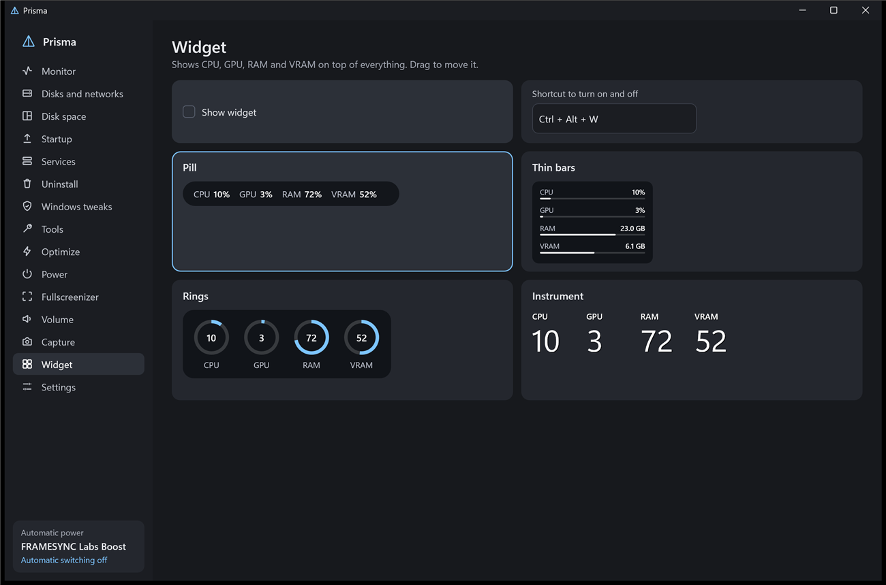
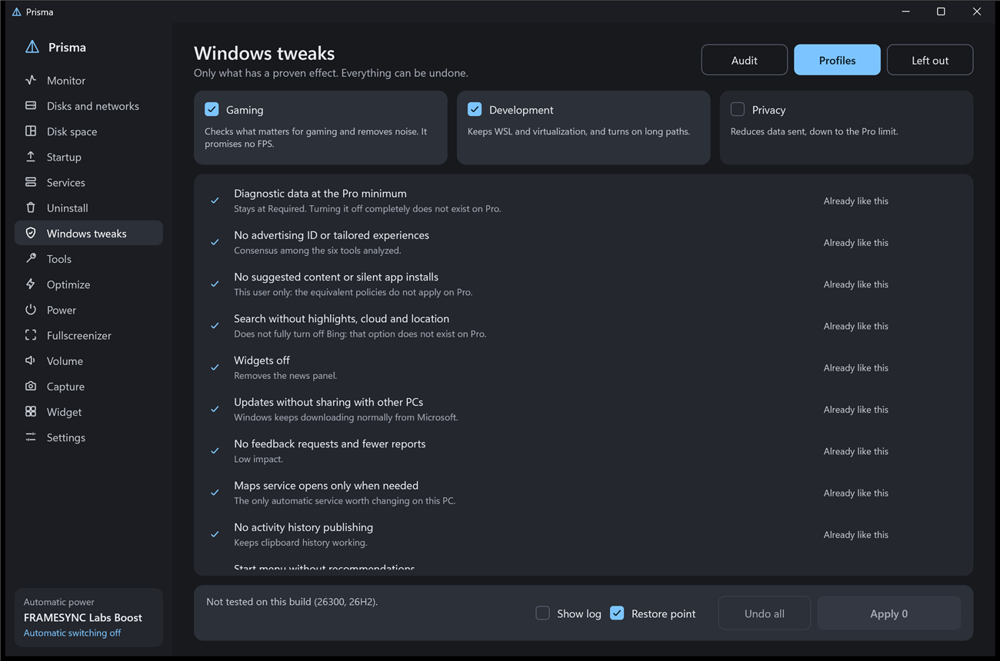

# Prisma

**English** · [Português (Brasil)](README.pt-BR.md)

A lightweight utility for Windows 11, written entirely in Rust with no UI framework. It sits in the tray, loads only what is in use and fits in a single 1.3 MB file. It replaces Task Manager and brings together the small tools a PC gamer usually collects one by one.

**[Download the latest version](https://github.com/maliquem/Prisma/releases/latest)**



## Getting started

Prisma is one file, `Prisma.exe`, with nothing else to install. Windows may warn about an unknown publisher the first time, because the file is not code-signed.

- **Portable:** run it from any folder. Settings stay in `PrismaData`, next to the program, and nothing is registered in Windows.
- **Installed:** open **Settings** and click **Install on this PC**. Prisma moves to Program Files, gets a Start menu shortcut and appears in the Windows program list.

Only the installed version can start with Windows and replace Task Manager.

The interface comes in English and Brazilian Portuguese. Prisma starts in your Windows language, and you can change it in **Settings**. Text that comes from Windows itself, such as service descriptions and command output, stays in the Windows language.

## Updates

Prisma checks this page when it opens and once a day. When there is a new version it tells you, and nothing is installed until you click **Install** in **Settings**. It downloads the file from this page, checks its SHA-256 hash, swaps the program and restarts. The check sends no data of yours, and you can turn it off. The installed version needs Prisma running as administrator to update.

## Features

- **Monitor:** per-core CPU, GPU, RAM, VRAM, disk and network for each program, with icons and End task.
- **Disks and networks:** speed, active time and free space for each disk, plus a health grade (Good, Warning, At risk) from SMART, including USB drives. Each network shows speed, address and total transferred.
- **Disk space:** analyzes a whole disk by reading the NTFS table, with folders, largest files, file types and a visual map. Opens in Explorer and, as administrator, sends files to the Recycle Bin.
- **Startup:** turns on, turns off, adds and removes what opens with Windows, and shows who signed each program. Sorts by name, enabled or disabled.
- **Services:** description, start, stop and restart. As administrator, right-clicking a service opens its own Windows properties window.
- **Uninstall:** removes in batches, creates a restore point and looks for leftovers. Sorts by name, size or install date. Only items carrying the exact program name come selected, folders go to the Recycle Bin and the registry gets a backup first.
- **Replace Task Manager:** an option that makes Ctrl+Shift+Esc open Prisma. Uninstalling gives Task Manager back.
- **Windows tweaks:** first a read-only audit, then layered Gaming, Development and Privacy profiles with documented effects only. The Left out tab explains what was excluded and why. Each change records the previous value, and Undo only restores what nobody touched afterwards. No profile touches updates, antivirus, UAC, Memory Integrity or virtualization. **Show log** displays every change, before and after.
- **Tools:** Windows repair (DISM, then SFC), crash history, Windows Update reset, disk check, network, DNS, cleanup, winget, diagnostics and advanced restart. On a suspect disk, modes that write are blocked. The step-by-step log shows the exact command, its output, errors and the time of each step.
- **Optimize:** suggests what to close and always asks. The never-close list is respected, the always-close list closes those programs, and automatic detection suggests names for both.
- **Power:** detects a game or high load and switches the power plan, going back to rest after 60 s without load.
- **Per-game profile:** remembers borderless mode and volume for each program.
- **Fullscreenizer:** turns the focused window into borderless fullscreen.
- **Per-program volume:** the keyboard volume keys, with a modifier, change only the focused program.
- **Widget:** CPU, GPU, RAM and VRAM over everything, in four styles.
- **Capture:** photos with annotations and video in AV1, HEVC or H.264. When the display is in HDR, it records in SDR or HDR10.
- **Replay:** in game mode, keeps the last seconds in memory.
- **Crash report:** if Prisma crashes, it saves a report in its data folder and tells you the next time it opens. The report stays on your PC.



## Default shortcuts

All of them can be changed in the program.

| Action | Shortcut |
| --- | --- |
| Fullscreenizer | Ctrl + Alt + F |
| Focused program volume | Ctrl + volume and mute keys |
| Widget | Ctrl + Alt + W |
| Optimize | Ctrl + Alt + O |
| Area photo | Ctrl + Alt + P |
| Full screen photo | Ctrl + Alt + A |
| Record and stop | Ctrl + Alt + R |
| Save replay | Ctrl + Alt + B |

On a photo: Enter copies, Ctrl + S saves, Ctrl + Z undoes and Esc cancels. Pinned photo: drag to move, right-click closes.

## Limits

- A game in exclusive fullscreen must be in windowed mode before using Fullscreenizer.
- No CPU temperature or power reading, since they need a kernel driver.
- Profiles do not promise FPS. The value is privacy and less noise.
- Removed apps come back through the Store, and that can fail.
- The health grade is an indicator, not a guarantee: a disk can fail without warning.
- The network column, disk health and fast NTFS reading need Prisma as administrator.
- Everything Prisma changes in the system is recorded in `acoes.log`, in its data folder.
- H.264 has no 10-bit mode: recording HDR10 uses HEVC instead.
- Protected content, such as Netflix, comes out black in captures.

## Requirements

64-bit Windows 11.

- Recording video needs a video encoder on the GPU (NVIDIA, AMD or Intel) and, on Windows N editions, the Media Feature Pack. Without it, only recording is unavailable.
- GPU temperature depends on the NVIDIA driver. The other readings work on any card.

## Building

```bash
cargo build --release
```

Needs Rust and the Visual Studio Build Tools.

## License

[PolyForm Noncommercial 1.0.0](LICENSE). You can use, change and share Prisma for any noncommercial purpose. Selling it or using it commercially needs separate permission from the author.

## Publishing a version

1. Update `version` in `Cargo.toml`, add the section to `CHANGELOG.md` and update both READMEs.
2. Commit and push a tag such as `v0.3.0`.

GitHub then builds `Prisma.exe` and publishes the release with its hash, and every copy of Prisma offers the update.
