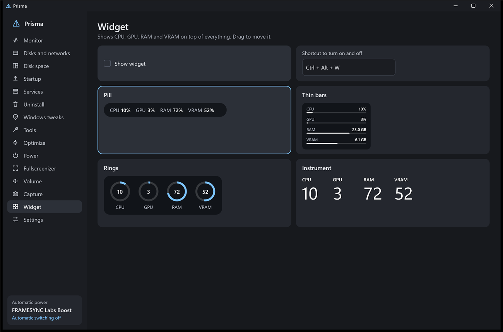
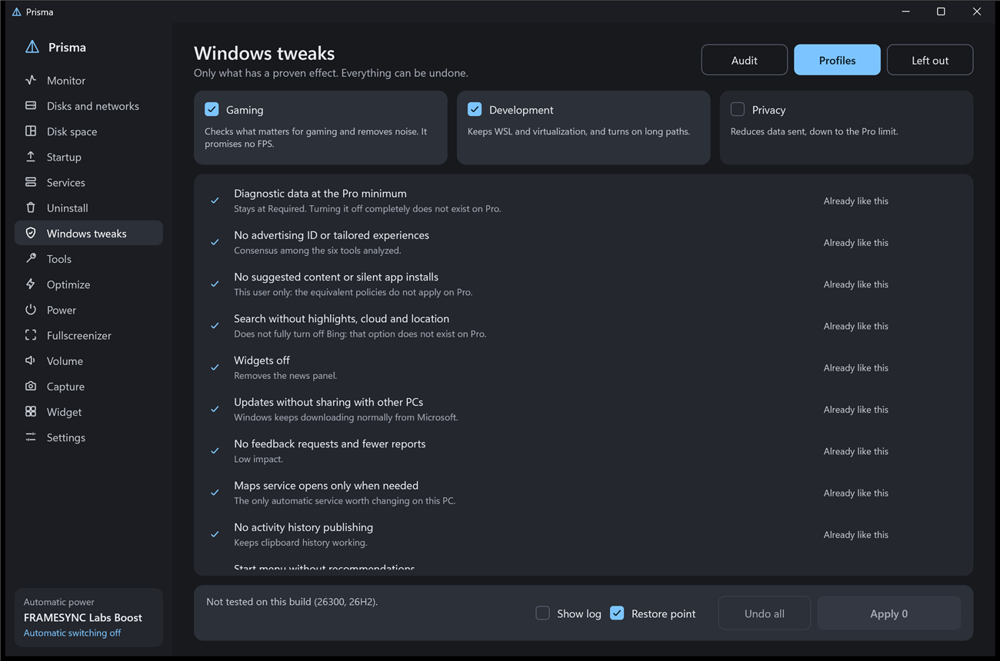

# Prisma

[English](README.md) · **Português (Brasil)**

Utilitário leve para Windows 11, todo em Rust, sem framework de interface. Fica na bandeja, só carrega o que está em uso e cabe em um único arquivo de 1,3 MB. Substitui o Gerenciador de Tarefas e reúne as pequenas ferramentas que quem joga no PC costuma juntar uma a uma.

**[Baixar a versão mais recente](https://github.com/maliquem/Prisma/releases/latest)**



## Primeiros passos

O Prisma é um único arquivo, `Prisma.exe`, sem mais nada para instalar. O Windows pode avisar sobre editor desconhecido na primeira vez, porque o arquivo não tem assinatura digital.

- **Portátil:** rode de qualquer pasta. As configurações ficam em `PrismaData`, ao lado do programa, e nada é registrado no Windows.
- **Instalado:** abra **Configurações** e clique em **Instalar no PC**. O Prisma vai para Arquivos de Programas, ganha atalho no menu Iniciar e aparece na lista de programas do Windows.

A versão instalada inicia com o Windows por padrão, e você desliga isso em **Configurações**. A portátil não inicia com o Windows. O Gerenciador de Tarefas pode ser substituído nas duas, mas na portátil o atalho para de funcionar se você mover ou apagar o arquivo.

A interface vem em português do Brasil e inglês. O Prisma começa no idioma do Windows, e você troca em **Configurações**. Textos que vêm do próprio Windows, como descrições de serviços e saída de comandos, ficam no idioma do Windows.

## Atualizações

O Prisma procura nesta página ao abrir e uma vez por dia. Quando há versão nova, ele avisa, e nada é instalado até você clicar em **Instalar** em **Configurações**. Ele baixa o arquivo daqui em partes, confere o hash SHA-256, troca o programa e reinicia. A busca não envia dados seus e pode ser desligada. A versão instalada precisa do Prisma como administrador para atualizar.

## Funções

- **Monitor:** CPU por núcleo, GPU, RAM, VRAM, disco e rede de cada programa, com ícones. O botão direito finaliza a tarefa, vai para os detalhes, abre o local do arquivo, pesquisa online e mostra as propriedades. A aba Detalhes lista cada processo com o PID.
- **Discos e redes:** velocidade, tempo ativo e espaço de cada disco, e nota de saúde (Bom, Atenção, Risco) pelo SMART, inclusive em HDs USB. Cada rede mostra velocidade, endereço e total transferido.
- **Espaço em disco:** analisa um disco inteiro lendo a tabela do NTFS, com pastas, maiores arquivos, tipos e mapa visual. Abre no Explorador e, como administrador, manda para a Lixeira.
- **Inicialização:** liga, desliga, adiciona e remove o que abre com o Windows, e mostra quem assinou cada programa. Ordena por nome, ativados ou desativados.
- **Serviços:** descrição, iniciar, parar e reiniciar. O botão direito mostra iniciar, parar, reiniciar e propriedades, que abre a janela do próprio Windows para aquele serviço.
- **Desinstalar:** remove em lote, cria ponto de restauração, procura restos e informa o que foi excluído. Ordena por nome, data ou tamanho. Só vem marcado o que tem o nome exato, nomes parecidos aparecem para você conferir, pastas vão para a Lixeira e o registro ganha backup antes.
- **Fechar à força:** um atalho configurável, Alt+F4 por padrão, encerra na hora o programa em foco pelo PID, mesmo travado em tela cheia. O que não foi salvo é perdido. A área de trabalho, a barra de tarefas e os processos do Windows continuam com o Alt+F4 normal.
- **Substituir o Gerenciador de Tarefas:** um botão em Configurações faz Ctrl+Shift+Esc abrir o Prisma, e outro devolve. A desinstalação também devolve o Gerenciador de Tarefas.
- **Ajustes do Windows:** primeiro uma auditoria que só lê o PC. Depois os perfis Jogo, Desenvolvimento e Privacidade, em camadas, só com ajustes de efeito documentado. A aba Fora da lista explica o que ficou de fora e por quê. Cada mudança guarda o valor anterior, e Desfazer só restaura o que ninguém mexeu depois. Nenhum perfil toca em atualizações, antivírus, UAC, Integridade da Memória ou virtualização. **Ver log** mostra cada mudança, com o antes e o depois.
- **Ferramentas:** reparo do Windows (DISM e depois SFC), histórico de falhas, Windows Update, verificação de disco, rede, DNS, limpeza, winget, diagnóstico e reinício avançado. Em disco suspeito, os modos que escrevem ficam bloqueados. Cada ferramenta guarda o próprio passo a passo, com o comando exato, a saída, os erros e o tempo de cada etapa.
- **Otimizar:** sugere o que fechar e sempre pergunta. Blacklist nunca fecha, whitelist sempre fecha. A detecção automática sugere nomes para as duas listas.
- **Energia:** detecta jogo ou carga alta e troca o plano. Volta ao repouso depois de 60 s sem carga. Você escolhe a porcentagem e o tempo que contam como carga na CPU e na GPU.
- **Perfil por jogo:** lembra o volume de cada programa.
- **Fullscreenizer:** deixa a janela em foco em tela cheia sem bordas. Quem usa uma vez entra numa lista salva, onde dá para adicionar pela lista de programas ou pelo .exe, remover e marcar Automático para aplicar sempre que o programa abrir.
- **Som:** volume por programa, e as teclas de volume do teclado, com um modificador, mudam só o programa em foco. Você escolhe o aparelho de saída e o de entrada de cada programa, inclusive os adicionados à mão pela lista de programas ou pelo .exe. A lista traz o que o menu Iniciar mostra, aplicativos da Microsoft Store, os programas instalados e o que está aberto. Isso usa um recurso interno do Windows, e alguns programas só trocam de aparelho ao reabrir.
- **Widget:** CPU, GPU, RAM e VRAM por cima de tudo, em quatro estilos.
- **HDR:** painel de leitura que mostra o modo da tela, o perfil de calibração ativo com a saturação real, o brilho que cada fonte declara, o que o Windows informa aos jogos, o Dolby Vision declarado e os formatos de som aceitos. Avisa quando algo não confere. A leitura direta da ficha da tela existe só em placas NVIDIA. A calibração própria abre padrões de teste em tela cheia, com o preto, o pico em cinco tamanhos de janela e cada canal de cor, e grava um perfil por modo de imagem da TV, com as primárias reais da tela. O Windows pode continuar informando os valores antigos aos jogos por um tempo depois de ativar. O perfil não muda o que a TV faz. O teste de atraso do som toca um clique junto de um clarão, para comparar o atraso com e sem som espacial.
- **Captura:** foto com anotações e vídeo em AV1, HEVC ou H.264. Com a tela em HDR, grava em SDR ou HDR10. Com Som do sistema ligado, grava todos os sons do PC. Desligado e com Janela em foco, grava só o som daquela janela.
- **Replay:** em modo jogo, guarda os últimos segundos na memória.
- **Relatório de falha:** se o Prisma cair, ele guarda um relatório na pasta de dados e avisa na próxima abertura. O relatório fica só no seu PC.



Ações que mudam algo pedem confirmação em um popup, todas as listas têm barra de rolagem para arrastar, e o botão Padrão de cada tela volta as opções dela.

## Atalhos padrão

Todos podem ser trocados no programa.

| Ação | Atalho |
| --- | --- |
| Fullscreenizer | Ctrl + Alt + F |
| Volume do programa em foco | Ctrl + teclas de volume e mudo |
| Widget | Ctrl + Alt + W |
| Otimizar | Ctrl + Alt + O |
| Foto da área | Ctrl + Alt + P (também aceita Print Screen, se você configurar) |
| Foto da tela inteira | Ctrl + Alt + A |
| Gravar e parar | Ctrl + Alt + R |
| Salvar replay | Ctrl + Alt + B |

Na foto: Enter copia, Ctrl + S salva, Ctrl + Z desfaz e Esc cancela. Foto fixada: arraste para mover, botão direito fecha.

## Limites

- Jogo em tela cheia exclusiva precisa estar em modo janela antes do Fullscreenizer.
- Sem temperatura e consumo da CPU, porque exigem driver de kernel.
- Os perfis não prometem FPS. O valor é privacidade e menos ruído.
- Apps removidos voltam pela Loja, e a volta pode falhar.
- A nota de saúde é um indicador, não uma garantia: disco pode falhar sem aviso.
- Coluna de rede, saúde dos discos e leitura rápida do NTFS exigem o Prisma como administrador.
- Tudo que o Prisma muda no sistema fica registrado em `acoes.log`, na pasta de dados.
- H.264 não tem 10 bits: gravar em HDR10 usa HEVC.
- Conteúdo protegido, como Netflix, sai preto nas capturas.

## Requisitos

Windows 11 de 64 bits.

- Gravar vídeo exige codificador de vídeo na GPU (NVIDIA, AMD ou Intel) e, em edições N do Windows, o Pacote de Recursos de Mídia. Sem isso, só a gravação fica indisponível.
- Temperatura da GPU depende do driver da NVIDIA. As demais leituras funcionam em qualquer placa.

## Compilar

```bash
cargo build --release
```

Precisa do Rust e das Build Tools do Visual Studio.

## Licença

[PolyForm Noncommercial 1.0.0](LICENSE). Você pode usar, alterar e compartilhar o Prisma para qualquer fim não comercial. Vender ou usar comercialmente exige permissão à parte do autor.

## Publicar uma versão

1. Atualize `version` no `Cargo.toml`, acrescente a seção no `CHANGELOG.md` e atualize os dois READMEs.
2. Faça o commit e envie uma etiqueta como `v0.3.0`.

O GitHub compila o `Prisma.exe` e publica a versão com o hash, e todas as cópias do Prisma oferecem a atualização.
