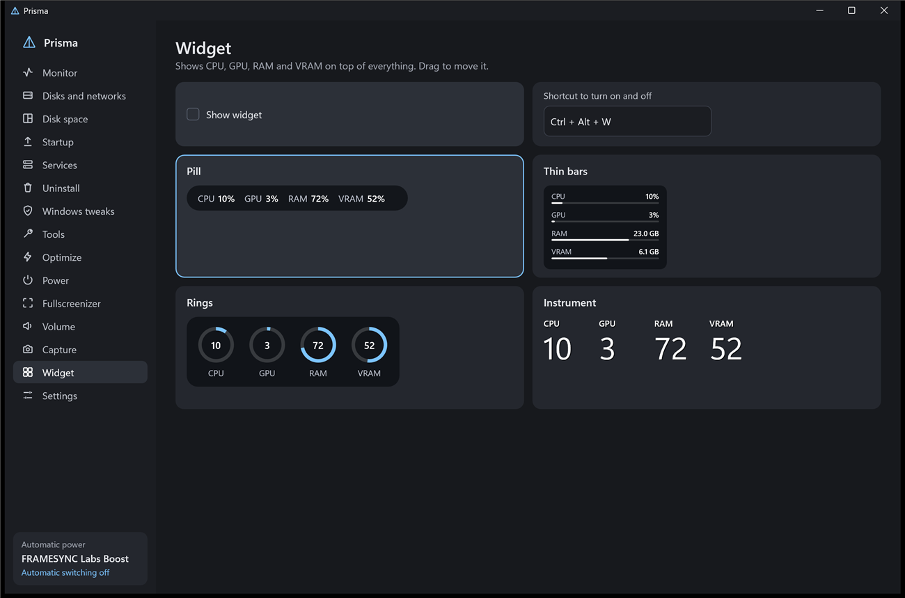
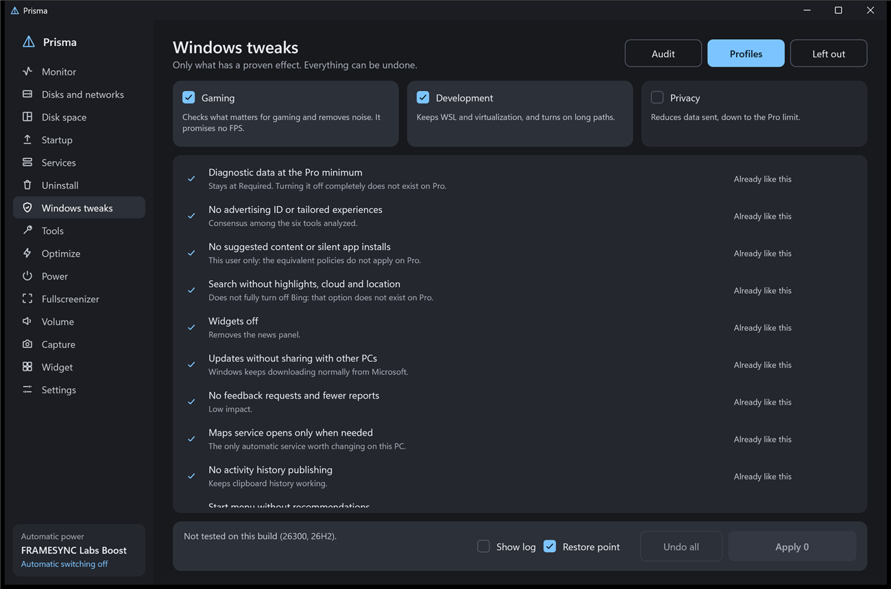

# Prisma

[English](README.md) · [Português (Brasil)](README.pt-BR.md) · [Español](README.es.md) · **Русский** · [简体中文](README.zh-CN.md)

Лёгкая утилита для Windows 11, целиком написанная на Rust без UI-фреймворка. Живёт в трее, загружает только то, что используется, и умещается в один файл размером 2 МБ. Заменяет диспетчер задач и собирает вместе мелкие инструменты, которые компьютерные игроки обычно ищут по одному.

**[Скачать последнюю версию](https://github.com/maliquem/Prisma/releases/latest)** · **[Руководство: все функции (на английском)](docs/guide/GUIDE.md)**

[](https://ko-fi.com/maliquem)



## Начало работы

Prisma — это один файл, `Prisma.exe`. При первом запуске Windows может предупредить о неизвестном издателе, потому что файл не подписан сертификатом.

При первом запуске экран приветствия спрашивает, хотите ли вы установить программу, дать ей права администратора и заменить диспетчер задач. Все три пункта отмечены, и Windows запрашивает разрешение один раз. С этого экрана также открывается руководство, где объяснено, что умеет и чего не умеет каждая функция. Экран появляется один раз, если не снять отметку **Больше не показывать**.

- **Портативная:** запускается из любой папки. Настройки хранятся в `PrismaData` рядом с программой, в Windows ничего не регистрируется. С правами администратора Windows спрашивает при каждом запуске.
- **Установленная:** Prisma переходит в Program Files, получает ярлык в меню «Пуск» и появляется в списке программ Windows. С правами администратора запускается без вопросов. Установить можно и позже, в **Настройках**.

Установленная версия по умолчанию запускается вместе с Windows; это можно выключить в **Настройках**. Портативная версия с Windows не запускается. Заменить диспетчер задач можно в обеих, но в портативной сочетание клавиш перестанет работать, если переместить или удалить файл.

Руководство и **Сообщить об ошибке** — две кнопки рядом с названием Prisma вверху окна. Наведите на них курсор, чтобы увидеть, что делает каждая.

Интерфейс есть на бразильском португальском, английском, испанском, русском и упрощённом китайском. Prisma запускается на языке Windows, а сменить язык можно в **Настройках**. Руководство и список изменений есть на португальском и английском; на остальных языках они показываются на английском. Тексты, которые приходят из самой Windows, например описания служб и вывод команд, остаются на языке Windows.

## Обновления

Prisma проверяет эту страницу раз в день. Если есть новая версия и вы открываете окно, программа спрашивает, обновиться ли. Свёрнутая или в трее, она вас не отвлекает. Если ответить «Да», она скачивает файл с этой страницы по частям, проверяет хеш SHA-256, заменяет программу и перезапускается. Проверка не отправляет никаких ваших данных. Чтобы отключить её, отметьте **Больше не показывать** в вопросе или выключите в **Настройках**. В установленной версии Windows запрашивает разрешение, если Prisma запущена не от имени администратора.

## Функции

- **Монитор:** CPU по ядрам, GPU, ОЗУ, видеопамять, диск и сеть каждой программы, с иконками. Щелчок правой кнопкой по программе позволяет снять задачу, перейти к подробностям, открыть расположение файла, поискать в интернете или открыть свойства. Вкладка «Подробности» показывает все процессы с их PID. Поиск по имени или PID, сортировка по имени с приложениями сверху (как в Диспетчере задач) и перезапуск Проводника, когда зависла панель задач.
- **Диски и сети:** скорость, активное время и свободное место каждого диска, плюс оценка здоровья (Хорошо, Внимание, Под угрозой) по SMART, включая USB-накопители. Для каждой сети — скорость, адрес и общий объём трафика.
- **Место на диске:** анализирует весь диск через таблицу NTFS: папки, самые большие файлы, типы файлов и визуальная карта. Открывает в Проводнике и, с правами администратора, отправляет файлы в корзину.
- **Поиск:** находит файлы и папки по имени на всех дисках по мере ввода — на вкладке или во всплывающем окне по Ctrl + Alt + Пробел. С правами администратора индекс строится из таблицы NTFS за секунды и следит за каждым изменением. Установленные программы идут первыми, вопросы уходят в браузер или установленный ИИ, а `>` выполняет команды PowerShell или CMD с подсказками. По желанию, по умолчанию выключен.
- **Автозагрузка:** включает, выключает, добавляет и убирает то, что запускается с Windows, и показывает, кто подписал каждую программу. Сортировка по имени, включённым или выключенным.
- **Службы:** описание, запуск, остановка и перезапуск. Щелчок правой кнопкой по службе даёт запуск, остановку, перезапуск и свойства, которые открывают собственное окно свойств Windows.
- **Удаление:** удаляет пакетами, создаёт точку восстановления и ищет остатки, затем сообщает, что было удалено. Сортировка по имени, дате или размеру. Отмечены только точные совпадения по имени, похожие имена показываются для проверки, папки уходят в корзину, а реестр сначала сохраняется в копию.
- **Закрыть принудительно:** настраиваемое сочетание, по умолчанию Alt+F4, сразу завершает активную программу по PID, даже если она зависла в полноэкранном режиме. Несохранённое пропадает. Рабочий стол, панель задач и процессы Windows сохраняют обычное поведение Alt+F4.
- **Замена диспетчера задач:** кнопка в настройках заставляет Ctrl+Shift+Esc открывать Prisma, другая возвращает всё назад. Удаление программы тоже возвращает диспетчер задач.
- **Настройки Windows:** сначала аудит только для чтения, затем многоуровневые профили «Игры», «Разработка» и «Конфиденциальность» только с задокументированным эффектом. Вкладка «Не вошло» объясняет, что исключено и почему. Каждое изменение запоминает прежнее значение, а «Отменить» восстанавливает только то, что потом никто не трогал. Ни один профиль не трогает обновления, антивирус, UAC, целостность памяти и виртуализацию. **Показать журнал** выводит каждое изменение, до и после.
- **Инструменты:** восстановление Windows (DISM, затем SFC), история сбоев, сброс Центра обновления, проверка диска, сеть, DNS, очистка, winget, диагностика и расширенная перезагрузка. На подозрительном диске режимы с записью заблокированы. Каждый инструмент ведёт собственный пошаговый журнал с точной командой, выводом, ошибками и временем каждого шага.
- **Оптимизировать:** предлагает, что закрыть, и всегда спрашивает. Список «никогда не закрывать» соблюдается, список «всегда закрывать» закрывает эти программы, а автоопределение предлагает имена для обоих. Вопрос при запуске игры выключен и включается в разделе «Питание».
- **Счётчик:** компактная полоса и полная панель поверх игры, только по сочетанию клавиш, которое измеряет активную программу, добавляет игру в список и при повторном нажатии скрывает счётчик. Показывает FPS, 1% и 0,1% низких, время кадра, CPU, GPU, видеопамять и ОЗУ. Компактная полоса может показывать также ОЗУ, температуру CPU и GPU и план электропитания, а ещё режим ограничителя, который подсвечен, пока ограничение действует. Для температуры CPU нужен PawnIO — бесплатный открытый драйвер, который Prisma устанавливает со страницы «Счётчик». Данные берутся из событий Windows, внутри игры ничего нет. Ограничение FPS для каждой игры, вручную или автоматически после 5 минут игры. По умолчанию при включённом ограничителе в игру входит небольшой модуль Prisma, поэтому ограничение меняется сразу в DirectX 10, 11 и 12. Если это не удаётся, игра падает или обнаружен античит, ограничение переходит к драйверу NVIDIA и применяется при следующем запуске игры. Кнопки — в полной панели: Ctrl + Alt + 5 освобождает для них мышь и клавиатуру, а ограничение можно ввести с клавиатуры. Также выбирает профиль DLSS (только в играх с DLSS), Auto HDR Windows для каждой игры, тот же, что на вкладке HDR, и план электропитания (а также план для каждой игры, который включается при её запуске; неиспользуемые игры могут уходить из списка через несколько дней, сохраняя настройки), показывает загруженный апскейлер, генерацию кадров и Reflex, и включает HDR Windows для игр из списка или для всех, не выключая HDR, который уже был включён. Нужна Prisma с правами администратора. В эксклюзивном полноэкранном режиме полоса может не появиться.
- **Журнал данных:** необязательная запись для изучения производительности, запускается со страницы «Счётчик» или сочетанием клавиш во время игры. Сохраняет каждый кадр, каждую секунду и загрузку CPU каждого потока игры в `Документы\Prisma\Logs`, с итогом в конце; на видеокартах NVIDIA также GPU (контроллер памяти, мощность и её предел, что сдерживало частоту, PCIe и видеопамять) — для изучения модов оптимизации. Введите минуты игрового времени (по умолчанию 5, 0 — без ограничения). Работает, только если вы его включите, а чтение потоков выключено в играх с обнаруженным античитом. Во время записи счётчик показывает красное предупреждение о записи — и в компактной полосе, и на полной панели. В сводке также указаны действующий лимит и генерация кадров: какую загрузила игра, сколько времени она работала и во сколько раз.
- **Питание:** замечает игру или высокую нагрузку и переключает план электропитания, возвращаясь в покой после 60 с без нагрузки. Вы выбираете процент и время, которые считаются нагрузкой для CPU и GPU. Выберите план, чтобы изменить его со всеми параметрами, которые регистрирует Windows, включая скрытые, или чтобы импортировать и экспортировать файлы .pow. Щелчок правой кнопкой по плану также предлагает «Экспорт» и «Изменить». При первом изменении сохраняется копия исходного плана. Когда автопереключение выключено, постоянная схема действует, пока его снова не включат.
- **Профиль для игры:** запоминает громкость каждой программы.
- **Fullscreenizer:** превращает активное окно в полноэкранное без рамки. Программы, к которым он применялся, попадают в сохранённый список, куда их можно добавить из списка программ или по .exe, убрать и отметить «Авто», чтобы применять при каждом запуске.
- **Звук:** громкость каждой программы, а клавиши громкости на клавиатуре с модификатором меняют только активную программу. Выбор устройства вывода и ввода для каждой программы, включая добавленные вручную из списка программ или по .exe. В списке — то, что показывает меню «Пуск», приложения Microsoft Store, установленные программы, игры Steam и Epic и всё, что открыто. Это использует внутреннюю функцию Windows, и некоторые программы переключают устройство только после перезапуска. Закреплённые программы остаются в списке даже закрытыми и возвращаются с сохранённой громкостью. Сочетания для устройств по умолчанию сразу переключают вывод и ввод Windows, каждое со своими устройствами. «Не давать звуку засыпать» воспроизводит поток без слышимого звука, чтобы HDMI и Dolby не обрезали начало следующего звука, и останавливается сам после 10 минут простоя.
- **Виджет:** CPU, GPU, ОЗУ и видеопамять поверх всего, в четырёх стилях.
- **HDR:** панель только для чтения: режим дисплея, активный профиль калибровки и его реальная насыщенность, яркость, заявленная каждым источником, что Windows сообщает играм, заявленная поддержка Dolby Vision и принимаемые форматы звука. Предупреждает, если что-то не совпадает. Прямое чтение данных самого дисплея работает только на видеокартах NVIDIA. Собственная калибровка открывает полноэкранные тестовые шаблоны для чёрного, пика в пяти размерах окна и каждого цветового канала и сохраняет по профилю на каждый режим изображения ТВ с реальными основными цветами дисплея. Windows может какое-то время после активации сообщать играм старые значения. Профиль не меняет то, что делает ТВ. Список Auto HDR принудительно включает его, выключает или оставляет решение Windows для каждой игры DX11 и DX12, ничего не внедряя в игру. Тест задержки звука воспроизводит щелчок со вспышкой, чтобы сравнить задержку с пространственным звуком и без него.
- **Драйвер NVIDIA:** только с видеокартой NVIDIA. Параметры драйвера в глобальном профиле или для каждой игры, как в NVIDIA Profile Inspector, без тех, что уже ничего не делают (SLI, 3D Vision, Ansel, CSAA, MFAA, отладка и старый OpenGL). Синхронизация и FPS, DLSS и генерация кадров, сглаживание и резкость, текстуры, RTX HDR и индикаторы, а также системные параметры — каждый с пояснением при наведении и кнопкой «По умолчанию» для возврата. Перед первым изменением сохраняется копия всех профилей драйвера.
- **Захват:** снимки с пометками и видео в AV1, HEVC или H.264. Когда дисплей в HDR, запись идёт в SDR или HDR10. «Запись окна» записывает активное окно, «Запись экрана» — весь экран. С включённым системным звуком записывается весь звук ПК. С выключенным «Запись окна» записывает только звук этого окна.
- **Повтор:** в игровом режиме держит последние секунды в памяти.
- **Общий экран (тестируется):** показывает другой ПК через интернет и позволяет им управлять — для удалённого доступа или совместной локальной игры на расстоянии, без учётной записи. Сопряжение один раз по короткому коду (например, `K7M2-QX9P`) или ссылке, которая открывает Prisma, сверка кода подтверждения, а затем прямое подключение, через вашу VPN или через ретранслятор, всегда со сквозным шифрованием. Разрешения для каждого устройства (звук, геймпад, клавиатура, мышь, копирование и вставка, защищённый экран), до 4 человек с виртуальными геймпадами Xbox (на хосте нужен ViGEmBus или VIIPER), HDR преобразуется или выключается, пока кто-то смотрит, и необязательная служба Windows для экрана блокировки, UAC и Ctrl+Alt+Del. Настройки разрешения, частоты кадров, кодека (включая экспериментальный PyroWave с HDR10 и 4:4:4, только для локальной сети или VPN), полосы, приоритета, источника звука, порта и сочетаний клавиш, а также режим погружения, счётчик задержки, предупреждение об ухудшении связи и меню подключения с сочетанием для каждого пункта. Настройки хоста действуют прямо во время подключения, звучащее приложение для звонков убирается из звука, а на ноутбуках с двумя видеокартами можно выбрать, какая кодирует и какая декодирует. Сопряжённые устройства разделены на две вкладки (те, что смотрит этот ПК, и те, что смотрят его), их можно переименовать; изменение разрешений подключённого устройства действует сразу. На хосте есть вкладка «Подключено», где можно сразу отключить, заблокировать или изменить доступ, и уведомление, когда кто-то подключается или уходит. Ctrl + Alt + Shift + Q на хосте отключает всех. **Мышь и клавиатура** (как Deskflow) управляет мышью и клавиатурой этого ПК до двух соседних сопряжённых ПК без видео: каждый экран ставится слева, в центре или справа, мышь переходит с экрана на соседний, а Scroll Lock закрепляет её на текущем экране. **Только звук** (как AudioRelay) воспроизводит на этом ПК звук сопряжённого ПК без видео. Приглашения действуют от 5 минут до 24 часов, с обратным отсчётом и кнопкой отзыва; новые устройства по умолчанию спрашивают при каждом подключении. Хост выбирает, с какого звукового выхода берётся звук, и может подмешать микрофон, а у каждого смотрящего устройства могут быть свои настройки хоста (например, PyroWave для одного и AV1 для другого). Каждый изменённый параметр показывает уведомление на обеих сторонах, а страница показывает задержку каждого режима с журналом.
- **Сообщить об ошибке:** нажмите кнопку с жуком вверху окна. Выберите функцию и серьёзность, опишите, что случилось, и при желании добавьте изображение. Браузер откроет GitHub, где всё уже написано, и останется только подтвердить. Изображение копируется в буфер обмена: просто вставьте его через Ctrl+V. Можно приложить данные ПК и короткий журнал, без имени пользователя, имени ПК и путей к файлам. Страницы GitHub публичны, и вы видите всё перед отправкой.
- **Отчёт о сбое:** если Prisma падает, она сохраняет отчёт в своей папке данных и сообщает об этом при следующем запуске. Файл остаётся на вашем ПК. В **Сообщить об ошибке** может уйти только краткое описание ошибки, и только если вы его отправите.



Действия, которые что-то меняют, просят подтверждения во всплывающем окне, у каждого списка есть перетаскиваемая полоса прокрутки, а кнопка «По умолчанию» на каждой странице возвращает её параметры.

## Сочетания клавиш по умолчанию

Все можно изменить в программе.

| Действие | Сочетание |
| --- | --- |
| Fullscreenizer | Ctrl + Alt + F |
| Громкость активной программы | Ctrl + клавиши громкости и отключения звука |
| Виджет | Ctrl + Alt + W |
| Оптимизировать | Ctrl + Alt + O |
| Снимок области | Ctrl + Alt + P (Print Screen тоже работает, если его назначить) |
| Показать компактный счётчик | Ctrl + Alt + 1 |
| Показать полный счётчик | Ctrl + Alt + 2 |
| Скрыть счётчик | Ctrl + Alt + 0 |
| Управление счётчиком | Ctrl + Alt + 5 |
| Режим ограничителя (Авто, Вручную, Без ограничения) | Ctrl + Alt + 3 |
| Поднять или снизить ограничение | Ctrl + Alt + ↑ или ↓ |
| Начать или остановить журнал данных | Ctrl + Alt + 4 |
| Снимок всего экрана | Ctrl + Alt + A |
| Снимок активного окна | Ctrl + Alt + J |
| Запись окна и стоп | Ctrl + Alt + R |
| Запись экрана и стоп | Ctrl + Alt + T |
| Сохранить повтор | Ctrl + Alt + B |

На снимке: Enter или Ctrl + C копирует, Ctrl + S сохраняет, Ctrl + Z отменяет, Esc закрывает. Наведите курсор на кнопку, чтобы увидеть, что она делает, и её клавишу. Закреплённый снимок: перетаскивание перемещает, правый щелчок закрывает.

## Ограничения

- Игру в эксклюзивном полноэкранном режиме нужно перевести в оконный режим, прежде чем использовать Fullscreenizer.
- Не используйте внедрение в онлайн-играх. Обнаружение античита распознаёт известные файлы и названия, и если ничего не найдено, это не доказывает, что античита нет. Для любой игры на странице «Счётчик» можно выбрать метод «Драйвер».
- Игры на DirectX 9 и Vulkan используют ограничение драйвером, которое применяется после перезапуска.
- Нет температуры и потребления CPU: для них нужен драйвер ядра.
- Профили не обещают FPS. Их ценность — конфиденциальность и меньше лишнего.
- Удалённые приложения возвращаются через Store, и это может не сработать.
- Оценка здоровья — это показатель, а не гарантия: диск может отказать без предупреждения.
- Столбец сети, здоровье дисков и быстрое чтение NTFS требуют Prisma с правами администратора.
- Всё, что Prisma меняет в системе, записывается в `acoes.log` в её папке данных.
- У H.264 нет 10-битного режима: для записи HDR10 используется HEVC.
- Защищённый контент, например Netflix, получается чёрным при захвате.
- Общий экран тестируется. Без прямого пути или VPN соединение идёт через публичные ретрансляторы n0 (со сквозным шифрованием). Короткий код хранится выбранное время на трёх публичных ретрансляторах имён (dns.iroh.link, relay.pkarr.org и pkarr.pubky.org), подписанный и без чего-либо, что вас идентифицирует; если ни один не отвечает, длинное приглашение работает без них. Микрофон зрителя не передаётся.

## Требования

64-битная Windows 11.

- Для записи видео нужен видеокодер на GPU (NVIDIA, AMD или Intel), а в редакциях Windows N — Media Feature Pack. Без него недоступна только запись.
- Температура GPU зависит от драйвера NVIDIA. Остальные показатели работают на любой видеокарте.

## Сборка

```bash
cargo build --release
```

Нужны Rust и Visual Studio Build Tools.

## Сторонние компоненты

Общий экран использует библиотеки с открытым кодом без изменений:

- [iroh и iroh-dns](https://github.com/n0-computer/iroh) (MIT или Apache-2.0) — проходит NAT и, без прямого пути, передаёт соединение через публичные ретрансляторы n0, всегда со сквозным шифрованием.
- [attohttpc](https://github.com/sbstp/attohttpc) (MPL-2.0) — используется iroh для открытия портов роутера через UPnP. Исходный код — по ссылке.
- [PyroWave](https://github.com/Themaister/pyrowave) (MIT) — экспериментальный кодек для локальной сети. Его библиотека (вместе с Granite, volk и заголовками Vulkan, все под MIT) встроена в Prisma и записывается на диск вместе с лицензией, только когда кодек используется.
- [Модули PawnIO](https://github.com/namazso/PawnIO.Modules) (LGPL-2.1), AMDFamily17 и IntelMSR, которые работают внутри драйвера PawnIO и читают температуру CPU. Prisma общается с драйвером только через его интерфейс управления; сам драйвер устанавливается отдельно, официальным установщиком. Лицензия и исходники — в `res/pawnio/LEIAME.txt`.
- [tokio](https://github.com/tokio-rs/tokio) (MIT), [blake3](https://github.com/BLAKE3-team/BLAKE3) (CC0-1.0 или Apache-2.0), [data-encoding](https://github.com/ia0/data-encoding) (MIT), [mini-nvcodec и mini-cuda](https://github.com/AdrianEddy/wgpu-interop) (MIT или Apache-2.0), [vigem-client](https://github.com/CasualX/vigem-client) (MIT), [viiper-client](https://github.com/Alia5/VIIPER) (MIT), [url](https://github.com/servo/rust-url) (MIT или Apache-2.0) и [webpki-roots](https://github.com/rustls/webpki-roots) (CDLA-Permissive-2.0, список удостоверяющих центров).

Список параметров на странице «Драйвер NVIDIA» изучен по [NVIDIA Profile Inspector](https://github.com/Orbmu2k/nvidiaProfileInspector) (MIT, Orbmu2k и участники): только идентификаторы и значения параметров, без кода.

ViGEmBus и VIIPER не входят в Prisma: кому нужны виртуальные геймпады, устанавливает один из них сам.

## Лицензия

[PolyForm Noncommercial 1.0.0](LICENSE). Вы можете использовать, изменять и распространять Prisma для любых некоммерческих целей. Для продажи или коммерческого использования нужно отдельное разрешение автора.

Как опубликовать версию, см. [README на английском](README.md#publishing-a-version).
