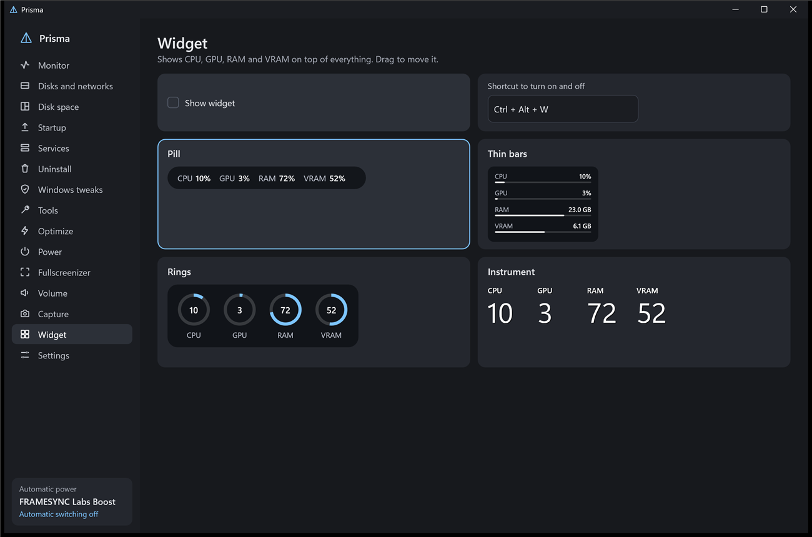
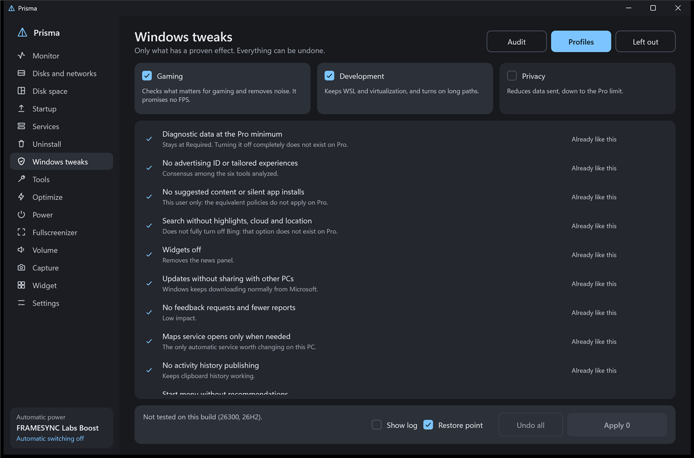

# Prisma

[English](README.md) · [Português (Brasil)](README.pt-BR.md) · [Español](README.es.md) · [Русский](README.ru.md) · **简体中文**

一款轻量的 Windows 11 实用工具，完全用 Rust 编写，不依赖任何界面框架。它常驻托盘，只加载正在使用的部分，整个程序只有一个 2 MB 的文件。它可以代替任务管理器，并把电脑玩家通常要一个个收集的小工具集中在一起。

**[下载最新版本](https://github.com/maliquem/Prisma/releases/latest)** · **[指南：每项功能的说明（英文）](docs/guide/GUIDE.md)**

[](https://ko-fi.com/maliquem)



## 开始使用

Prisma 只有一个文件 `Prisma.exe`。第一次运行时 Windows 可能会提示发布者未知，因为文件没有代码签名。

第一次打开时，欢迎界面会询问是否安装、授予管理员权限以及替换任务管理器。三项默认勾选，Windows 只请求一次权限。这个界面还可以打开指南，说明每项功能能做和不能做的事。它只出现一次，除非你取消勾选 **不再显示**。

- **便携版：** 可在任意文件夹运行。设置保存在程序旁的 `PrismaData` 中，不在 Windows 中注册任何内容。以管理员身份运行时，每次打开 Windows 都会询问。
- **安装版：** Prisma 会移到 Program Files，在开始菜单中创建快捷方式，并出现在 Windows 的程序列表中。以管理员身份运行时，打开不再询问。也可以稍后在 **设置** 中安装。

安装版默认随 Windows 启动，可以在 **设置** 中关闭。便携版不随 Windows 启动。两个版本都可以替换任务管理器，但在便携版中，如果移动或删除文件，快捷键就会失效。

指南和 **报告问题** 是窗口顶部 Prisma 名称旁的两个按钮。把鼠标悬停在上面即可看到各自的作用。

界面支持巴西葡萄牙语、英语、西班牙语、俄语和简体中文。Prisma 以 Windows 的语言启动，可以在 **设置** 中更改。指南和每个版本的更新说明只有葡萄牙语和英语；在其他语言下显示英文。来自 Windows 本身的文本，例如服务说明和命令输出，保持 Windows 的语言。

## 更新

Prisma 每天检查一次本页面。有新版本且你打开窗口时，它会询问是否更新。最小化或在托盘中时不会打扰你。如果选择“是”，它会分段从本页面下载文件，校验 SHA-256 哈希，替换程序并重启。检查不会发送你的任何数据。在提示中勾选 **不再显示**，或在 **设置** 中关闭，即可停止检查。在安装版中，如果 Prisma 没有以管理员身份运行，Windows 会请求权限。

## 功能

- **监视器：** 每个程序的每核 CPU、GPU、内存、显存、磁盘和网络，带图标。右键点击程序可以结束任务、转到详细信息、打开文件位置、在线搜索或查看属性。“详细信息”标签页列出所有进程及其 PID。可按名称或 PID 搜索，任务栏卡住时可重启资源管理器。
- **磁盘和网络：** 每个磁盘的速度、活动时间和可用空间，以及基于 SMART 的健康评级（良好、警告、有风险），包括 USB 驱动器。每个网络显示速度、地址和总流量。
- **磁盘空间：** 通过读取 NTFS 表分析整个磁盘，显示文件夹、最大的文件、文件类型和可视化地图。可在资源管理器中打开，以管理员身份运行时可把文件移到回收站。
- **搜索：** 边输入边按名称查找所有磁盘上的文件和文件夹，可在标签页中使用，也可按 Ctrl + Alt + 空格 打开弹出窗口。以管理员身份运行时，索引几秒钟内从 NTFS 表建立，并实时跟踪每个变化。已安装的程序排在最前，问题会发到浏览器或已安装的 AI，`>` 可运行带提示的 PowerShell 或 CMD 命令。可选，默认关闭。
- **启动：** 开启、关闭、添加和移除随 Windows 启动的内容，并显示每个程序由谁签名。可按名称、已启用或已禁用排序。
- **服务：** 说明、启动、停止和重启。右键点击服务可启动、停止、重启和查看属性，属性会打开 Windows 自己的属性窗口。
- **卸载：** 批量移除，创建还原点并查找残留，然后告诉你删除了什么。可按名称、日期或大小排序。只有名称完全匹配的项会被勾选，相似名称会列出供你检查，文件夹移到回收站，注册表先备份。
- **强制关闭：** 可配置的快捷键，默认 Alt+F4，按 PID 立即结束当前程序，即使它在全屏中卡死。未保存的内容会丢失。桌面、任务栏和 Windows 进程保持普通的 Alt+F4 行为。
- **替换任务管理器：** 设置中的一个按钮让 Ctrl+Shift+Esc 打开 Prisma，另一个按钮把它还原。卸载时也会还原任务管理器。
- **Windows 调整：** 先进行只读审核，然后是分层的“游戏”、“开发”和“隐私”配置，只包含有文档记录效果的调整。“未纳入”标签页说明排除了什么以及原因。每项更改都会记录之前的值，“撤销”只恢复之后没人动过的内容。任何配置都不会改动更新、杀毒软件、UAC、内存完整性或虚拟化。**显示日志** 会列出每项更改的前后对比。
- **工具：** Windows 修复（先 DISM 后 SFC）、崩溃历史、重置 Windows 更新、检查磁盘、网络、DNS、清理、winget、诊断和高级重启。在可疑磁盘上，会写入的模式被阻止。每个工具都保留自己的逐步日志，包括确切的命令、输出、错误和每一步的时间。
- **优化：** 建议关闭哪些程序，并且总是先询问。会遵守从不关闭列表，始终关闭列表中的程序会被关闭，自动检测会为两个列表推荐名称。游戏打开时的询问默认关闭，可在“电源”中开启。
- **性能监视：** 游戏上方的紧凑条和完整面板，只通过快捷键显示：快捷键会测量当前程序、把游戏加入列表，再按一次则隐藏。显示 FPS、1% 和 0.1% 低帧、帧时间、CPU、GPU、显存和内存。读数来自 Windows 事件，不在游戏中放任何东西。可按游戏限制 FPS，手动或在游玩 5 分钟后自动设置。默认情况下，限制器开启时一个小的 Prisma 模块会进入游戏，因此在 DirectX 10、11 和 12 中限制会立即改变。如果失败、游戏崩溃或检测到反作弊，限制会转交 NVIDIA 驱动，在下次打开游戏时生效。按钮在完整面板中：Ctrl + Alt + 5 为它们释放鼠标和键盘，也可以直接输入限制值。它还可以选择 DLSS 配置（仅限支持 DLSS 的游戏）、按游戏设置的 Windows 自动 HDR（与 HDR 标签页中的相同）和电源计划，显示已加载的超分辨率、帧生成和 Reflex，并为列表中的游戏或所有游戏开启 Windows HDR，不会关闭原本已开启的 HDR。需要以管理员身份运行 Prisma。在独占全屏中，监视条可能不会出现。
- **数据日志：** 可选的录制功能，用于研究性能，可在“性能监视”页面或游戏中用快捷键启动。它把每一帧、每一秒以及游戏每个线程的 CPU 保存到 `文档\Prisma\Logs`，最后附上总结；在 NVIDIA 显卡上还包括 GPU（显存控制器、功耗及其上限、限制频率的原因、PCIe 和显存），便于研究优化模组。输入游戏时长分钟数（默认 5，0 为不限）。只在你开启时运行，在检测到反作弊的游戏中不读取线程。
- **电源：** 检测到游戏或高负载时切换电源计划，无负载 60 秒后回到空闲。你可以选择 CPU 和 GPU 多少百分比、持续多久算作负载。选择一个计划即可用 Windows 注册的所有选项（包括隐藏选项）编辑它，或导入和导出 .pow 文件。右键点击计划也提供“导出”和“编辑”。第一次编辑会保留原始计划的副本。
- **按游戏配置：** 记住每个程序的音量。
- **全屏化工具：** 把当前窗口变成无边框全屏。用过它的程序会加入保存的列表，你可以从程序列表或按 .exe 添加、移除程序，并勾选“自动”让程序每次打开时应用。
- **声音：** 按程序调节音量，键盘音量键配合修饰键时只改变当前程序。可为每个程序选择输出和输入设备，包括从程序列表或按 .exe 手动添加的程序。列表包含开始菜单中的程序、Microsoft Store 应用、已安装的程序、Steam 和 Epic 游戏以及所有已打开的程序。这使用 Windows 的内部功能，有些程序要重新打开后才会切换设备。固定的程序即使关闭也留在列表中，并以保存的音量回来。默认设备快捷键会同时切换 Windows 的输出和输入，每个快捷键使用你选的设备。“保持声音唤醒”会播放听不见的信号，避免 HDMI 和 Dolby 截断下一个声音的开头，空闲 10 分钟后自动停止。
- **小组件：** 在所有内容上方显示 CPU、GPU、内存和显存，共四种样式。
- **HDR：** 只读面板，显示显示器模式、启用的校准配置文件及其实际饱和度、各来源声明的亮度、Windows 告诉游戏的值、声明的 Dolby Vision 支持以及支持的声音格式。有不一致时会发出警告。直接读取显示器自身的数据只在 NVIDIA 显卡上可用。自行校准会打开全屏测试图，用于黑色、五种窗口大小的峰值以及各颜色通道，并按电视画面模式各保存一个使用显示器真实原色的配置文件。启用后 Windows 可能在一段时间内仍向游戏报告旧值。配置文件不会改变电视本身的处理。自动 HDR 列表可以按游戏强制开启、关闭或交给 Windows 决定，适用于 DX11 和 DX12 游戏，不向游戏注入任何东西。声音延迟测试会播放带闪光的咔嗒声，用来比较开启和关闭空间音效时的延迟。
- **NVIDIA 驱动：** 仅限 NVIDIA 显卡。像 NVIDIA Profile Inspector 一样修改全局或单个游戏配置文件中的驱动选项，并去掉已经不起作用的选项（SLI、3D Vision、Ansel、CSAA、MFAA、调试和旧 OpenGL）。包括同步与帧率、DLSS 与帧生成、抗锯齿与锐化、纹理、RTX HDR 与指示器以及系统选项，鼠标悬停可查看说明，可用“默认”恢复。第一次更改前会备份所有驱动配置文件。
- **捕获：** 带标注的截图，以及 AV1、HEVC 或 H.264 视频。显示器处于 HDR 时，可录制 SDR 或 HDR10。“录制窗口”录制当前窗口，“录制屏幕”录制整个屏幕。开启系统声音时录制电脑的所有声音。关闭时，“录制窗口”只录制该窗口的声音。
- **回放：** 在游戏模式下，把最后几秒保存在内存中。
- **屏幕共享（测试中）：** 通过互联网显示并控制另一台电脑，用于远程访问或异地本地合作，无需账号。用一个短代码（如 `K7M2-QX9P`）或一个会打开 Prisma 的链接配对一次，核对确认码，之后即可直连、通过你的 VPN 或通过中继连接，始终端到端加密。每台设备单独设置权限（声音、手柄、键盘、鼠标、复制粘贴、安全桌面），最多 4 人使用虚拟 Xbox 手柄（主机需要 ViGEmBus 或 VIIPER），有人观看时 HDR 会被转换或关闭，另有可选的 Windows 服务用于锁屏、UAC 和 Ctrl+Alt+Del。可设置分辨率、帧率、编解码器、带宽、优先级、声音来源、端口和快捷键，还有沉浸模式、延迟监视、连接变差时的警告，以及每个选项都有快捷键的连接菜单。主机设置在连接期间即时生效，正在发声的通话应用会被排除在声音之外；在有两块显卡的笔记本上，可以选择用哪块编码、哪块解码。已配对的设备分在两个标签页中（此电脑观看的和观看此电脑的），并可重命名；更改已连接设备的权限会立即生效。主机有“已连接”标签页，可当场断开、封禁或更改访问权限，有人连接或离开时会收到通知。在主机上按 Ctrl + Alt + Shift + Q 可断开所有人。 **鼠标和键盘**（类似 Deskflow）用这台电脑的鼠标和键盘控制旁边已配对的电脑，没有视频：鼠标越过你选择的屏幕边缘即可过去，按 Scroll Lock 返回。**仅声音**（类似 AudioRelay）在这台电脑上播放已配对电脑的声音，没有视频。
- **报告问题：** 点击窗口顶部的虫子按钮。选择功能和严重程度，描述发生了什么，如有需要可添加图片。浏览器会打开 GitHub，内容已全部写好，你只需确认。图片会复制到剪贴板：用 Ctrl+V 粘贴即可。可以附上电脑数据和简短日志，不含用户名、电脑名或文件路径。GitHub 页面是公开的，发送前你能看到全部内容。
- **崩溃报告：** 如果 Prisma 崩溃，它会在数据文件夹中保存一份报告，并在下次打开时告诉你。文件留在你的电脑上。在 **报告问题** 中，只有错误摘要可以附上，而且只有在你发送时才会附上。



会更改内容的操作都会弹出确认，每个列表都有可拖动的滚动条，每页的“默认”按钮可以恢复该页的选项。

## 默认快捷键

都可以在程序中更改。

| 操作 | 快捷键 |
| --- | --- |
| 全屏化工具 | Ctrl + Alt + F |
| 当前程序音量 | Ctrl + 音量键和静音键 |
| 小组件 | Ctrl + Alt + W |
| 优化 | Ctrl + Alt + O |
| 区域截图 | Ctrl + Alt + P（设置后也可用 Print Screen） |
| 显示紧凑监视 | Ctrl + Alt + 1 |
| 显示完整监视 | Ctrl + Alt + 2 |
| 隐藏监视 | Ctrl + Alt + 0 |
| 监视控制 | Ctrl + Alt + 5 |
| 开关限制器 | Ctrl + Alt + 3 |
| 提高或降低限制 | Ctrl + Alt + ↑ 或 ↓ |
| 开始或停止数据日志 | Ctrl + Alt + 4 |
| 全屏截图 | Ctrl + Alt + A |
| 当前窗口截图 | Ctrl + Alt + J |
| 录制窗口并停止 | Ctrl + Alt + R |
| 录制屏幕并停止 | Ctrl + Alt + T |
| 保存回放 | Ctrl + Alt + B |

在截图上：Enter 或 Ctrl + C 复制，Ctrl + S 保存，Ctrl + Z 撤销，Esc 取消。把鼠标悬停在按钮上可看到它的作用和按键。固定的截图：拖动可移动，右键关闭。

## 限制

- 独占全屏的游戏需要先切换到窗口模式，才能使用全屏化工具。
- 不要在网络游戏中使用注入。反作弊检测只能识别已知的文件和游戏名称，没找到并不能证明游戏没有反作弊。在“性能监视”页面中，任何游戏都可以选择“驱动”方式。
- DirectX 9 和 Vulkan 游戏使用驱动限制，重新打开后生效。
- 不读取 CPU 温度和功耗，因为这需要内核驱动。
- 配置不承诺提升 FPS。其价值在于隐私和减少干扰。
- 移除的应用要通过 Store 找回，这可能会失败。
- 健康评级只是指标，不是保证：磁盘可能毫无预兆地损坏。
- 网络列、磁盘健康和快速 NTFS 读取需要以管理员身份运行 Prisma。
- Prisma 对系统的所有更改都记录在其数据文件夹的 `acoes.log` 中。
- H.264 没有 10 位模式：录制 HDR10 时改用 HEVC。
- 受保护的内容（如 Netflix）在捕获中会显示为黑色。
- 屏幕共享处于测试阶段。没有直连路径或 VPN 时，连接会经过 n0 的公共中继（端到端加密）。短代码会在三个公共名称中继（dns.iroh.link、relay.pkarr.org 和 pkarr.pubky.org）上保留 10 分钟，带签名且不含任何能识别你的信息；如果都没有响应，长邀请无需它们也能使用。不会发送观看方的麦克风。

## 系统要求

64 位 Windows 11。

- 录制视频需要 GPU 上的视频编码器（NVIDIA、AMD 或 Intel），在 Windows N 版本上还需要 Media Feature Pack。没有它时，只是无法录制。
- GPU 温度依赖 NVIDIA 驱动。其他读数在任何显卡上都可用。

## 构建

```bash
cargo build --release
```

需要 Rust 和 Visual Studio Build Tools。

## 第三方软件

屏幕共享使用未经修改的开源库：

- [iroh 和 iroh-dns](https://github.com/n0-computer/iroh)（MIT 或 Apache-2.0），负责穿越 NAT，没有直连路径时通过 n0 的公共中继转发连接，始终端到端加密。
- [attohttpc](https://github.com/sbstp/attohttpc)（MPL-2.0），iroh 用它通过 UPnP 打开路由器端口。源代码见链接。
- [tokio](https://github.com/tokio-rs/tokio)（MIT）、[blake3](https://github.com/BLAKE3-team/BLAKE3)（CC0-1.0 或 Apache-2.0）、[data-encoding](https://github.com/ia0/data-encoding)（MIT）、[mini-nvcodec 和 mini-cuda](https://github.com/AdrianEddy/wgpu-interop)（MIT 或 Apache-2.0）、[vigem-client](https://github.com/CasualX/vigem-client)（MIT）、[viiper-client](https://github.com/Alia5/VIIPER)（MIT）、[url](https://github.com/servo/rust-url)（MIT 或 Apache-2.0）以及 [webpki-roots](https://github.com/rustls/webpki-roots)（CDLA-Permissive-2.0，证书颁发机构列表）。

“NVIDIA 驱动”页面的选项列表参考了 [NVIDIA Profile Inspector](https://github.com/Orbmu2k/nvidiaProfileInspector)（MIT，Orbmu2k 及贡献者）：只用了选项的 ID 和取值，没有使用代码。

ViGEmBus 和 VIIPER 不随 Prisma 提供：需要虚拟手柄的人请自行安装其中之一。

## 许可证

[PolyForm Noncommercial 1.0.0](LICENSE)。你可以出于任何非商业目的使用、修改和分享 Prisma。出售或商业使用需要另外获得作者许可。

发布版本的方法见[英文 README](README.md#publishing-a-version)。
