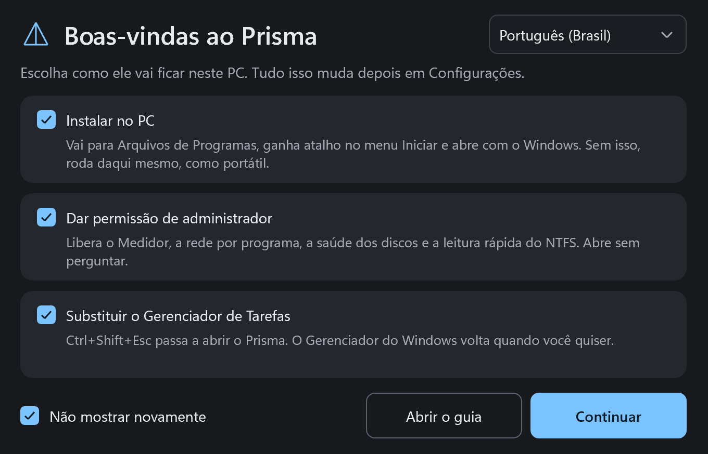
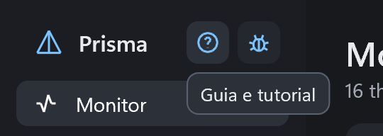
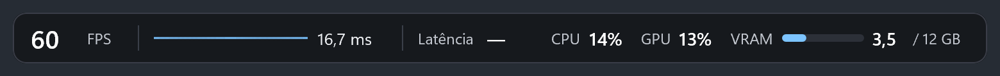
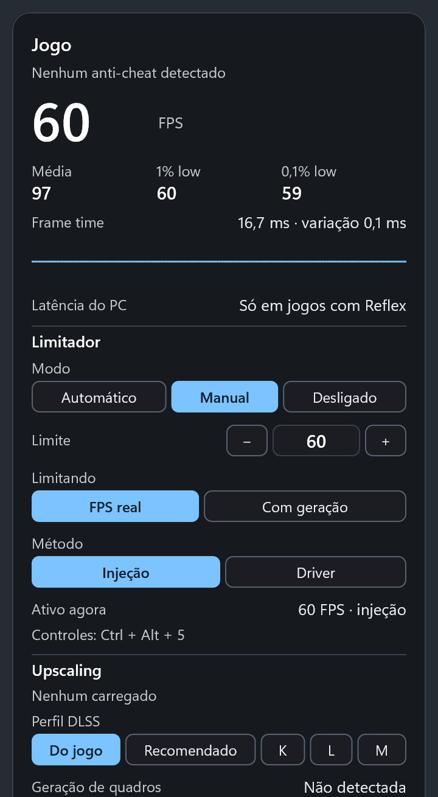
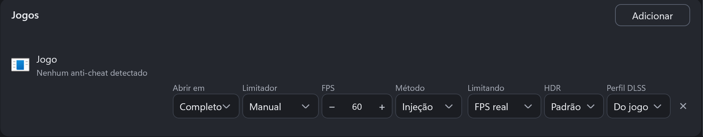
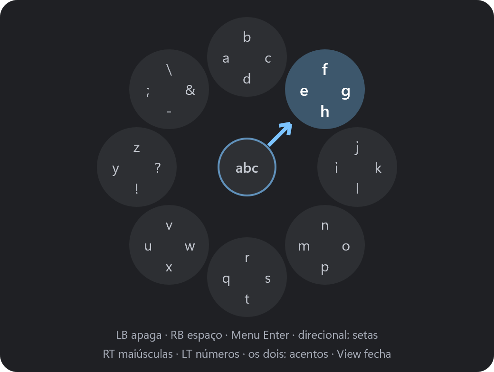

# Guia do Prisma

[English](GUIDE.md)

## Primeiros passos

O Prisma é um único arquivo, Prisma.exe. Na primeira vez que você abre, ele mostra a tela de boas-vindas com três escolhas, todas marcadas. Desmarque o que não quiser e clique em **Continuar**. O Windows pede a permissão de administrador uma vez e aplica tudo junto.

- **Instalar no PC:** copia o Prisma para Arquivos de Programas, cria o atalho no menu Iniciar, coloca o programa na lista de programas do Windows e faz ele abrir com o Windows. Sem isso, ele roda da pasta onde está, como versão portátil, e as configurações ficam em PrismaData, ao lado do arquivo.
- **Dar permissão de administrador:** o Medidor, a coluna de rede, a saúde dos discos e a leitura rápida do NTFS precisam dela. Instalado, o Prisma abre como administrador sem perguntar. Portátil, o Windows pergunta a cada abertura, porque um arquivo fora de Arquivos de Programas pode ser trocado por outro programa.
- **Substituir o Gerenciador de Tarefas:** Ctrl+Shift+Esc passa a abrir o Prisma. Só funciona na versão instalada: numa pasta comum, qualquer programa poderia trocar o arquivo que o atalho abre, e o atalho vale para todas as contas do PC. Sem marcar Instalar no PC, essa opção fica apagada.
- **Não mostrar novamente:** vem marcado, então a tela aparece uma vez. Desmarcado, ela aparece toda vez que o programa abrir de novo. Dá para mudar em Configurações.

A tela também tem o seletor de idioma. O Prisma começa no idioma do Windows: português, inglês, espanhol, russo ou chinês simplificado, conforme o Windows, e inglês nos demais.

Tudo isso pode ser mudado depois em **Configurações**. O Prisma fica na bandeja do Windows: fechar a janela não encerra o programa. Para sair, use o menu do ícone na bandeja.

## Guia e Reportar bug

Os dois ficam ao lado do nome Prisma, no alto da janela, sempre à vista. Passe o mouse em cima para ver o que cada botão faz. No guia, clicar num tópico à esquerda pula direto para ele.

## Monitor

Mostra o que está usando o PC agora: CPU por núcleo, GPU, RAM e VRAM, e o uso de CPU, RAM, GPU, VRAM, disco e rede de cada programa.

- **Dá para:** finalizar uma tarefa, ver os detalhes, abrir o local do arquivo, pesquisar online e ver as propriedades com o botão direito. A coluna PID mostra o número de cada programa; um programa com vários processos mostra um traço, e a aba Detalhes lista cada processo com o seu PID.
- **Buscar:** o campo ao lado das abas filtra a lista pelo nome do programa ou do arquivo. Digite só números para achar pelo PID.
- **Ordem por nome:** clicar em **Programa** ordena por nome e separa a lista como no Gerenciador de Tarefas: **Aplicativos** (os programas com janela aberta) no topo, depois **Em segundo plano** e **Processos do Windows**, cada grupo com quantos são.
- **Reiniciar o Explorer:** quando a barra de tarefas, o menu Iniciar ou a área de trabalho travam. O Prisma pergunta antes, fecha o Explorer pelo PID e ele volta sozinho em alguns segundos. As janelas de pasta abertas fecham.
- **Não dá para:** ver temperatura e consumo da CPU, porque isso exige um driver de kernel. A coluna de rede exige o Prisma como administrador. A temperatura da GPU depende do driver da NVIDIA.

## Medidor

Mostra o desempenho por cima do jogo e limita o FPS. As leituras vêm dos eventos do Windows, sem nada dentro do jogo. Precisa do Prisma como administrador.

Ele só aparece pelo atalho, e mede o programa em foco quando você aperta. Ligar pelo atalho num jogo já coloca esse jogo na lista, para guardar o limite, o HDR e o perfil dele; apertar o mesmo atalho de novo esconde o medidor, e o jogo continua na lista. **Adicionar da lista de programas** também traz os jogos instalados pela Steam e pela Epic.

- **HDR automático:** liga o HDR do Windows quando o jogo abre e desliga quando ele fecha. Se o HDR já estava ligado, ele continua ligado. **Só na lista** vale para os jogos da lista; **Todos** vale para todo jogo que o modo jogo do Energia reconhece, e **Não ligar**, na lista, tira um jogo.

### Barra compacta

Fica no alto da tela e mostra o FPS, a linha de frame time, a latência, CPU, GPU e VRAM. Escolha se ela fica à esquerda, no centro ou à direita. Atalho: Ctrl + Alt + 1.

Em **A mais na barra compacta**, na aba Medidor, você acrescenta RAM, temperatura da CPU, temperatura da GPU e o plano de energia. As temperaturas aparecem ao lado do uso de cada uma.

Com um jogo da lista em foco, a barra mostra o modo do limitador: **Sem limite**, **Auto** com o limite (ou **Auto: medindo** nos primeiros 5 minutos) ou **Manual** com o limite. Ele fica aceso quando o limite está agindo, pela injeção ou pelo driver, e apagado quando não está.

A linha mostra como os quadros variam. Linha reta quer dizer quadros regulares. Variações de até 1 ms são ignoradas, e picos grandes indicam travadas.

### Painel completo

Fica à direita ou à esquerda da tela e mostra tudo em uma coluna. Atalho: Ctrl + Alt + 2. Na aba Medidor você escolhe o que aparece e a opacidade.

- **FPS e médias:** o número grande é o FPS de agora. 1% low e 0,1% low mostram os piores momentos. Quanto mais perto da média, mais estável o jogo está.
- **Frame time:** o tempo de cada quadro, em milissegundos. Variação baixa é bom.
- **Latência do PC:** só aparece em jogos com Reflex.
- **Upscaling, geração de quadros e Reflex:** mostra o que foi carregado pelo jogo.
- **Temperatura da CPU:** aparece abaixo da CPU. O Windows não entrega essa leitura sozinho, então ela precisa do PawnIO, um driver gratuito, aberto e assinado pela Microsoft, o mesmo tipo de driver que o Steam usa. Na aba Medidor, **Instalar PawnIO** baixa o instalador oficial, confere a assinatura e abre ele para você aceitar. Para tirar depois, use Aplicativos instalados do Windows. Sem ele, a linha diz Precisa do PawnIO.
- **Plano de energia:** mostra o plano do Windows em uso. Com os controles abertos, clique nele (ou aperte Enter) para abrir a lista e escolher outro; as setas trocam pelo vizinho.

Para usar os botões do painel dentro do jogo, aperte **Ctrl + Alt + 5**. O jogo continua em primeiro plano, e isso libera o mouse e o teclado: as setas andam pelas opções e mudam a escolhida, e o clique também funciona. Para escrever o limite, digite o número e aperte Enter. Aperte o atalho de novo, ou Esc, para voltar ao jogo. Ctrl + Alt + 0 esconde o medidor e zera as medições.

### Limitador de FPS

Com o limitador ligado, cada jogo guarda o próprio limite. Na lista de jogos da aba Medidor você escolhe modo, limite, método e o que está sendo limitado.

- **Limitador:** Manual usa o número que você escolher. Automático mede 5 minutos de jogo e escolhe um limite que o jogo sustenta.
- **Método Injeção:** o padrão. Um pequeno módulo do Prisma entra no jogo e o limite muda na hora, em DirectX 10, 11 e 12.
- **Método Driver:** grava o limite no driver NVIDIA. Só vale a partir da próxima vez que o jogo abrir.
- **Limitando:** FPS real conta os quadros que o jogo produz. Com geração considera os quadros que vão para a tela.
- **Perfil DLSS:** escolhe o perfil que o driver NVIDIA usa naquele jogo. Vale ao reabrir o jogo. Só aparece nos jogos que trazem o DLSS; nos outros, a coluna diz Sem DLSS.
- **Auto HDR:** a mesma escolha de Auto HDR por jogo da aba HDR (Padrão, Forçar ou Desligar). Mudar aqui muda lá.
- **Energia:** o plano de energia do Windows que liga quando o jogo abre. Quando ele fecha, volta o plano de antes, se ninguém trocou no meio. **Não mudar** deixa como está, e aí vale a Energia automática.
- **Tirar da lista sem abrir há:** um jogo parado por 7, 14, 30, 60 ou 90 dias sai da lista, para ela não crescer demais. As escolhas dele ficam guardadas e valem quando ele abrir de novo, e ele volta para a lista. **Mostrar todos** mostra também os parados. O padrão é nunca tirar.
- **Atalhos:** Ctrl + Alt + 3 troca o modo do jogo em foco: Automático, Manual, Sem limite e de volta ao Automático. O medidor mostra o modo escolhido. Ctrl + Alt + seta para cima ou para baixo muda o limite. O limite vai de 20 a 1023.

Se a injeção falhar, se o jogo cair ou se houver anti-cheat detectado, o Prisma passa sozinho para o driver e avisa. Sem a leitura de quadros do Windows, a injeção entra mesmo assim depois de 8 segundos de jogo em foco, e o motivo de a leitura não abrir vai para o registro de ações.

- **Não use injeção em jogos online.** A detecção de anti-cheat reconhece arquivos e títulos conhecidos, mas não achar nada não prova que o jogo não tem. Nesses jogos, escolha o método Driver.
- **Não dá para:** usar injeção em DirectX 9 e Vulkan. Esses jogos usam o limite do driver, que vale ao reabrir. O limite pelo driver exige placa NVIDIA. Em tela cheia exclusiva, a barra pode não aparecer.

### Registro de dados

Grava o desempenho para estudar depois. Só roda se você ligar, na aba Medidor ou com Ctrl + Alt + 4. Digite quantos minutos de jogo gravar (5 é o padrão, 0 é sem limite). Enquanto grava, o medidor avisa: o compacto mostra um ponto vermelho com **Gravando** e o tempo no começo da barra, e o completo mostra uma faixa vermelha logo abaixo do nome do jogo.

Os arquivos ficam em Documentos, Prisma, Logs: cada quadro, cada segundo, a CPU de cada thread do jogo e um resumo no final. Em placas NVIDIA, cada segundo traz também a GPU para quem estuda otimização: uso do controlador de memória, energia em relação ao limite, o que segurou o clock (energia, temperatura), o tráfego PCIe e a VRAM total; o começo do arquivo traz o driver, os clocks máximos, o limite de energia e o link PCIe, e o resumo diz se o limite foi energia, temperatura ou VRAM. O resumo também diz o limite que estava valendo (pela injeção ou pelo driver) e a geração de quadros: qual o jogo carregou (DLSS, FSR ou XeSS), em quantos segundos ela ficou ligada e em quantas vezes, e se o Lossless Scaling estava aberto. Com o PawnIO instalado, cada segundo traz também a temperatura da CPU (coluna cpu_c). Saber se ela ligou depende dos marcadores do Reflex; sem eles, o resumo diz que ela foi carregada, sem medir. Em jogos com anti-cheat detectado, a leitura de threads fica desligada.

## Discos e redes

Mostra velocidade, tempo ativo e espaço de cada disco, com nota de saúde pelo SMART: Bom, Atenção ou Risco, inclusive em HDs USB. Cada rede mostra velocidade, endereço e total transferido.

- **Não dá para:** tratar a nota como garantia. Um disco pode falhar sem aviso. A saúde exige o Prisma como administrador.

## Espaço em disco

Analisa um disco inteiro e mostra pastas, maiores arquivos, tipos e um mapa visual.

- **Dá para:** abrir no Explorador e, como administrador, mandar para a Lixeira.
- **Não dá para:** usar a leitura rápida sem administrador ou em disco que não seja NTFS.

## Pesquisar

Acha arquivos e pastas pelo nome em todos os discos, enquanto você digita. Vem desligada: aperte **Ligar** na aba Pesquisar.

O Prisma guarda os nomes de todos os arquivos num índice, na memória e no disco, para responder na hora e já estar pronto ao abrir. O índice usa cerca de 70 MB a cada milhão de arquivos: um disco de sistema com 2 milhões de arquivos fica perto de 140 MB. Com o Prisma como administrador, ele lê a tabela do NTFS em segundos e se atualiza no momento em que um arquivo é criado, renomeado ou apagado. Sem administrador, ou em disco que não seja NTFS, ele percorre as pastas, o que demora mais, e atualiza a cada 15 minutos.

- **Janelinha:** Ctrl + Alt + Espaço abre uma caixa de pesquisa por cima de qualquer programa, com até oito resultados. Enter abre, Ctrl + Enter mostra na pasta, Ctrl + C copia o caminho e Esc fecha. As setas andam pela lista.
- **Na aba:** a lista completa, com nome, pasta, tamanho e data. Clique no título de uma coluna para ordenar, de novo para inverter e uma terceira vez para voltar à relevância. Clique duas vezes para abrir. O botão direito abre, mostra na pasta ou copia o caminho.
- **Como pesquisar:** maiúsculas e acentos não contam, então "relatorio" acha "Relatório". Várias palavras precisam aparecer todas. Use aspas para um trecho com espaço, `ext:pdf;docx` para tipos, `pasta:` só para pastas, `arquivo:` só para arquivos, `*` e `?` como curinga no nome inteiro, `!palavra` para tirar e uma barra, como `fotos\2024`, para procurar no caminho.
- **Programas:** programas do menu Iniciar que combinam com o texto, até três, aparecem no topo, inclusive os da Microsoft Store. Enter abre, Ctrl + Shift + Enter abre como administrador e Ctrl + Enter mostra na pasta. Vem ligado.
- **Internet e IAs:** o texto vira uma linha para pesquisar no navegador padrão ou perguntar a uma IA. Se parece pergunta, porque termina com "?" ou começa com como, qual, o que e parecidos, essas linhas vêm no topo; senão, depois dos primeiros arquivos. Em Opções, escolha quais aparecem: Google, Bing, DuckDuckGo e Brave Search, e as IAs Claude, ChatGPT, Gemini, Copilot, Perplexity, Grok e DeepSeek. Sem escolha, vêm o Google e as IAs instaladas. Uma IA instalada abre no aplicativo dela; senão, abre o site. Quando não dá para levar a pergunta pronta, ela vai copiada e é só colar com Ctrl + V. Vem ligado.
- **Comandos:** comece com `>` para rodar um comando, como `>ipconfig /all`. Aparecem Rodar no PowerShell e Rodar no CMD: Enter roda sem administrador, mesmo com o Prisma como administrador, e Ctrl + Shift + Enter roda como administrador, pedindo a permissão ao Windows. O comando abre no terminal padrão do Windows, que fica aberto. Enquanto você digita, aparecem sugestões de comandos, parâmetros e pastas; Tab aceita a selecionada ou a primeira. A lista sai do próprio Windows na primeira vez (os comandos do PowerShell com os parâmetros, os do CMD com a descrição e os programas do PATH), demora uns minutos e fica guardada. Vem desligado.
- **Completar como o terminal:** com os comandos ligados, um PowerShell escondido completa como o terminal, com caminhos, parâmetros e o histórico do PowerShell. Ele fecha sozinho depois de 2 minutos parado. Vem desligado.
- **Opções:** escolha os discos e o atalho, o que mais aparece na pesquisa, leia os discos de novo ou desligue. Ler os discos de novo também refaz a lista de comandos. Desligar tira o índice da memória e do disco.
- **Disco com problema:** discos com nota abaixo de Bom em Discos e redes ficam de fora, para o índice não forçar um disco que está falhando. Dá para incluir clicando nele em Opções.
- **Abrir:** os arquivos abrem pelo Explorador, com o programa padrão e sem herdar o administrador do Prisma.

## Inicialização

Liga, desliga, adiciona e remove o que abre com o Windows, e mostra quem assinou cada programa. Ordena por nome, ativados ou desativados.

## Serviços

Mostra a descrição de cada serviço. Dá para iniciar, parar e reiniciar. O botão direito abre as propriedades na janela do próprio Windows.

## Desinstalar

Remove programas em lote, cria ponto de restauração, procura o que sobrou e informa o que foi excluído.

- **Segurança:** só vem marcado o que tem o nome exato. Nomes parecidos aparecem para você conferir, pastas vão para a Lixeira e o registro ganha backup antes.

## Ajustes do Windows

Primeiro uma auditoria que só lê o PC. Depois os perfis Jogo, Desenvolvimento e Privacidade, em camadas, só com ajustes de efeito documentado. A aba Fora da lista explica o que ficou de fora e por quê.

- **Dá para:** desfazer. Cada mudança guarda o valor anterior, e Desfazer só restaura o que ninguém mexeu depois. **Ver log** mostra cada mudança, com o antes e o depois.
- **Não dá para:** esperar mais FPS: o ganho é privacidade e menos ruído. Nenhum perfil toca em atualizações, antivírus, UAC, Integridade da Memória ou virtualização. Apps removidos voltam pela Loja, e a volta pode falhar.

## Ferramentas

Reúne reparo do Windows (DISM e depois SFC), histórico de falhas, Windows Update, verificação de disco, rede, DNS, limpeza, winget, diagnóstico e reinício avançado. Cada ferramenta guarda o próprio passo a passo, com o comando exato, a saída, os erros e o tempo de cada etapa.

- **Não dá para:** usar os modos que escrevem em disco suspeito. Eles ficam bloqueados.

## Otimizar

Sugere o que fechar antes de jogar e sempre pergunta. Blacklist nunca fecha, Whitelist sempre fecha, e a detecção automática sugere nomes para as duas listas. Atalho: Ctrl + Alt + O.

Se você quiser, uma pergunta pequena aparece no canto superior direito quando um jogo abre, e some em 10 segundos. Ela vem desligada: ligue em Energia, no quadro Ao entrar em modo jogo, com Perguntar se quero otimizar.

## Energia

Detecta jogo ou carga alta e troca o plano de energia. Volta ao repouso depois de 60 segundos sem carga. Você escolhe a porcentagem e o tempo que contam como carga.

Com a **Troca automática** desligada, o quadro **Plano fixo** escolhe um plano que liga na hora e fica até a troca voltar, também depois de reiniciar o Prisma ou o PC. Se um jogo trocar o plano no meio (o plano por jogo do Medidor, por exemplo), o plano fixo volta quando ele fecha. **Sem plano fixo**, o Prisma não muda o plano.

Conta como jogo o programa em foco que cobre a tela e usa a GPU ele mesmo, ou que mora na pasta de jogos da Steam, Epic, GOG ou Xbox. Navegadores, players de vídeo, acesso remoto como o Parsec, Discord, OBS e lançadores nunca contam, mesmo em tela cheia.

- **Dá para:** editar um plano com todas as opções que o Windows registra, inclusive as ocultas, e importar ou exportar arquivos .pow. A primeira edição guarda uma cópia do plano original.
- **Nome dos planos:** os planos do Prisma levam o nome no idioma escolhido e mudam de nome junto com ele, sem duplicar.
- **Limite:** os planos do Prisma são criados só na versão instalada.

## Fullscreenizer

Deixa a janela em foco em tela cheia sem bordas. Atalho: Ctrl + Alt + F. Quem usa uma vez entra numa lista salva, onde dá para marcar Automático e aplicar sempre que o programa abrir.

- **Não dá para:** usar com jogo em tela cheia exclusiva. Coloque o jogo em modo janela antes.

## Som

Controla o volume de cada programa. As teclas de volume do teclado, com um modificador (Ctrl por padrão), mudam só o programa em foco. O Prisma lembra o volume de cada programa.

- **Dá para:** escolher o aparelho de saída e o de entrada de cada programa, e adicionar programas à mão.
- **Fixar:** o alfinete ao lado do nome deixa o programa na lista mesmo fechado, guardando o volume, a saída e a entrada. Quando ele abre, volta com o volume guardado.
- **Atalhos de aparelho padrão:** cada atalho troca a saída e a entrada padrão do Windows de uma vez, por exemplo Ctrl + Alt + Num 1 para a TV e o fone. **Adicionar** cria um atalho; escolha a saída e a entrada (ou Não mudar) e clique no campo para gravar as teclas. O X apaga.
- **Manter o som acordado:** toca um fluxo sem som audível, para HDMI e Dolby não cortarem o começo do próximo som. Para sozinho depois de 10 minutos sem uso.
- **Limite:** a troca de aparelho usa um recurso interno do Windows, e alguns programas só trocam ao reabrir.

## HDR

Painel de leitura com o modo da tela, o perfil de calibração ativo, o brilho que cada fonte declara, o que o Windows informa aos jogos, o Dolby Vision declarado e os formatos de som aceitos. Avisa quando algo não confere.

- **Calibração:** abre padrões de teste em tela cheia e grava um perfil por modo de imagem da TV.
- **Auto HDR por jogo:** força, desliga ou deixa com o Windows, em jogos DX11 e DX12, sem injetar nada.
- **Teste de atraso do som:** toca um clique junto de um clarão, para comparar com e sem som espacial.
- **Não dá para:** mudar o que a TV faz: o perfil só informa o Windows, e o Windows pode continuar informando os valores antigos aos jogos por um tempo. A leitura direta da ficha da tela existe só em placas NVIDIA.

## Driver NVIDIA

Só aparece com placa NVIDIA. Muda as opções do driver no perfil global ou no perfil de um jogo, como o NVIDIA Profile Inspector, só com as opções que ainda fazem algo nas placas e drivers de hoje.

- **Perfil:** Todos os jogos (global) ou um jogo da lista. A lista tem os jogos do Medidor e os que você adiciona pela lista de programas ou pelo .exe. Jogo sem perfil no driver ganha um na primeira mudança; jogo que já tem perfil da NVIDIA usa o dela. **Tirar da lista** tira o jogo só da lista: o que foi gravado continua no driver.
- **Grupos:** Sincronia e FPS, DLSS, Antisserrilhado, Texturas, Imagem e indicadores, e Sistema. Passe o mouse no nome para ver o que a opção faz. O ponto azul marca o que está gravado neste perfil. **Padrão** mostra o valor que vale sem nada gravado aqui e volta a ele.
- **Cópias:** antes da primeira mudança de cada abertura do Prisma, ele guarda uma cópia de todos os perfis do driver; as 10 mais novas ficam na pasta de dados, em `nvidia`. **Cópias** volta todos os perfis a uma delas, e o que mudou depois se perde.
- **Ficam de fora:** SLI, 3D Vision, Ansel, CSAA, MFAA, opções de depuração e as só de OpenGL antigo, que não fazem nada nas placas atuais. Opções que pedem um driver mais novo que o instalado não aparecem.
- **Quando vale:** na próxima vez que o jogo abrir. O limite de FPS e o preset do DLSS são as mesmas opções que o Medidor grava nos jogos dele.

## Captura

Tira foto com anotações e grava vídeo em AV1, HEVC ou H.264. Com a tela em HDR, grava em SDR ou HDR10. O vídeo fica na pasta que você escolher.

- **Gravar Janela e Gravar Tela:** Ctrl + Alt + R grava a janela em foco e Ctrl + Alt + T grava a tela inteira. Com Som do sistema ligado, grava todos os sons do PC. Desligado, Gravar Janela grava só o som daquela janela. Se a janela mudar de tamanho no meio, o vídeo fica com o tamanho do começo: a janela aparece no canto, cortada se cresceu, com o resto preto se diminuiu.
- **Foto:** Ctrl + Alt + P seleciona uma área, Ctrl + Alt + A pega a tela inteira e Ctrl + Alt + J pega a janela em foco. Enter ou Ctrl + C copia, Ctrl + S salva, Ctrl + Z desfaz e Esc cancela.
- **Replay:** em modo jogo, guarda os últimos segundos na memória. Ctrl + Alt + B salva.
- **Não dá para:** capturar conteúdo protegido, como Netflix, que sai preto. H.264 não tem 10 bits: gravar em HDR10 usa HEVC. Gravar exige codificador de vídeo na GPU.

## Compartilhar tela

Em teste. Mostra e controla outro PC pela internet, para acesso remoto ou para jogar co-op local à distância, sem conta e sem servidor do Prisma. A imagem sai da placa de vídeo com pouco atraso, e o som do PC vai junto. A página tem seis abas: **Compartilhar**, **Host**, **Cliente**, **Rede**, **Atalhos** e **Controles**. Com alguém conectado a este PC, aparece a sétima, **Conectados**.

- **Parear, uma vez:** no PC que vai ser visto, escolha o que quem parear pode fazer e clique em **Criar convite**. Ao lado, **Convite vale** escolhe por quanto tempo: 5, 10 ou 30 minutos ou 1 hora. O pareamento fica para sempre; o convite só precisa durar até o outro PC parear. Aparece uma janela com um código curto, como `K7M2-QX9P`, que vale uma vez, com o tempo que falta contando. **Revogar** cancela o convite na hora, antes de vencer. Nela, **Copiar código** copia o código, **Copiar link** copia um link e **Compartilhar** abre a janela de compartilhar do Windows, para mandar por e-mail, Discord, WhatsApp e outros. O link é curto (`prismashare.github.io/c/#K7M2-QX9P`). Quem abre o link num PC com o Prisma vê o Prisma abrir na página certa e perguntar se quer parear; sem o Prisma, a página leva para os downloads no GitHub. No outro PC, também dá para digitar o código em **Parear com outro PC** e clicar em **Parear**. Cada aparelho tem 5 tentativas com o mesmo convite. Os dois mostram o mesmo código de confirmação de seis dígitos: confira antes de aceitar. Quando alguém pede para entrar, um aviso aparece por 5 segundos e a pergunta fica no canto superior direito, no visual do Prisma, com o nome do aparelho e as permissões, até você escolher. No pareamento, **Parear** (o recomendado) pareia e pergunta a cada conexão, **Parear e confiar** pareia e confia no aparelho, sem perguntar, e **Recusar** recusa. Numa conexão, **Permitir** ou **Recusar**. Se o Prisma não estiver aberto na bandeja, a pergunta vem na caixa do Windows, como antes.
- **Código e convite longo:** o código fica guardado pelo tempo escolhido em três relés públicos de nomes (o mesmo sistema que o iroh usa para achar os PCs), assinado e sem nada que identifique você. Se nenhum relé responder, a janela avisa, e **Copiar convite longo** copia o convite completo, que funciona sem relé nenhum.
- **Conectar:** com o compartilhamento ligado no host, clique em **Assistir** no aparelho da lista. A conexão tenta primeiro o caminho direto, depois a sua VPN (Tailscale, ZeroTier) e, se nada passar, os relés públicos do iroh. Tudo vai criptografado de ponta a ponta.
- **Mouse e teclado:** para até três PCs lado a lado, cada um com a sua tela, como o Deskflow. Na aba **Cliente**, em **Telas lado a lado**, escolha quem fica na esquerda, no meio e na direita (este PC e os PCs que ele assiste); depois clique em **Mouse e teclado** no aparelho da lista. Um PC sem posição vai para a primeira livre ao lado deste. O mouse passa pela borda de uma tela para a vizinha e o teclado vai junto, sem vídeo nem som; o texto copiado passa com a permissão de copiar e colar. Ligar em mais de um PC junta todos na mesma conexão. **Scroll Lock** trava o mouse na tela em que ele está e destrava (o atalho muda na aba **Atalhos**). Só a tecla apertada por uma pessoa faz isso: um Scroll Lock mandado por outro programa é ignorado, e os avisos "Mouse travado nesta tela" e "Mouse destravado" não aparecem sozinhos. Segurando um botão do mouse, o cursor não passa. Enquanto o mouse está em outro PC, o cursor deste some, e o de um PC some quando o mouse sai dele; ele volta quando o mouse volta ou quando alguém mexe no mouse de verdade daquele PC. Ligado, o botão fica colorido e vira **Parar mouse e teclado**, que tira aquele PC. Cada outro PC precisa estar compartilhando e ter dado a este a permissão de mouse (e a de teclado, para o teclado ir junto); o mouse e o teclado chegam no monitor escolhido no Host de lá. Só entre PCs com o Prisma, e janelas abertas como administrador neste PC não deixam o mouse sair por elas.
- **Só o som:** o som do outro PC toca neste, sem vídeo, como o AudioRelay: para ouvir o PC da sala no fone do notebook, ou o som de um PC sem caixa. Clique em **Só o som** no aparelho da lista; ligado, o botão fica colorido e vira **Parar o som**, que encerra. O outro PC precisa estar compartilhando e ter dado a este a permissão de som; o som segue as opções do Host de lá (um programa só, ou sem os programas de chamada). Dá para usar junto com **Mouse e teclado**. Só entre dois PCs com o Prisma.
- **Aparelhos pareados:** duas abas separam os PCs que este assiste dos que assistem a este. **Renomear** dá outro nome ao aparelho, só neste PC; o nome original fica embaixo, menor. Salvar com o campo vazio volta ao original.
- **Permissões por aparelho:** som, controle, teclado, mouse, copiar e colar (texto, nos dois sentidos; o que você copia neste PC só vai para o host quando a janela de assistir está na frente) e tela segura. Marque e desmarque na lista; se o aparelho estiver conectado, vale na hora. Sem nenhuma, o aparelho só vê.
- **Aba Host:** o nome deste PC para os outros, o monitor, a placa de vídeo que codifica (a do monitor, ou outra num notebook com duas placas), a resolução máxima, os quadros por segundo, o ritmo dos quadros (só quando a tela muda, ou constante, para quem prefere um ritmo fixo), a prioridade (menor atraso, equilíbrio ou qualidade), o codec (AV1, HEVC, H.264 ou PyroWave), o limite de banda (até 150 Mbit/s, ou até 700 com o PyroWave), HDR10 de 10 bits e 4:4:4. Os automáticos seguem quem assiste. Também escolhe o som que vai (o PC todo ou só um programa), tira do som o programa de chamada (que então também sai da lista do som que vai), limita quantas pessoas entram, deixa uma pessoa por vez no mouse e no teclado, dá prioridade ao mouse e ao teclado do host e recusa conexões enquanto este PC assiste a outro. As mudanças valem durante a conexão: as da imagem recomeçam o vídeo por um instante, e o resto muda sem recomeçar. O Windows só deixa tirar um programa do som: sai o programa de chamada que está tocando (o Discord numa chamada, e não o Telegram aberto e calado), e a escolha muda sozinha durante a conexão.
- **Som do host:** **Saída capturada** escolhe de qual saída de som o som sai (a padrão do Windows ou outra, como uma placa de som ou o HDMI da TV, para quando o som do PC não toca na padrão). **Entrada junto** mistura um microfone ou outra entrada deste PC ao som que vai. Tirar o programa de chamada só funciona na saída padrão.
- **Opções por aparelho:** no alto da aba Host, a lista ao lado de **Imagem** escolhe **Todos os aparelhos** ou um aparelho que assiste a este. Num aparelho, marque **Configuração própria para este aparelho** e mude o que quiser (codec, resolução, banda, som e o resto): vale quando aquele aparelho conecta, como PyroWave para o notebook da rede local e AV1 para quem vem pela internet. Com mais de uma pessoa ao mesmo tempo, vale a configuração de quem conectou primeiro. Nome, pessoas, rede, controles e atalhos são sempre os de todos. Os aparelhos com configuração própria aparecem com * na lista.
- **PyroWave (experimental):** codec que quase não comprime: a imagem sai quase igual à original e cada quadro se vira sozinho, sem esperar quadro-chave quando um pacote se perde. Em troca pede uns 200 Mbit/s em 1080p60, e mais em 4K ou em mais quadros por segundo, então só funciona na rede local ou pela VPN (ZeroTier, Tailscale), nunca pelo relé. A biblioteca do PyroWave vem dentro do Prisma e é gravada na pasta AppData\Local\Prisma\pyrowave, com a licença dela, na primeira vez que o codec é usado. Se quem assiste estiver numa versão do Prisma sem ele, ou se alguém entrar pelo relé, vale o automático; a aba Host avisa em laranja. Faz HDR10 nas mesmas condições dos outros codecs e 4:4:4 em qualquer placa de vídeo, quando quem assiste pede e o host aceita; com o 4:4:4, o automático sobe para uns 300 Mbit/s em 1080p60.
- **Aba Cliente:** abrir em tela cheia sem borda, VSync, modo imersivo (o mouse fica preso na janela, e a tecla Windows e o Alt + Tab vão para o outro PC), pedir 4:4:4, começar sem som, o medidor de latência (desligado, simples ou detalhado), os quadros por segundo pedidos ao host (automático segue os Hz desta tela), a placa de vídeo que decodifica e mostra (vale na próxima conexão) e o aviso de conexão piorando.
- **Medidor e aviso:** o simples mostra o atraso de ponta a ponta com uma bolinha verde, amarela ou vermelha. O detalhado mostra também a rede, o vídeo com a prioridade do host (menor atraso, equilíbrio ou qualidade), os quadros por segundo, a banda, a decodificação, os quadros perdidos e o caminho. O aviso aparece por alguns segundos quando a rede perde mais de 2% dos quadros, quando a latência varia mais de 10 ms ou sobe por 3 segundos seguidos.
- **Menu da conexão:** Ctrl + Alt + Shift + P, na janela de quem assiste, abre o menu com o vídeo da conexão, tela cheia, modo imersivo (desligado, mouse, teclado ou os dois), quadros por segundo, medidor, aviso, som, VSync, pedir 4:4:4, controle em segundo plano, teclado como controle, Ctrl + Alt + Del e **Desconectar**, cada um com o atalho ao lado. O mouse e as setas, Tab, Enter e Esc funcionam. Tudo vale na hora; mudar os quadros por segundo ou o 4:4:4 recomeça o vídeo. Se o host limita os quadros por segundo, ele manda o menor dos dois.
- **Aba Rede:** porta UDP fixa, para quem redireciona a porta no roteador (vazia é automática), e o pedido ao roteador para abrir a porta sozinho (UPnP, NAT-PMP, PCP). Mostra também por onde passou a última conexão.
- **Aba Atalhos:** troca os atalhos do menu, da tela cheia, do modo imersivo, do medidor, do som, do Ctrl + Alt + Del, de desconectar e da tecla de emergência. Clique no atalho e aperte a combinação nova; Esc cancela. O atalho do modo imersivo liga e desliga só na conexão aberta; o modo que fica é o da aba Cliente.
- **Co-op e aba Controles:** até 4 pessoas ao mesmo tempo. O controle de cada uma vira um controle de Xbox virtual no host. Isso precisa do ViGEmBus (Nefarius) ou do VIIPER instalado no host; o Prisma não instala nenhum dos dois. Os controles saem sozinhos quando o jogo em primeiro plano tem anti-cheat. A aba mostra os controles ligados aqui, com a bateria, e os virtuais de quem assiste. Ela também deixa mandar o controle com a janela em segundo plano e usar o teclado como controle.
- **HDR:** o host converte a imagem HDR para quem não tem tela HDR. Se preferir, marque **Desligar o HDR quando quem assiste não tem HDR**: o HDR volta quando a sala esvazia, ou no próximo início do Prisma, se algo cair no meio.
- **Serviço do Windows:** opcional. Com ele, quem tem a permissão **Tela segura** vê e usa o aviso do UAC, a tela de bloqueio e a do PIN, inclusive depois de o PC reiniciar sozinho. **Instalar** pede administrador e mostra o que muda antes de instalar. **Remover** desfaz tudo. O serviço roda uma cópia do Prisma, que é trocada pela versão nova quando o Prisma atualizado abre como administrador. Se o serviço ficar caindo, a página avisa. Com o serviço instalado, mudar quem assiste a este PC (permissões, Esquecer, convites, opções do host) pede o Prisma aberto como administrador; os PCs que você assiste mudam sem administrador.
- **Aba Conectados:** mostra cada aparelho conectado a este PC, com o caminho e a latência. O tipo de acesso muda na hora e fica salvo para as próximas conexões. **Desconectar** derruba só aquela conexão. **Banir** pergunta antes, derruba e esquece o aparelho, que só volta com um convite novo.
- **Avisos:** o Windows mostra uma notificação do Prisma quando alguém conecta a este PC ou sai. Clicar nela abre a aba Conectados. Toda opção trocada no menu da conexão ou por atalho aparece por alguns segundos na janela de quem assiste, e quando o host muda o vídeo ou o acesso no meio da conexão, quem assiste também vê. No host, o Prisma avisa quando alguém muda os quadros por segundo ou o 4:4:4, quando as opções do Host são aplicadas, quando o acesso de alguém muda, quando a tecla de emergência desconecta todo mundo e quando o mouse trava ou destrava.
- **Latência:** com **Assistir**, **Mouse e teclado** ou **Só o som** ligado, o cartão do aparelho mostra a latência de cada modo, e embaixo da lista fica o registro **Latência**, com uma linha a cada 5 segundos: a rede (média, mínima e máxima, ida e volta) e, quando há, o atraso de ponta a ponta do vídeo ou o do som.
- **Segurança:** Ctrl + Alt + Shift + Q, no host, desconecta todo mundo na hora. **Esquecer** tira um aparelho, que só volta com convite novo; se ele estiver assistindo, sai da sala na hora.
- **Não dá para:** usar sem o Prisma aberto no host (a não ser com o serviço); capturar conteúdo protegido, que sai preto; ouvir o microfone de quem assiste.

## Controles

Mostra os controles ligados por USB ou Bluetooth, ao vivo, e pode usar o controle como teclado e mouse. Nada é gravado no controle. Lê DualSense, DualShock 4, 8BitDo (Pro 3 testado), Pro Controller do Switch (sem teste em hardware), controles Xbox e os que se apresentam como Xbox, e controles genéricos, com os botões numerados. Sem controle ligado, o Prisma não gasta nada com eles.

- **Lista:** nome, conexão (USB ou Bluetooth), bateria e taxa de relatório de cada controle. Clique em um para ver ao vivo.
- **Tela:** no topo, a linha **Perfis** escolhe um perfil; ao lado, **Novo perfil** cria um com outro nome, começando como cópia do aberto (ligado aos mesmos programas) ou **De fábrica** (o Base: nada mapeado, nenhum programa ligado), e **Mais ▾** reúne Renomear, Importar, Exportar, **Voltar ao de fábrica** (para todo perfil, depois de perguntar), Apagar perfil e os modelos. O editor de perfis fica sempre na página. Abaixo, o cartão do controle tem um chip por controle ligado; clique num chip para escolhê-lo. Em **Como o jogo vê este controle**, **Nativo: nome do controle** deixa o jogo receber o controle como ele é, com o perfil valendo por cima (veja **Mapeamento** abaixo), e **Teclado e mouse** liga o mapeamento. **Virar controle Xbox** fica desativado, para uma fase futura. A escolha vale para todos os controles, e uma linha embaixo explica a escolha atual. Na terceira linha, **Perfil deste controle**, a lista escolhe o perfil só desse controle: **Perfil do programa** (ele segue o programa em foco, como antes) ou um perfil qualquer, que vale só para ele, com a barra de luz, os gatilhos e a vibração dele. Com vários controles, cada um pode ter o seu. Trocar de perfil pelo radial, ou por uma ligação num controle que tem perfil próprio, muda só o perfil dele, e fica salvo. Na mesma linha, **Desconectar** fica sempre ligado e desconecta o controle escolhido do Bluetooth; no cabo, não acontece nada. Com dois controles Xbox, um no cabo e outro no Bluetooth, ele acha o do Bluetooth. O mesmo existe em **Ação do Prisma**, como **Desconectar o Bluetooth**, e no radial. Depois vêm quatro abas, **Mapeamento**, **Macros**, **Menu radial** e **Ajustes**. Mapeamento mostra à esquerda o desenho do controle escolhido, com o teste dos botões e o cartão **O que mudou na camada**, e à direita o editor de perfis, com camadas, **Ligações**, turbo, sticks, zonas mortas e o assistente Acessível; sem controle ligado, o editor ocupa a largura toda. Macros tem a seção de macros e o **Texto rápido** do perfil. Menu radial tem o cartão **Radial do Prisma**. Ajustes tem duas colunas, que rolam juntas. À esquerda ficam os **Avisos**, o cartão **Mapeamento** e os avisos de conflito e de pareado sem controle; à direita, **Copiar diagnóstico** e o cartão **Medir sticks e gatilhos**, baixo enquanto não há medição nem resultado na tela, com o cartão **Teclado do Prisma** embaixo dele. LT e RT também trocam de aba. Enquanto uma macro é gravada, as abas e a lista de perfis ficam paradas, e **Apagar perfil** e **Importar** ficam desligados. Escolher o modelo **Acessível** leva para a aba Mapeamento, onde fica o assistente. Na linha das abas, à direita, **Abre sozinho com** escolhe o programa que liga este perfil: **Nenhum programa**, o jogo atual, os jogos do Medidor, ou **Escolher programa**, que abre a lista de programas. Um jogo escolhido liga o perfil quando ele estiver em foco; um programa escolhido na lista continua ligado aos outros perfis em que já estava. A lista mostra só o primeiro programa do perfil, e escolher outro o troca. Quando o programa deste perfil também está em outro perfil, a linha mostra a caixa **Padrão do programa** (só um padrão por programa) e a lista **Abre com o padrão** ou **Abre com o último usado**. Com o último usado, abrir o programa escolhe o perfil usado por último nele, lembrado mesmo depois de reiniciar; senão, o padrão, e sem padrão, o primeiro. Voltar ao programa que já estava aberto (Alt+Tab) mantém o perfil que você estava usando nele. Enquanto o mesmo programa continua em foco, o Prisma mantém o perfil que você escolheu. Na Base aparece só **Jogos sem perfil próprio**, sem lista; no Desktop, **Fora dos jogos**. Gravando uma macro, a lista mostra só o jogo atual.
- **Ao vivo:** o desenho do controle (DualSense, DualShock 4 ou Xbox) acende os botões apertados, e os gatilhos acendem quando apertados. Cada stick tem um ponto que se move com ele. O botão escolhido no editor tem um contorno no desenho. Clique num botão do desenho para escolhê-lo no editor (se a origem no editor era **Teclado e mouse**, ela passa para **Botões do controle**). Se o botão escolhido for um stick ou um gatilho, o editor mostra no topo, antes de **Ligações**, um painel só com ele: num stick, o modo dele nesta camada (direcional como botões, mouse, rolagem ou igual à camada pai, com a velocidade) e a zona morta, com início e fim; num gatilho, só a zona morta. Esse stick ou gatilho não se repete na lista de sticks e zonas mortas mais abaixo. Passe o mouse sobre um botão para ver o nome dele. Acima do desenho ficam conexão, taxa de relatório e bateria. Quando o perfil tem mais de uma camada, chips com os nomes delas aparecem logo abaixo dessa linha, acima do desenho: o escolhido fica destacado, e clicar num escolhe essa camada no editor. Os que não cabem ficam só na lista de camadas do editor. O desenho é do próprio Prisma, sem logos de marcas. Controles genéricos mantêm a visão ao vivo, com sticks, gatilhos e botões.
- **Teste dos botões:** embaixo do desenho, um cartão mostra o último botão apertado (enquanto segura, "apertado"; ao soltar, quantos ms ficou apertado), **Responderam X de N** (os gatilhos contam passando da metade), os botões que **Faltam** e o **Histórico** dos últimos 6 apertos, com quanto tempo cada um durou. Marca **aperto duplo** quando o mesmo botão é apertado de novo menos de 60 ms depois de solto, sinal de que o botão pode estar falhando. **Limpar** recomeça; trocar de controle também recomeça. Controles genéricos não têm esse cartão.
- **Gyro e touchpad:** só no DualSense e no DualShock 4, embaixo do teste dos botões. Um cartão mostra ao vivo, em °/s, as barras de **Inclinar**, **Virar** e **Girar** (de -360 a 360, com o zero no meio) e um quadro do touchpad com um ponto por dedo, até dois. O controle se calibra sozinho sempre que fica parado por 1 s; **Calibrar** pede a calibração na hora (deixe o controle parado na mesa por 1,5 s), e uma linha diz se está calibrado, esperando ou ainda sem calibrar. No cabo USB o gyro e o touchpad sempre chegam; pelo Bluetooth o Prisma pede o modo completo ao conectar, e se o gyro não aparecer, desligue e ligue o controle (o cartão avisa isso). A escala é nominal (±2000 °/s), não a calibração de fábrica do controle.
- **Gyro por camada:** no editor de perfis, a linha **Gyro** de cada camada escolhe **Igual à camada mãe**, **Passa ao jogo** ou **Mouse**; com Mouse, o giro move o cursor, em px/° (de 1 a 60, 10 de fábrica). Quando alguma camada usa Mouse, aparecem **Virar** (**Espaço local** ou **Espaço do jogador**, que segue a gravidade: virar o controle de pé ou deitado move igual) e as caixas **Inverter horizontal**, **Inverter vertical** e **Suavizar tremor**. Só no DualSense e no DualShock 4 com o relatório completo: pelo cabo USB, ou pelo Bluetooth o Prisma pede o modo completo ao conectar. Ex.: uma camada **Mira** com Gyro em Mouse, ativada segurando L2, mira com o controle.
- **Passa ao jogo, teste e macro:** em gyro e touchpad, **Passa ao jogo** deixa o jogo ler o controle direto (o Prisma não usa nem esconde). A luz do perfil aberto aparece no controle na hora, também em Nativo. **Testar** no cartão Teste dos botões deixa o controle apertar qualquer botão sem navegar pelo Prisma; **Parar** volta ao normal. Gravar macro: nada feito dentro do Prisma entra, e os botões do controle ainda não são gravados.
- **Touchpad por camada:** no editor de perfis, a linha **Touchpad** de cada camada escolhe **Igual à camada mãe**, **Passa ao jogo** ou **Mouse**; com Mouse, um dedo move o cursor, em px pela largura toda do touchpad (de 200 a 4000, 1200 de fábrica), e encostar não faz o cursor pular. Com dois dedos, Mouse rola a página, seguindo os dedos. O clique do touchpad continua sendo um botão como os outros. Mesmas condições do gyro: só no DualSense e no DualShock 4 com o relatório completo.
- **Gestos do touchpad:** no DualSense e no DualShock 4, os gestos ligam como qualquer botão, na fileira de botões do editor de perfis: **Touchpad ↑**, **Touchpad ↓**, **Touchpad ←** e **Touchpad →** (deslizar um dedo, até 0,8 s), **Toque no touchpad** (encostar e soltar rápido sem apertar; com Duplo vira toque duplo) e **Clique na metade esquerda** e **Clique na metade direita** (o clique físico, conforme o lado do dedo). O clique inteiro continua existindo. Com Touchpad = Mouse na camada, o deslizar fica para o mouse e só o toque vale como gesto.
- **Regiões e stick do touchpad:** os quatro cantos do touchpad, **Canto do touchpad ↖**, **↗**, **↙** e **↘**, seguram o botão enquanto um dedo fica parado ali (valem em qualquer modo do touchpad). Na linha **Touchpad** de cada camada, **Stick esquerdo** e **Stick direito** fazem o dedo virar o stick: o desvio desde onde encostou, cheio a um quarto da largura do touchpad; soltar volta ao centro. Vale o mais desviado entre o stick de verdade e o dedo, e nesse modo o deslizar não vira gesto (o toque e o clique por metade continuam).
- **8BitDo:** o Pro 3 (e, pelo driver do SDL, também Pro 2, Ultimate 2, Ultimate 2C e Ultimate 3, sem teste em hardware) é lido pelo canal do próprio fabricante quando está no modo D (D-input). O Prisma lê o relatório completo do controle ao abrir, como o SDL faz. Os botões aparecem pelo nome impresso no 8BitDo (B, A, Y, X na posição da Nintendo: B embaixo, A à direita; L, R, Select, Start, Home), e também os botões de trás L4, R4 e as duas pás PL e PR, que podem ser ligados nos perfis como qualquer botão. Lê gyro e acelerômetro (gyro como mouse funciona nele) e a bateria em %. A vibração de confirmação e as do perfil vão ao Pro 3 pelo relatório de vibração do fabricante. Na aba Mapeamento não há desenho próprio: aparece a lista ao vivo dos botões com os ícones. SF30 Pro e SN30 Pro continuam como controle genérico. Taxa medida no Pro 3 pelo Bluetooth (2026-11-14): em uso, 79 relatórios por segundo, mediana de 7,6 ms entre relatórios e p99 de 45 ms. O relógio do próprio controle dá o mesmo ritmo (78 por segundo), então as pausas vêm do controle e não do PC. Parado na mesa, ele baixa sozinho para uns 58 por segundo. Pelo cabo não foi medido. Se o receptor USB Manba One estiver ligado, o Pro 3 no modo S (Switch) conecta a ele (o receptor faz o papel do Switch para o controle) e chega ao PC como controle Xbox 360 pelo XInput; aí o Prisma o lê como Xbox, sem gyro, botões de trás nem bateria em %. Para as funções próprias do 8BitDo, use o modo D.
- **Pro Controller do Switch:** o Pro Controller do Nintendo Switch (USB/Bluetooth 057E:2009) e os controles que se apresentam como ele são lidos pelo protocolo do Switch. Sem teste em hardware: só foi conferido com testes automáticos. Ao abrir, o Prisma liga o relatório completo do controle (modo de entrada 0x30), lê a calibração de fábrica dos sticks na memória do controle (só leitura, nada é gravado), liga gyro e acelerômetro e acende o LED de jogador 1. Os botões aparecem pelos nomes da Nintendo (B, A, Y, X com B embaixo e A à direita; L, R, ZL, ZR, -, +, Home, Capture). Os sticks usam a calibração de fábrica. Lê gyro e acelerômetro (gyro como mouse funciona) e a bateria em % (em 8 níveis). ZL e ZR são digitais (liga/desliga). A vibração ainda não é enviada a este controle.
- **Controles genéricos (DirectInput):** controles comuns, manches de voo e volantes que não são de nenhuma família acima aparecem com até 32 botões numerados, o direcional (o primeiro hat) e cada eixo numa barra ao vivo com o nome dele (X, Y, Z, Rx, Ry, Rz, Deslizante, Roda, Leme, Manete, Acelerador, Freio, Embreagem, Volante). Nos perfis, os botões 1 a 32 ligam como qualquer botão. Os eixos viram sticks e gatilhos: X e Y são o stick esquerdo, Z e Rz o direito, Rx e Ry os gatilhos; o volante vira o stick esquerdo na horizontal, acelerador e manete o gatilho direito, freio o esquerdo, o leme o stick direito na horizontal e um segundo hat o stick direito, quando esses lugares estão livres. Sem teste em hardware: só foi conferido com testes automáticos.
- **Bateria:** em % no DualSense e no DualShock 4 por USB, no 8BitDo, em 8 níveis no Pro Controller do Switch (sem teste em hardware), em quatro níveis no Xbox, e "com fio" nos controles sem bateria. Por Bluetooth, o DualSense e o DualShock 4 só mandam a bateria num modo que exige gravar no controle, então ela fica "desconhecida".
- **Taxa:** quantos relatórios por segundo o controle manda, com a média, o p99 e o máximo do intervalo entre eles, medidos a cada 2 segundos. No Xbox o Windows não entrega os relatórios: a taxa sai do contador do XInput enquanto você mexe o controle e aparece com "em movimento", sem o p99. O Xbox One S por Bluetooth dá cerca de 120 por segundo.
- **Medir sticks e gatilhos:** **Começar** leva 13 segundos, em três etapas: soltar o controle, girar os sticks encostando na borda e apertar os gatilhos até o fim. Mostra o desvio parado (drift), a tremida, o alcance, o quanto o contorno foge de um círculo, as voltas cobertas e o curso de cada gatilho. Valores ruins ficam em laranja.
- **Avisos:** o aviso do próprio Prisma (o mesmo do volume) aparece quando um controle conecta ou desconecta, quando a bateria fica abaixo do limite (10% de fábrica, uma vez por descarga; 0 desliga) e, se você ligar, quando a variação entre relatórios passa do valor escolhido (uma vez por conexão). Com **Som no alto-falante do controle** ligada (vem desligada), um DualSense ou DualShock 4 ligado pelo cabo toca um som curto no próprio alto-falante ao conectar, desconectar, trocar de perfil, com bateria baixa ou com variação alta, e os limites continuam valendo. Pelo Bluetooth o som fica desligado por enquanto: nos testes, ele fez o DualSense mandar pacotes que o Steam lê como botões apertados. O botão **Testar alto-falante**, no mesmo cartão, toca um som curto no alto-falante de cada DualSense e DualShock 4 ligado pelo cabo, mesmo com a caixa **Som no alto-falante do controle** desligada; sem nenhum deles ligado, a página mostra um aviso.
- **Conflitos:** com Steam, reWASD, DS4Windows ou DSX abertos, a página explica em uma frase o que cada um pode mudar no controle.
- **Pareado sem controle:** se um controle Bluetooth aparece conectado mas o Windows não ligou a parte de controle, a página avisa para remover e parear de novo pelo assistente clássico do Windows (Win + R, `devicepairingwizard`). Isso aconteceu com um DualSense pareado pelas Configurações.
- **Copiar diagnóstico:** copia um texto com os controles, a conexão, a bateria, a taxa e os conflitos, para colar num relatório.
- **Mapeamento:** **Teclado e mouse** em **Como o jogo vê este controle** faz o controle mandar teclas e mouse para o Windows; de fábrica vem **Nativo**. Fora dos jogos, o Nativo usa o perfil **Base** (que não muda nada). No Nativo só age um perfil que você fez (ou o Base, se você o mudou): com o Base de fábrica, nem o botão do radial nem o Win + G mexem em nada; com **Teclado e mouse**, vale o perfil **Desktop**: o stick esquerdo mexe o mouse, o direito rola a página, A clica, B clica com o botão direito, X é Esc, Y é Enter, um toque no Select é Win + Tab e segurar abre o radial do Prisma, Start abre o menu Iniciar, o direcional são as setas, LB e RB voltam e avançam no navegador, os gatilhos baixam e sobem o volume, o clique do stick direito abre o teclado do Prisma e o Mudo do DualSense tira o som. Nos jogos (os do Medidor e qualquer programa em tela cheia, menos a área de trabalho) vale o perfil do jogo ou o **Base** (que não muda nada): sem driver, o jogo continua vendo o controle. Em Nativo, o jogo recebe o controle como ele é e o perfil age por cima, então as ligações de teclas podem dar os dois comandos ao mesmo tempo. No cartão **Mapeamento** da aba Ajustes, com o mapeamento desligado, o botão **Ligar: teclado e mouse** liga ali, com o aviso de que em Nativo o jogo recebe o controle como ele é.
- **Mods do DSX:** no cartão **Mods do DSX**, embaixo do **Mapeamento** da aba Ajustes, a caixa **Aceitar mods pela porta UDP 6969** (desligada de fábrica) faz o Prisma aceitar, só no próprio PC, os mods feitos para o DSX: cor da barra de luz, gatilhos adaptativos e voltar às opções do usuário. O que o mod pede passa na frente do perfil, também pelo Bluetooth, e vale até o mod mandar voltar, até a caixa desligar ou até fechar o Prisma. Se o DSX estiver aberto usando a porta, feche-o antes. A luz dos jogadores, a do microfone e o limite do gatilho são ignorados.
- **Troca de perfil:** o perfil segue o programa em foco, conferido a cada 0,25 segundo enquanto o controle manda relatórios, com uma folga de 0,4 segundo e nunca com botão apertado. O aviso mostra o perfil novo, e o aviso de conectar mostra o perfil ativo.
- **Parada de emergência:** segure Guia (ou PS) + Select + Start por 2 segundos e o mapeamento para na hora, soltando tudo. A mesma combinação liga de novo.
- **Jogo como administrador:** o Windows não deixa as teclas de um programa comum chegarem num programa aberto como administrador. O Prisma avisa uma vez por programa.
- **Tempo interno:** a página mostra quanto o Prisma leva do relatório do controle chegar até a tecla sair, na mediana e no p99.
- **Perfis:** a linha de perfis no topo da página escolhe perfis, e o editor fica na aba Mapeamento (macros e texto rápido na aba Macros). Escolha o perfil, ou crie um com **Novo perfil**: a lista escolhe começar como **Cópia de** o perfil aberto (ligado aos mesmos programas) ou **De fábrica** (o Base: nada mapeado, nenhum programa ligado), e você dá o nome; **Criar** confirma, **Cancelar** desiste, e **Esse nome já existe** avisa de nome repetido. Em **Mais ▾**, **Renomear** (não vale no Desktop nem no Base) também atualiza as ligações de outros perfis que apontam para o nome antigo. **Voltar ao de fábrica** (em todo perfil, depois de perguntar) põe o Desktop e o Base na versão de fábrica; um perfil seu fica como o Base, com o nome e os programas ligados. **Apagar perfil** apaga um perfil seu, à parte. Cada mudança vale na hora. Na página Controles, a fileira de botões do editor de perfis e os botões ao vivo de cada controle conectado mostram o ícone de cada botão no lugar do nome; passe o mouse por cima para ver o nome. Os ícones seguem o controle em uso: Xbox (A, B, X, Y, LB/RB, LT/RT), PlayStation (cruz, círculo, quadrado, triângulo, L1/R1, L2/R2), Nintendo (as letras do Xbox nas posições da Nintendo, L/R, ZL/ZR, − e +), e números nos controles genéricos; são desenhos de linha em uma cor, sem logo de marca. As listas de botão de **Confirmar** e **Voltar** do radial, o **Junto com** das ligações e os dois campos do **Atalho do turbo** também mostram o ícone do botão ao lado do nome.
- **Tipo do perfil:** cada perfil é marcado como **DualSense**, **DualShock 4** ou **Xbox** (qualquer outro controle conta como Xbox). Um perfil novo ganha o tipo do controle escolhido na página. Em **Mais ▾**, a linha mostra o tipo atual (**Perfil de DualSense**) e **Marcar como perfil de Xbox** (ou de DualSense ou DualShock 4) troca a marca. Perfis antigos sem marca contam como DualSense se usam alguma parte só do DualSense ou do DualShock 4, senão como Xbox. Ao carregar um perfil num controle que não tem alguma parte que ele usa, um aviso lista essas partes (touchpad, gyro, barra de luz, botão Mudo, gatilhos adaptativos; Mudo e gatilhos adaptativos existem só no DualSense), e o perfil carrega mesmo assim: essas ligações não fazem nada ali. Para ter um perfil de Xbox, escolha o controle Xbox e use **Novo perfil** para fazer uma cópia; ela sai marcada como Xbox, e você completa o que se perdeu.
- **Camadas:** a Base e as que você criar, que herdam dela o que não definirem. Uma ligação "Camada enquanto segura" troca de camada só com o botão apertado; "Liga e desliga camada" troca até apertar de novo. Com Segurar, a camada entra já no aperto, e um Tocar no mesmo botão ainda sai se você soltar rápido. A tecla apertada sempre solta na camada em que foi apertada.
- **Sticks e zona morta:** em cada camada, cada stick pode virar mouse (com a velocidade), rolar a página ou ter as direções como botões. A zona morta de cada stick e gatilho tem início e fim: abaixo do início conta como parado, a partir do fim como curso todo.
- **Flick stick:** cada stick de uma camada pode ser **Flick stick**, ao lado de **Direções como botões**, **Mouse** e **Rolar**. Empurrar o stick até o fim vira a câmera para aquela direção (para cima é em frente, à direita são 90° para a direita) em 0,1 s; com o stick mantido no fim, girá-lo gira a câmera junto, pelo caminho mais curto. Soltar não mexe. Liga com o stick a 90% do curso e solta abaixo de 80%. O valor é quantos pixels de mouse dão uma volta inteira no jogo (500 a 60000, 6000 de fábrica). Com flick stick na camada, o editor mostra o botão **Testar volta**: depois de 3 s, o Prisma move o mouse esse valor para a direita em 1 s; no jogo, a câmera deve dar uma volta inteira e parar onde estava. Se passar, diminua o valor; se faltar, aumente.
- **Curva do mouse, hair trigger e gatilho até o fim:** no painel de cada stick, a linha **Curva do mouse** escolhe **Reta**, **Suave** (o padrão, como antes) ou **Forte**; ela vale para o stick em modo Mouse, no perfil todo. No painel de cada gatilho, a caixa **Hair trigger** faz um movimento curto (4% do curso) apertar e soltar, em qualquer ponto; soltar de todo sempre solta. **L2 até o fim** e **R2 até o fim** (no Xbox, **LT até o fim** e **RT até o fim**) são botões que apertam com o gatilho a 95% e soltam abaixo de 90%; ligam como qualquer botão, então dá para ter uma ação no meio do curso e outra no fundo.
- **Gatilho adaptativo (só DualSense):** no painel de cada gatilho (L2 e R2), abaixo de **Hair trigger**, a lista **Gatilho adaptativo** tem **Passa ao jogo** (padrão), **Solto** (nenhum efeito, mesmo que o jogo tenha definido um), **Resistência** (o gatilho resiste de um ponto do curso até o fim), **Arma** (resiste e cede de uma vez) e **Vibração** (vibra do ponto escolhido até o fim). Com **Passa ao jogo**, o Prisma não mexe no gatilho e os efeitos do jogo continuam. Com um efeito escolhido aparecem **Começa em** (0 a 90%, de dez em dez) e **Força** (1 a 8); na Vibração aparece também **Vibra** (1 a 40 Hz). Enquanto o editor de perfis está aberto, o controle faz o efeito do perfil que está sendo editado, e é assim que se testa. Ao fechar o editor, trocar de perfil, apertar a parada de emergência ou fechar o Prisma, ele solta só os gatilhos que controlava; os de **Passa ao jogo** ficam com o jogo. Perfis sem essa configuração funcionam como **Passa ao jogo**.
- **Barra de luz:** no editor de perfis, para DualSense e DualShock 4, a linha **Barra de luz** escolhe **Não mexer** (o padrão, em que o Prisma não toca na luz), **Desligada**, **Pela bateria** (um degradê contínuo, com as cores e o passo que você escolher) **Cor**, **Piscar** ou **Arco-íris**. Em **Cor**, o botão **Escolher cor…** abre uma janela com um quadrado de cor, uma faixa de matiz ao lado, a amostra da cor e os valores em hexadecimal e em R, G e B; **Confirmar** fecha a janela, e a cor aparece numa amostra ao lado da lista. Enquanto você mexe no seletor, o controle já acende com a cor; **Cancelar** devolve a cor de antes. Ao escolher **Cor**, ela começa num azul-claro. Em **Pela bateria**, o botão **Ajustar cores…** abre uma janela com a prévia do degradê inteiro e as três cores, para carga vazia, metade da carga e carga cheia; cada uma tem a sua amostra e o botão **Mudar…**, que abre o mesmo seletor de cor. O campo **Passo da cor**, de 1 a 25 %, diz de quanto em quanto por cento a cor muda, e **Fechar** fecha a janela. Com **Pela bateria**, a prévia do degradê aparece ao lado da lista. Vale para o perfil em uso e, por padrão, só no cabo; a caixa **Também pelo Bluetooth** liga pelo Bluetooth. Funciona também em Nativo, sem mudar nada do que o jogo recebe. Ao fechar o Prisma, a luz volta a um azul padrão. **Piscar** acende a cor escolhida por meio segundo e apaga por meio segundo, sem parar; começa no azul-claro, e ao lado aparecem a amostra da cor e o botão **Escolher cor…**, o mesmo seletor de **Cor**. **Arco-íris** dá a volta por todas as cores a cada 3 segundos. Os dois mudam a luz no máximo 20 vezes por segundo, e dois controles no mesmo efeito piscam juntos. Valem as mesmas regras de cabo, Bluetooth e Nativo.
- **Vibração de confirmação:** ao lado da **Barra de luz**, a lista **Vibrar ao confirmar** escolhe **Não**, **Leve** ou **Forte**, com um botão **Testar**. O controle vibra por um instante ao passar para esse perfil e ao ligar ou desligar a parada de emergência. Vale no DualSense e no DualShock 4.
- **Vibração por botão, gatilho e stick:** em **Vibrar ao confirmar**, abaixo da lista, três campos de 0 a 8: **Vibrar com os botões**, **Vibrar com os gatilhos** e **Vibrar com os sticks**. 0 desliga. Os botões dão um toque curto (40 ms) a cada aperto; os gatilhos vibram mais quanto mais fundo estão apertados; os sticks vibram mais quanto mais longe do centro, e o repouso (até 15% do curso) fica sem vibração. No DualSense pelo Bluetooth, a vibração vai para os atuadores hápticos, o háptico de verdade do controle; se o controle não aceitar esse envio, o Prisma volta sozinho ao motor de vibração comum. No cabo e no DualShock 4, usa o motor de vibração comum do controle, o mais leve dos dois. A parada de emergência desliga. O quarto campo, **Vibrar com o som do PC** (de 0 a 8; 0 desliga), faz o controle vibrar com o som que a saída padrão do Windows está tocando: só graves e médios passam, e 8 dobra o som, que costuma vir baixo. No DualSense pelo cabo, o som vai aos atuadores hápticos pelos canais 3 e 4 da saída de som do controle, em modo compartilhado, então o fone e o alto-falante do controle continuam livres para outros programas; pelo Bluetooth, o Prisma gera o háptico a partir do som, em baixa fidelidade. No DualShock 4, e no DualSense sem essa saída de 4 canais, a força move o motor fraco.
- **Botões:** clique num botão (com o nome do seu controle) para ver o que ele faz na camada. Uma ligação junta quando (pressionar, tocar, segurar, duplo, soltar ou alternar), sozinho ou junto com outro botão, e o destino: uma tecla (clique no campo e aperte a tecla, com Ctrl, Shift, Alt ou Win), uma tecla especial (Esc, volume, mídia, navegador), um clique do mouse, a roda, uma camada, uma ação do Prisma, outro perfil ou um programa. Tocar e duplo só respondem depois que o botão solta, até 0,3 s a mais, e a página avisa.
- **Assistência:** **Alternar** prende a tecla ou o clique no primeiro aperto e solta no segundo, para quem tem dificuldade de segurar.
- **Turbo:** fica à parte das ligações, em **Turbo do botão**, e vale para o botão escolhido em todas as camadas do perfil. Vem desligado, em 2x e com 500 ms de espera. Ligado, o que o botão aperta passa a apertar e soltar sozinho depois da espera, de 8 (2x) a 20 (5x) vezes por segundo. O **Atalho do turbo** (RS + RT de fábrica) liga e desliga o turbo pelo controle: segure o atalho e aperte o botão; o Prisma avisa qual botão mudou. Em jogo com anti-cheat, o turbo fica parado e o botão funciona normal; o Prisma avisa uma vez por jogo.
- **Macros:** cada perfil tem as suas, até 32 por perfil e com até 2000 passos cada, e elas viajam com o perfil ao exportar e importar. No editor de perfis, a seção **Macros** fica abaixo do turbo: escolha uma macro, crie com **Nova macro** ou apague com **Apagar macro**, que também tira os botões ligados a ela. Cada macro tem um modo: **Uma vez**, **Repetir enquanto segura** (repete enquanto o botão fica apertado e para ao soltar) ou **Repetir até apertar de novo**. **Gravar** grava teclas, cliques do mouse (esquerdo, direito, do meio e laterais) e a roda, com as esperas entre eles em passos de 10 ms; o movimento do mouse não é gravado. Enquanto grava, um aviso fica na tela: volte ao Prisma e clique em **Parar**. Nada digitado ou clicado na própria janela do Prisma é gravado, e as teclas que o Prisma envia são ignoradas. Gravar substitui os passos da macro. Na lista de passos, cada um aparece (Apertar, Soltar, Roda ou Esperar, com o tempo ajustável) com **Remover**; **Adicionar passo** põe uma tecla (com modificadores), um clique ou uma espera de 10 ms a 60000 ms. Na ligação, o destino **Macro** escolhe a macro que o botão roda; funciona com qualquer quando e com "junto com". A macro para, soltando o que estiver segurando, com a parada de emergência, quando o perfil muda, quando o teclado do Prisma abre e quando o controle desconecta. Em jogo com anti-cheat, as macros não rodam, como o turbo; o Prisma avisa uma vez.
- **Teclado e mouse:** no editor de perfis, o seletor abaixo de **Ligações** troca **Botões do controle** por **Teclado e mouse**. Aí escolha a origem: **Tecla** (clique no campo e aperte a tecla) ou uma da lista: Ctrl, Shift ou Alt de cada lado, Windows, Esc, Backspace, o botão do meio do mouse ou os laterais 1 e 2. Os cliques esquerdo e direito nunca mudam. As regras usam as mesmas camadas, o mesmo **quando** e os mesmos destinos dos botões, e **Junto com** faz uma combinação com outra tecla. Exemplo: Caps Lock tocado = Esc, segurado = Ctrl. As regras ficam no perfil, seguem a troca automática por programa e vão junto ao exportar. Cada perfil usa até 17 teclas diferentes. As teclas passam sem mudar com a janela do Prisma em foco, em programas abertos como administrador e com o mapeamento parado ou desligado. O gancho de teclado só existe enquanto o perfil em uso tem regra de tecla. Em jogo com anti-cheat, as teclas passam sem mudar, porque o gancho de teclado fica desligado.
- **Texto rápido:** no editor de perfis, a seção **Texto rápido** fica abaixo de **Macros**. Cada item tem uma **Abreviação (opcional)** e um **Texto**; use **Adicionar** para criar e **Remover** para apagar. A abreviação tem de 2 a 16 letras e números, sem acento nem símbolo, e não pode repetir no mesmo perfil. O texto tem até 500 caracteres, em uma linha. Cada perfil aceita até 64 textos. Em qualquer programa, digite a abreviação como palavra inteira e aperte Espaço, Enter ou Tab: a abreviação some e o texto é digitado no lugar, seguido do Espaço, Enter ou Tab. Por exemplo, com obg, ao apertar Espaço, o texto vira Obrigado pela partida! Não diferencia maiúsculas de minúsculas. Não acontece com Ctrl, Alt ou Windows apertado, nem no meio de uma palavra maior. O texto é digitado como texto, então funciona com qualquer idioma do teclado do Windows. Um texto sem abreviação só sai por uma ligação com o destino **Texto rápido**, em um botão do controle ou em uma tecla. Os textos ficam no perfil, seguem a troca automática por programa e vão junto ao exportar. Não funciona com a janela do Prisma em foco, em programas abertos como administrador, com o mapeamento parado ou desligado e em jogos com anti-cheat. Limite: clicar com o mouse em outro ponto da mesma janela não zera a palavra que está sendo digitada; trocar de janela zera.
- **Combinação repetida:** ao escolher "junto com" ou o atalho do turbo, a página avisa se a mesma combinação já é usada por outra ligação, pelo atalho do turbo ou pela parada de emergência. Ela não impede: só avisa.
- **Modelos:** Ficam no menu **Mais ▾**, como **Modelo: Só Mouse**. Um modelo troca as camadas, ligações e zonas mortas do perfil aberto, depois de perguntar; os programas ligados a ele continuam. Só Mouse (mouse, rolagem e cliques), Jogo sem controle (WASD no stick esquerdo, câmera no direito, cliques nos gatilhos), Corrida (acelera e freia nos gatilhos), Um lado só (o lado esquerdo faz o mouse) e Acessível, que pergunta o lado, se o clique liga e desliga em vez de segurar, e a velocidade do mouse.
- **Importar e exportar:** **Exportar** grava o perfil aberto num arquivo .txt; **Importar** lê um. O arquivo é conferido linha por linha e recusado inteiro se algo não fizer sentido. Se o perfil importado abrir programas ou links, o Prisma pergunta cada um, inclusive nas ligações de teclado e mouse; os recusados saem do perfil. Um nome igual a um perfil seu ganha "(importado)".
- **Ações do Prisma:** em **Ação do Prisma** estão todas as funções que têm atalho (fotos, gravação, replay, Medidor e o registro dele, limite de FPS, volume, tela cheia sem bordas, widget, Otimizar, Fechar à força, Reiniciar o Explorer, busca e cada combinação de som), mais ligar e desligar o HDR, abrir o Prisma, trocar para um dos três planos de energia (automático, de jogo ou de repouso), criar um convite do Compartilhar tela e abrir cada página do Prisma (por exemplo **Página Monitor**). Cada função mostra antes, entre parênteses, a seção de onde vem, como **(Medidor) Medidor compacto** ou **(HDR) Ligar e desligar o HDR**; as páginas e **Abrir o Prisma** não têm prefixo. **Desconectar o Bluetooth**, **Mostrar a bateria** e **Radial do Prisma** são destinos próprios na lista de ligações, junto de **Teclado do Prisma**. **Trocar de perfil** passa para outro perfil até o programa em foco mudar. **Abrir programa** abre o programa que você escolher na lista ou pelo arquivo .exe. **Abrir link** abre um endereço no navegador padrão. O endereço começa com https:// ou http://, não tem espaços e tem até 500 caracteres. Se não começar assim, aparece um aviso e **Adicionar** fica desligado. **Teclado do Prisma**, no fim da mesma lista, é o atalho para abrir e fechar o teclado na tela. Listas longas mostram até 10 opções e rolam com a roda do mouse; as duas colunas da aba Ajustes, na página Controles, rolam juntas.
- **Teclado do Prisma:** um teclado feito para controle, que aparece embaixo da tela sem tirar o foco do programa. Abre com o clique do stick direito no perfil Desktop, com a ação **Abrir e fechar o teclado do Prisma** em qualquer perfil ou pelo Prisma Launcher, e funciona mesmo com **Como o jogo vê este controle** em **Nativo**. O stick esquerdo escolhe um dos 8 grupos, com uma seta no centro que acompanha para onde ele aponta, e A, B, X ou Y digita a letra que está na mesma posição do botão. LB apaga, RB dá espaço, Start é Enter e o direcional move o cursor; segurar qualquer botão repete a tecla, como num teclado (veja **Repetir ao segurar** abaixo). Segurando RT, maiúsculas; LT, números e símbolos; os dois, letras com acento. As letras, os símbolos e os botões estão na mesma posição do antigo teclado em roda do Big Picture do Steam; os acentos e o último grupo dos números são do Prisma. Select, ou B com o stick solto, fecha; chamar o teclado de novo também fecha (o botão ligado a ele no perfil, como o clique do stick direito no Desktop, ou o botão do radial). Enquanto ele está aberto, o controle serve só ao teclado: o perfil em uso (Desktop ou outro) fica parado e volta igual quando o teclado fecha, depois que os botões são soltos. Só o primeiro controle que mexer digita. Ao abrir e ao fechar, o aviso do Prisma diz **Teclado ativado** e **Teclado desativado**. As letras vão como texto, então valem com qualquer idioma do teclado do Windows. Ele escreve só letras latinas: para russo ou chinês, use o teclado do Windows. **Usar os dois sticks**, no cartão **Teclado do Prisma** da aba Ajustes, põe dois círculos lado a lado: um com as letras, em que RT dá maiúsculas e LT sozinho dá as letras com acento, e outro sempre com os números e símbolos. No stick esquerdo, A, B, X ou Y digita; no direito, o direcional digita o caractere na mesma posição da seta, e com o stick direito solto o direcional volta a ser as setas. **Letras no stick** escolhe se as letras ficam no esquerdo (de fábrica) ou no direito. Programas abertos como administrador não recebem as letras, como no mapeamento. Os botões aparecem com o ícone ao lado do que fazem nas linhas de ajuda embaixo, e o círculo do meio do stick esquerdo mostra os quatro botões que digitam; com dois sticks, o meio do círculo direito mostra o direcional. O modo (abc, ABC, 123, áç) fica logo abaixo do círculo do meio. **Fugir do cursor**, no mesmo cartão e ligado de fábrica, faz o teclado subir para o alto da tela quando o cursor de texto do programa em foco fica atrás dele, e descer de volta quando o cursor sai desse lugar. Funciona com um stick e com dois. Acha o cursor em campos de texto clássicos do Windows (como o Bloco de Notas) e em programas que mostram o cursor para ferramentas de acessibilidade (a maioria dos navegadores e dos programas atuais); num programa que não mostra onde está o cursor, o teclado fica embaixo. **Repetir ao segurar**, ligada de fábrica, faz a tecla de qualquer botão repetir enquanto ele fica apertado, como num teclado de verdade. **Espera para repetir** diz quanto esperar antes de começar a repetir, de 200 a 2000 ms (500 ms de fábrica); com a opção desligada, só LB e as setas repetem, depois da mesma espera.

- **Navegar pelo Prisma com o controle:** com a janela do Prisma em foco, o controle conectado navega por ela, mesmo com **Como o jogo vê este controle** em **Nativo**. O direcional move o cursor de controle em controle (botões, caixas, listas, campos e páginas do menu lateral); segurar repete, e uma lista com rolagem rola até o próximo controle quando ele está fora da vista. A escolhe o controle sob o cursor; depois de usar o mouse, o primeiro A só mostra onde está o foco. Num campo de texto, A também abre o teclado do Prisma. B volta: fecha uma lista suspensa ou uma pergunta, ou sai de um campo de texto. LB e RB vão para a página anterior ou seguinte do menu lateral, dando a volta. LT e RT trocam de aba nas páginas que têm abas (Driver NVIDIA, Compartilhar tela e Controles). Como no perfil Desktop, o stick esquerdo move o mouse, X é o clique esquerdo (segurar X arrasta) e o stick direito rola. Y esconde o Prisma, e o foco volta ao programa que está atrás. Enquanto o controle é usado, um anel marca o controle sob o cursor e uma barra embaixo mostra o que cada botão faz, com os ícones do controle em uso. Eles somem quando o mouse ou o teclado real é usado e voltam com qualquer botão do controle. Com o Prisma em foco, o perfil em uso não recebe o controle, exceto a parada de emergência e o botão que abre o radial do Prisma, que continuam funcionando; o gyro e o touchpad, quando mexem o mouse, seguem fazendo isso. Enquanto um campo espera uma tecla ("Pressione as teclas"), uma macro é gravada ou o teste de sticks e gatilhos (13 segundos) roda, a navegação pausa sozinha. Nesse tempo o controle não move o cursor, não clica e não troca de página no Prisma; a parada de emergência continua funcionando. A navegação volta sozinha quando isso acaba.

- **Radial do Prisma:** um círculo com até 8 ações do Prisma no meio da tela, sem tirar o foco do programa. As listas de cada lugar mostram as funções com o prefixo da seção, como na lista Ação do Prisma. O stick direito aponta, com a mesma seta do teclado; com um círculo só, **Stick** no cartão troca para o esquerdo. De fábrica, segure Select (View no Xbox, Share no PlayStation) por 400 ms: ele abre e fica aberto até A disparar a ação escolhida ou B fechar sem escolher (apertar de novo o botão que abriu também fecha); o toque curto no Select continua sendo a função normal dele (Win + Tab no perfil Desktop). Tudo isso se ajusta no cartão **Radial do Prisma** da aba **Menu radial**: **Botão** (Nenhum, Select ou Guia), **Abrir com** (Segurar ou Toque; o outro jeito faz a função normal do botão), **Segurar por** (200 a 2000 ms), **Confirmar** e **Voltar** (A, B, X, Y, LB ou RB; de fábrica A e B, e escolher no outro o botão de um troca os dois), **A escolha fica com o stick no centro** (ligada de fábrica: soltar o stick não desfaz a escolha, e o último lugar apontado continua marcado até apontar outro) e **Dois círculos (16 lugares)**, opcional: um círculo em cada stick, com 8 lugares cada, lado a lado na tela (o do stick esquerdo à esquerda). O stick que apontar por último escolhe. O cartão mostra as escolhas de cada stick separadas. Vale com **Teclado e mouse** escolhido em **Como o jogo vê este controle**. Nos jogos (perfil Base) o Select fica só com o jogo; o Guia abre em qualquer perfil. Também dá para ligar qualquer botão de um perfil a **Abrir o radial do Prisma**. As 8 ações ficam no mesmo cartão, de cima no sentido do relógio; de fábrica: teclado do Prisma, foto da tela inteira, salvar replay, Medidor compacto, ligar e desligar o som, mostrar a bateria, Otimizar e gravar a tela. **Nada** deixa a direção vazia, e **Abrir um programa…** escolhe um programa da lista ou um arquivo .exe (para trocar, **Escolher outro programa…**); mesmo com o Prisma aberto como administrador, o programa abre sem administrador. Cada lugar tem a caixa **4 opções**. Ligada, o lugar deixa de ter ação própria (a lista dele fica parada, escrita **4 opções no direcional**) e aparecem embaixo as quatro ações escolhidas pelo direcional, uma em cada seta, cada uma com sua ação ou programa: até 32 opções com um círculo e 64 com dois. No radial, esse lugar mostra os 4 ícones em cruz; ao apontar para ele, as 4 opções aparecem embaixo, e o direcional marca uma (A e B continuam sendo Confirmar e Voltar). Nenhuma vem marcada: Confirmar só dispara depois que o direcional escolher. Pôr 4 opções num lugar do stick esquerdo liga sozinho **A escolha fica com o stick no centro**, para dar para soltar o stick e usar o direcional com o mesmo polegar. No radial, cada direção mostra o ícone da ação e o nome embaixo; um programa aparece com o ícone de programa do Prisma e o nome dele. Enquanto ele está aberto, o controle serve só a ele, como no teclado. No meio de cada círculo aparece qual stick aponta (L ou R), e a linha de dica mostra os ícones de Confirmar e Voltar. Numa posição com 4 opções, a faixa de opções mostra um direcional com a seta certa acesa, e a dica diz que o direcional escolhe entre as 4. Um lugar também pode ser **Trocar perfil**, que na lista de cada lugar vem logo depois de **Nada**: o direcional escolhe entre até 4 perfis do programa em foco (todos os perfis, se ele não tiver nenhum), e Confirmar troca para o escolhido; os nomes aparecem na faixa de opções embaixo do círculo.
- **O Prisma cuida do botão Guia** (desligado de fábrica): sem driver, o Windows e o Steam continuam vendo o Guia. Com esta opção, a Xbox Game Bar deixa de abrir pelo botão do controle (a opção dela em Configurações > Jogos) e o Prisma faz a função normal do Guia, Win + G, no jeito que você escolheu. Desligar a opção, ou desinstalar o Prisma, devolve a opção da Game Bar como estava. Com o Steam aberto, desligue nele a opção do botão Guia, senão ele abre junto.

## Widget

Mostra CPU, GPU, RAM e VRAM por cima de tudo, em quatro estilos. Arraste para mudar de lugar. Atalho: Ctrl + Alt + W.

## Prisma Launcher

O Prisma Launcher, o lançador de jogos, conversa com o Prisma aberto no mesmo PC por um canal privado, que só o seu usuário do Windows abre. Pelo launcher, sem abrir a janela do Prisma, dá para:

- **Medidor:** mostrar a barra compacta, o painel completo ou esconder.
- **Energia:** ver os planos e escolher um plano fixo, ou voltar à troca automática.
- **Fullscreenizer:** deixar a janela do jogo sem bordas e voltar.
- **Som:** subir, baixar, escolher o volume do jogo ou deixar mudo.
- **HDR:** ligar ou desligar o HDR do Windows.
- **Driver NVIDIA:** ler e mudar as opções do driver no perfil do jogo ou no global, com os mesmos valores da tela Driver NVIDIA. O jogo entra na lista da tela. Só com placa NVIDIA.
- **Captura:** tirar uma foto só da janela do jogo, mesmo com o launcher por cima (vai direto para a pasta de capturas e para a área de transferência, sem abrir o editor), e começar ou parar a gravação da janela do jogo. Salvar o replay também funciona.
- **Compartilhar tela:** criar um convite, com a validade escolhida no launcher (de 1 minuto a 1 hora) ou a da página.
- **Controles:** ver os controles ligados, com a conexão, a bateria e a taxa de relatório, ligar ou desligar o controle como teclado e mouse e abrir ou fechar o teclado do Prisma. Com ele ligado, ver o perfil em uso, trocar de perfil (vale até o programa em foco mudar) e parar ou voltar o mapeamento, como a combinação de parada no controle.
- **Abrir uma tela:** Medidor, Energia, Fullscreenizer, Som, HDR, Driver NVIDIA, Captura, Compartilhar tela ou Controles.

O jogo aberto pelo launcher também entra no modo jogo na hora, sem esperar a detecção. Nada abre por cima do jogo: o Prisma só mostra um aviso, como nos atalhos. Com o Prisma fechado, o launcher não alcança nada disso.

## Configurações

- **Início com o Windows e administrador:** ligue ou desligue quando quiser. Mudar isso na versão instalada pede a permissão do Windows.
- **Substituir o Gerenciador de Tarefas:** ativa ou devolve. A desinstalação também devolve. Algumas versões do Windows protegem essa troca até de administrador. Nesse caso o Prisma avisa e passa a pegar o Ctrl+Shift+Esc ele mesmo, enquanto estiver aberto, e o cartão mostra "Ligado pelo atalho". O Ctrl+Alt+Del e o menu da barra de tarefas continuam abrindo o Gerenciador do Windows. Na versão portátil só dá para desativar.
- **Fechar à força:** um atalho, Alt + F4 por padrão, encerra na hora o programa em foco, mesmo travado em tela cheia. O que não foi salvo é perdido. A área de trabalho, a barra de tarefas e os processos do Windows continuam com o Alt + F4 normal.
- **Reiniciar o Explorer:** escolha um atalho, que vem sem nenhum. Como ele fecha a barra de tarefas, é preciso apertar duas vezes em até 4 segundos: o primeiro toque só avisa. O botão ao lado do nome reinicia na hora, depois de perguntar.
- **Idioma:** português do Brasil, inglês, espanhol, russo ou chinês simplificado. Este guia e as novidades ficam em inglês nos três últimos.
- **Atualizações:** veja a seção abaixo.
- **Mostrar as boas-vindas ao abrir:** traz a tela inicial de volta.

Cada tela tem um botão **Padrão**, que volta as opções só daquela tela.

## Atualizações

Com a busca automática ligada, o Prisma procura uma versão nova uma vez por dia no GitHub, sem enviar dados seus. Quando você abre a janela e há versão nova, ele pergunta se quer atualizar. Minimizado ou na bandeja, ele não interrompe.

- **Sim:** baixa, confere o arquivo, troca o programa e reinicia, com as suas configurações. A versão instalada pede a permissão do Windows se não estiver como administrador.
- **Não:** ele pergunta de novo na próxima vez que a janela abrir.
- **Não mostrar de novo:** desliga a busca automática. Para religar, marque a opção em Configurações, onde também há **Procurar agora**.
- **Novidades:** depois de atualizar, o Prisma abre com o que mudou em cada versão desde a que você usava, mesmo pulando várias. Para ver de novo, clique em **Novidades** ao lado da versão, em Configurações.

## Reportar bug

Clique no botão do inseto, no alto da janela. Escolha a função, a gravidade, descreva o que aconteceu e junte uma foto, se quiser. O navegador abre o GitHub com tudo escrito e você só confirma.

- **Privacidade:** dá para incluir dados do PC e um registro curto, sem nome de usuário, nome do PC ou caminhos de arquivo. A página do GitHub é pública, e você vê tudo antes de enviar.
- **Falhas:** se o Prisma cair, ele guarda um relatório na pasta de dados e avisa na próxima abertura. O arquivo fica só no seu PC.

## Atalhos

Todos podem ser trocados no programa.

- **Ctrl + Alt + F:** Fullscreenizer
- **Ctrl + teclas de volume e mudo:** volume do programa em foco
- **Ctrl + Alt + W:** Widget
- **Ctrl + Alt + O:** Otimizar
- **Ctrl + Alt + Espaço:** pesquisar arquivos, com a pesquisa ligada
- **Alt + F4:** Fechar à força
- **Ctrl + Alt + 1:** medidor compacto
- **Ctrl + Alt + 2:** medidor completo
- **Ctrl + Alt + 0:** esconder o medidor
- **Ctrl + Alt + 5:** controles do medidor
- **Ctrl + Alt + 3:** trocar o modo do limitador (Automático, Manual, Sem limite)
- **Ctrl + Alt + seta para cima ou para baixo:** aumentar ou diminuir o limite
- **Ctrl + Alt + 4:** registro de dados
- **Ctrl + Alt + P, A e J:** foto da área, da tela e da janela
- **Ctrl + Alt + R e T:** gravar janela e gravar tela
- **Ctrl + Alt + B:** salvar replay

Os atalhos de Compartilhar tela mudam na aba Atalhos da página: Ctrl + Alt + Shift + Q no host desconecta todo mundo; na janela de quem assiste, Ctrl + Alt + Shift + P abre o menu da conexão, Ctrl + Alt + Shift + F alterna tela cheia, Ctrl + Alt + Shift + I liga e desliga o modo imersivo, Ctrl + Alt + Shift + M troca o medidor, Ctrl + Alt + Shift + S liga e desliga o som, Ctrl + Alt + End manda Ctrl + Alt + Del e Ctrl + Alt + Shift + D desconecta.

## Limites gerais

- Windows 11 de 64 bits.
- Sem temperatura e consumo da CPU.
- Os textos que vêm do próprio Windows, como descrições de serviços, ficam no idioma do Windows.
- Tudo que o Prisma muda no sistema fica registrado em acoes.log, na pasta de dados.
- O arquivo não tem assinatura digital, então o Windows pode avisar sobre editor desconhecido.
- Compartilhar tela ainda está em teste: a conexão pela internet usa o iroh, de terceiros, e passa pelos relés públicos dele quando não há caminho direto.
