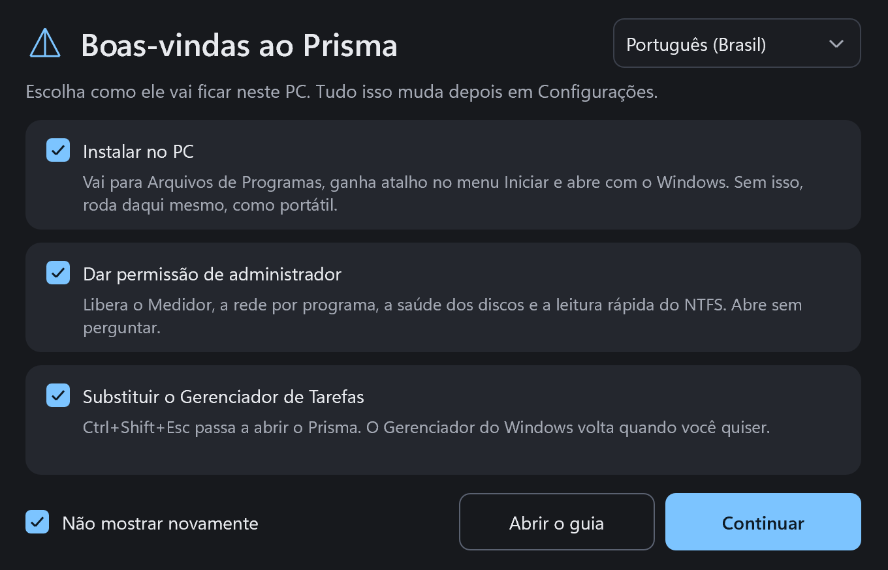
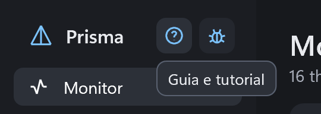
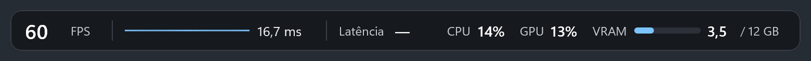
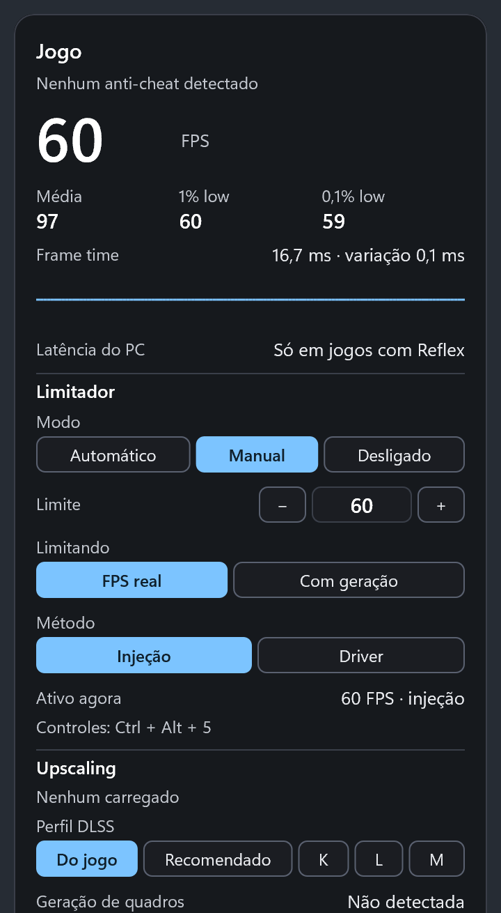
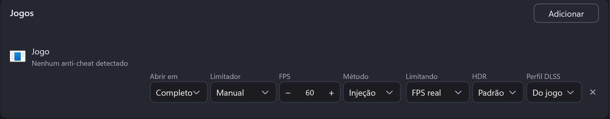

# Guia do Prisma

[English](GUIDE.md)

## Primeiros passos

O Prisma é um único arquivo, Prisma.exe. Na primeira vez que você abre, ele mostra a tela de boas-vindas com três escolhas, todas marcadas. Desmarque o que não quiser e clique em **Continuar**. O Windows pede a permissão de administrador uma vez e aplica tudo junto.

- **Instalar no PC:** copia o Prisma para Arquivos de Programas, cria o atalho no menu Iniciar, coloca o programa na lista de programas do Windows e faz ele abrir com o Windows. Sem isso, ele roda da pasta onde está, como versão portátil, e as configurações ficam em PrismaData, ao lado do arquivo.
- **Dar permissão de administrador:** o Medidor, a coluna de rede, a saúde dos discos e a leitura rápida do NTFS precisam dela. Instalado, o Prisma abre como administrador sem perguntar. Portátil, o Windows pergunta a cada abertura, porque um arquivo fora de Arquivos de Programas pode ser trocado por outro programa.
- **Substituir o Gerenciador de Tarefas:** Ctrl+Shift+Esc passa a abrir o Prisma. Só funciona na versão instalada: numa pasta comum, qualquer programa poderia trocar o arquivo que o atalho abre, e o atalho vale para todas as contas do PC. Sem marcar Instalar no PC, essa opção fica apagada.
- **Não mostrar novamente:** vem marcado, então a tela aparece uma vez. Desmarcado, ela aparece toda vez que o programa abrir de novo. Dá para mudar em Configurações.

A tela também tem o seletor de idioma. O Prisma começa no idioma do Windows: português no Windows em português e inglês nos demais.

Tudo isso pode ser mudado depois em **Configurações**. O Prisma fica na bandeja do Windows: fechar a janela não encerra o programa. Para sair, use o menu do ícone na bandeja.

## Guia e Reportar bug

Os dois ficam ao lado do nome Prisma, no alto da janela, sempre à vista. Passe o mouse em cima para ver o que cada botão faz.

## Monitor

Mostra o que está usando o PC agora: CPU por núcleo, GPU, RAM e VRAM, e o uso de CPU, RAM, GPU, VRAM, disco e rede de cada programa.

- **Dá para:** finalizar uma tarefa, ver os detalhes, abrir o local do arquivo, pesquisar online e ver as propriedades com o botão direito. A coluna PID mostra o número de cada programa; um programa com vários processos mostra um traço, e a aba Detalhes lista cada processo com o seu PID.
- **Buscar:** o campo ao lado das abas filtra a lista pelo nome do programa ou do arquivo. Digite só números para achar pelo PID.
- **Reiniciar o Explorer:** quando a barra de tarefas, o menu Iniciar ou a área de trabalho travam. O Prisma pergunta antes, fecha o Explorer pelo PID e ele volta sozinho em alguns segundos. As janelas de pasta abertas fecham.
- **Não dá para:** ver temperatura e consumo da CPU, porque isso exige um driver de kernel. A coluna de rede exige o Prisma como administrador. A temperatura da GPU depende do driver da NVIDIA.

## Medidor

Mostra o desempenho por cima do jogo e limita o FPS. As leituras vêm dos eventos do Windows, sem nada dentro do jogo. Precisa do Prisma como administrador.

Ele só aparece quando você pede: pelos atalhos, ou sozinho nos jogos que você adicionar à lista da aba Medidor. Para ele aparecer em todo jogo, escolha Em todos, menos os da lista em Quando o medidor liga.

### Barra compacta

Fica no alto da tela e mostra o FPS, a linha de frame time, a latência, CPU, GPU e VRAM. Escolha se ela fica à esquerda, no centro ou à direita. Atalho: Ctrl + Alt + 1.

A linha mostra como os quadros variam. Linha reta quer dizer quadros regulares. Variações de até 1 ms são ignoradas, e picos grandes indicam travadas.

### Painel completo

Fica à direita ou à esquerda da tela e mostra tudo em uma coluna. Atalho: Ctrl + Alt + 2. Na aba Medidor você escolhe o que aparece e a opacidade.

- **FPS e médias:** o número grande é o FPS de agora. 1% low e 0,1% low mostram os piores momentos. Quanto mais perto da média, mais estável o jogo está.
- **Frame time:** o tempo de cada quadro, em milissegundos. Variação baixa é bom.
- **Latência do PC:** só aparece em jogos com Reflex.
- **Upscaling, geração de quadros e Reflex:** mostra o que foi carregado pelo jogo.

Para usar os botões do painel dentro do jogo, aperte **Ctrl + Alt + 5**. Isso libera o mouse e o teclado: as setas andam pelas opções e mudam a escolhida, e o clique também funciona. Para escrever o limite, digite o número e aperte Enter. Aperte o atalho de novo, ou Esc, para voltar ao jogo. Ctrl + Alt + 0 esconde o medidor e zera as medições.

### Limitador de FPS

Com o limitador ligado, cada jogo guarda o próprio limite. Na lista de jogos da aba Medidor você escolhe modo, limite, método e o que está sendo limitado.

- **Limitador:** Manual usa o número que você escolher. Automático mede 5 minutos de jogo e escolhe um limite que o jogo sustenta.
- **Método Injeção:** o padrão. Um pequeno módulo do Prisma entra no jogo e o limite muda na hora, em DirectX 10, 11 e 12.
- **Método Driver:** grava o limite no driver NVIDIA. Só vale a partir da próxima vez que o jogo abrir.
- **Limitando:** FPS real conta os quadros que o jogo produz. Com geração considera os quadros que vão para a tela.
- **Perfil DLSS:** escolhe o perfil que o driver NVIDIA usa naquele jogo. Vale ao reabrir o jogo.
- **Atalhos:** Ctrl + Alt + 3 liga e desliga. Ctrl + Alt + seta para cima ou para baixo muda o limite. O limite vai de 20 a 1023.

Se a injeção falhar, se o jogo cair ou se houver anti-cheat detectado, o Prisma passa sozinho para o driver e avisa.

- **Não use injeção em jogos online.** A detecção de anti-cheat reconhece arquivos e títulos conhecidos, mas não achar nada não prova que o jogo não tem. Nesses jogos, escolha o método Driver.
- **Não dá para:** usar injeção em DirectX 9 e Vulkan. Esses jogos usam o limite do driver, que vale ao reabrir. O limite pelo driver exige placa NVIDIA. Em tela cheia exclusiva, a barra pode não aparecer.

### Registro de dados

Grava o desempenho para estudar depois. Só roda se você ligar, na aba Medidor ou com Ctrl + Alt + 4. Escolha 1, 5 ou 10 minutos de jogo, ou sem limite.

Os arquivos ficam em Documentos, Prisma, Logs: cada quadro, cada segundo, a CPU de cada thread do jogo e um resumo no final. Em jogos com anti-cheat detectado, a leitura de threads fica desligada.

## Discos e redes

Mostra velocidade, tempo ativo e espaço de cada disco, com nota de saúde pelo SMART: Bom, Atenção ou Risco, inclusive em HDs USB. Cada rede mostra velocidade, endereço e total transferido.

- **Não dá para:** tratar a nota como garantia. Um disco pode falhar sem aviso. A saúde exige o Prisma como administrador.

## Espaço em disco

Analisa um disco inteiro e mostra pastas, maiores arquivos, tipos e um mapa visual.

- **Dá para:** abrir no Explorador e, como administrador, mandar para a Lixeira.
- **Não dá para:** usar a leitura rápida sem administrador ou em disco que não seja NTFS.

## Pesquisar

Acha arquivos e pastas pelo nome em todos os discos, enquanto você digita. Vem desligada: aperte **Ligar** na aba Pesquisar.

O Prisma guarda os nomes de todos os arquivos num índice, na memória e no disco, para responder na hora e já estar pronto ao abrir. O índice usa cerca de 70 MB a cada milhão de arquivos: um disco de sistema com 2 milhões de arquivos fica perto de 140 MB. Com o Prisma como administrador, ele lê a tabela do NTFS em segundos e se atualiza no momento em que um arquivo é criado, renomeado ou apagado. Sem administrador, ou em disco que não seja NTFS, ele percorre as pastas, o que demora mais, e atualiza a cada 15 minutos.

- **Janelinha:** Ctrl + Alt + Espaço abre uma caixa de pesquisa por cima de qualquer programa, com até oito resultados. Enter abre, Ctrl + Enter mostra na pasta, Ctrl + C copia o caminho e Esc fecha. As setas andam pela lista.
- **Na aba:** a lista completa, com nome, pasta, tamanho e data. Clique no título de uma coluna para ordenar, de novo para inverter e uma terceira vez para voltar à relevância. Clique duas vezes para abrir. O botão direito abre, mostra na pasta ou copia o caminho.
- **Como pesquisar:** maiúsculas e acentos não contam, então "relatorio" acha "Relatório". Várias palavras precisam aparecer todas. Use aspas para um trecho com espaço, `ext:pdf;docx` para tipos, `pasta:` só para pastas, `arquivo:` só para arquivos, `*` e `?` como curinga no nome inteiro, `!palavra` para tirar e uma barra, como `fotos\2024`, para procurar no caminho.
- **Programas:** programas do menu Iniciar que combinam com o texto, até três, aparecem no topo, inclusive os da Microsoft Store. Enter abre, Ctrl + Shift + Enter abre como administrador e Ctrl + Enter mostra na pasta. Vem ligado.
- **Internet e IAs:** o texto vira uma linha para pesquisar no navegador padrão ou perguntar a uma IA. Se parece pergunta, porque termina com "?" ou começa com como, qual, o que e parecidos, essas linhas vêm no topo; senão, depois dos primeiros arquivos. Em Opções, escolha quais aparecem: Google, Bing, DuckDuckGo e Brave Search, e as IAs Claude, ChatGPT, Gemini, Copilot, Perplexity, Grok e DeepSeek. Sem escolha, vêm o Google e as IAs instaladas. Uma IA instalada abre no aplicativo dela; senão, abre o site. Quando não dá para levar a pergunta pronta, ela vai copiada e é só colar com Ctrl + V. Vem ligado.
- **Comandos:** comece com `>` para rodar um comando, como `>ipconfig /all`. Aparecem Rodar no PowerShell e Rodar no CMD: Enter roda sem administrador, mesmo com o Prisma como administrador, e Ctrl + Shift + Enter roda como administrador, pedindo a permissão ao Windows. O comando abre no terminal padrão do Windows, que fica aberto. Enquanto você digita, aparecem sugestões de comandos, parâmetros e pastas; Tab aceita a selecionada ou a primeira. A lista sai do próprio Windows na primeira vez (os comandos do PowerShell com os parâmetros, os do CMD com a descrição e os programas do PATH), demora uns minutos e fica guardada. Vem desligado.
- **Completar como o terminal:** com os comandos ligados, um PowerShell escondido completa como o terminal, com caminhos, parâmetros e o histórico do PowerShell. Ele fecha sozinho depois de 2 minutos parado. Vem desligado.
- **Opções:** escolha os discos e o atalho, o que mais aparece na pesquisa, leia os discos de novo ou desligue. Ler os discos de novo também refaz a lista de comandos. Desligar tira o índice da memória e do disco.
- **Disco com problema:** discos com nota abaixo de Bom em Discos e redes ficam de fora, para o índice não forçar um disco que está falhando. Dá para incluir clicando nele em Opções.
- **Abrir:** os arquivos abrem pelo Explorador, com o programa padrão e sem herdar o administrador do Prisma.

## Inicialização

Liga, desliga, adiciona e remove o que abre com o Windows, e mostra quem assinou cada programa. Ordena por nome, ativados ou desativados.

## Serviços

Mostra a descrição de cada serviço. Dá para iniciar, parar e reiniciar. O botão direito abre as propriedades na janela do próprio Windows.

## Desinstalar

Remove programas em lote, cria ponto de restauração, procura o que sobrou e informa o que foi excluído.

- **Segurança:** só vem marcado o que tem o nome exato. Nomes parecidos aparecem para você conferir, pastas vão para a Lixeira e o registro ganha backup antes.

## Ajustes do Windows

Primeiro uma auditoria que só lê o PC. Depois os perfis Jogo, Desenvolvimento e Privacidade, em camadas, só com ajustes de efeito documentado. A aba Fora da lista explica o que ficou de fora e por quê.

- **Dá para:** desfazer. Cada mudança guarda o valor anterior, e Desfazer só restaura o que ninguém mexeu depois. **Ver log** mostra cada mudança, com o antes e o depois.
- **Não dá para:** esperar mais FPS: o ganho é privacidade e menos ruído. Nenhum perfil toca em atualizações, antivírus, UAC, Integridade da Memória ou virtualização. Apps removidos voltam pela Loja, e a volta pode falhar.

## Ferramentas

Reúne reparo do Windows (DISM e depois SFC), histórico de falhas, Windows Update, verificação de disco, rede, DNS, limpeza, winget, diagnóstico e reinício avançado. Cada ferramenta guarda o próprio passo a passo, com o comando exato, a saída, os erros e o tempo de cada etapa.

- **Não dá para:** usar os modos que escrevem em disco suspeito. Eles ficam bloqueados.

## Otimizar

Sugere o que fechar antes de jogar e sempre pergunta. Blacklist nunca fecha, Whitelist sempre fecha, e a detecção automática sugere nomes para as duas listas. Atalho: Ctrl + Alt + O.

Se você quiser, uma pergunta pequena aparece no canto superior direito quando um jogo abre, e some em 10 segundos. Ela vem desligada: ligue em Energia, no quadro Ao entrar em modo jogo, com Perguntar se quero otimizar.

## Energia

Detecta jogo ou carga alta e troca o plano de energia. Volta ao repouso depois de 60 segundos sem carga. Você escolhe a porcentagem e o tempo que contam como carga.

Conta como jogo o programa em foco que cobre a tela e usa a GPU ele mesmo, ou que mora na pasta de jogos da Steam, Epic, GOG ou Xbox. Navegadores, players de vídeo, acesso remoto como o Parsec, Discord, OBS e lançadores nunca contam, mesmo em tela cheia.

- **Dá para:** editar um plano com todas as opções que o Windows registra, inclusive as ocultas, e importar ou exportar arquivos .pow. A primeira edição guarda uma cópia do plano original.
- **Limite:** os planos do Prisma são criados só na versão instalada.

## Fullscreenizer

Deixa a janela em foco em tela cheia sem bordas. Atalho: Ctrl + Alt + F. Quem usa uma vez entra numa lista salva, onde dá para marcar Automático e aplicar sempre que o programa abrir.

- **Não dá para:** usar com jogo em tela cheia exclusiva. Coloque o jogo em modo janela antes.

## Som

Controla o volume de cada programa. As teclas de volume do teclado, com um modificador (Ctrl por padrão), mudam só o programa em foco. O Prisma lembra o volume de cada programa.

- **Dá para:** escolher o aparelho de saída e o de entrada de cada programa, e adicionar programas à mão.
- **Manter o som acordado:** toca um fluxo sem som audível, para HDMI e Dolby não cortarem o começo do próximo som. Para sozinho depois de 10 minutos sem uso.
- **Limite:** a troca de aparelho usa um recurso interno do Windows, e alguns programas só trocam ao reabrir.

## HDR

Painel de leitura com o modo da tela, o perfil de calibração ativo, o brilho que cada fonte declara, o que o Windows informa aos jogos, o Dolby Vision declarado e os formatos de som aceitos. Avisa quando algo não confere.

- **Calibração:** abre padrões de teste em tela cheia e grava um perfil por modo de imagem da TV.
- **Auto HDR por jogo:** força, desliga ou deixa com o Windows, em jogos DX11 e DX12, sem injetar nada.
- **Teste de atraso do som:** toca um clique junto de um clarão, para comparar com e sem som espacial.
- **Não dá para:** mudar o que a TV faz: o perfil só informa o Windows, e o Windows pode continuar informando os valores antigos aos jogos por um tempo. A leitura direta da ficha da tela existe só em placas NVIDIA.

## Captura

Tira foto com anotações e grava vídeo em AV1, HEVC ou H.264. Com a tela em HDR, grava em SDR ou HDR10. O vídeo fica na pasta que você escolher.

- **Gravar Janela e Gravar Tela:** Ctrl + Alt + R grava a janela em foco e Ctrl + Alt + T grava a tela inteira. Com Som do sistema ligado, grava todos os sons do PC. Desligado, Gravar Janela grava só o som daquela janela.
- **Foto:** Ctrl + Alt + P seleciona uma área, Ctrl + Alt + A pega a tela inteira e Ctrl + Alt + J pega a janela em foco. Enter ou Ctrl + C copia, Ctrl + S salva, Ctrl + Z desfaz e Esc cancela.
- **Replay:** em modo jogo, guarda os últimos segundos na memória. Ctrl + Alt + B salva.
- **Não dá para:** capturar conteúdo protegido, como Netflix, que sai preto. H.264 não tem 10 bits: gravar em HDR10 usa HEVC. Gravar exige codificador de vídeo na GPU.

## Widget

Mostra CPU, GPU, RAM e VRAM por cima de tudo, em quatro estilos. Arraste para mudar de lugar. Atalho: Ctrl + Alt + W.

## Configurações

- **Início com o Windows e administrador:** ligue ou desligue quando quiser. Mudar isso na versão instalada pede a permissão do Windows.
- **Substituir o Gerenciador de Tarefas:** ativa ou devolve. A desinstalação também devolve. Algumas versões do Windows protegem essa troca até de administrador. Nesse caso o Prisma avisa e passa a pegar o Ctrl+Shift+Esc ele mesmo, enquanto estiver aberto, e o cartão mostra "Ligado pelo atalho". O Ctrl+Alt+Del e o menu da barra de tarefas continuam abrindo o Gerenciador do Windows. Na versão portátil só dá para desativar.
- **Fechar à força:** um atalho, Alt + F4 por padrão, encerra na hora o programa em foco, mesmo travado em tela cheia. O que não foi salvo é perdido. A área de trabalho, a barra de tarefas e os processos do Windows continuam com o Alt + F4 normal.
- **Reiniciar o Explorer:** escolha um atalho, que vem sem nenhum. Como ele fecha a barra de tarefas, é preciso apertar duas vezes em até 4 segundos: o primeiro toque só avisa. O botão ao lado do nome reinicia na hora, depois de perguntar.
- **Idioma:** português do Brasil ou inglês.
- **Atualizações:** veja a seção abaixo.
- **Mostrar as boas-vindas ao abrir:** traz a tela inicial de volta.

Cada tela tem um botão **Padrão**, que volta as opções só daquela tela.

## Atualizações

Com a busca automática ligada, o Prisma procura uma versão nova uma vez por dia no GitHub, sem enviar dados seus. Quando você abre a janela e há versão nova, ele pergunta se quer atualizar. Minimizado ou na bandeja, ele não interrompe.

- **Sim:** baixa, confere o arquivo, troca o programa e reinicia, com as suas configurações. A versão instalada pede a permissão do Windows se não estiver como administrador.
- **Não:** ele pergunta de novo na próxima vez que a janela abrir.
- **Não mostrar de novo:** desliga a busca automática. Para religar, marque a opção em Configurações, onde também há **Procurar agora**.
- **Novidades:** depois de atualizar, o Prisma abre com o que mudou em cada versão desde a que você usava, mesmo pulando várias. Para ver de novo, clique em **Novidades** ao lado da versão, em Configurações.

## Reportar bug

Clique no botão do inseto, no alto da janela. Escolha a função, a gravidade, descreva o que aconteceu e junte uma foto, se quiser. O navegador abre o GitHub com tudo escrito e você só confirma.

- **Privacidade:** dá para incluir dados do PC e um registro curto, sem nome de usuário, nome do PC ou caminhos de arquivo. A página do GitHub é pública, e você vê tudo antes de enviar.
- **Falhas:** se o Prisma cair, ele guarda um relatório na pasta de dados e avisa na próxima abertura. O arquivo fica só no seu PC.

## Atalhos

Todos podem ser trocados no programa.

- **Ctrl + Alt + F:** Fullscreenizer
- **Ctrl + teclas de volume e mudo:** volume do programa em foco
- **Ctrl + Alt + W:** Widget
- **Ctrl + Alt + O:** Otimizar
- **Ctrl + Alt + Espaço:** pesquisar arquivos, com a pesquisa ligada
- **Alt + F4:** Fechar à força
- **Ctrl + Alt + 1:** medidor compacto
- **Ctrl + Alt + 2:** medidor completo
- **Ctrl + Alt + 0:** esconder o medidor
- **Ctrl + Alt + 5:** controles do medidor
- **Ctrl + Alt + 3:** ligar ou desligar o limitador
- **Ctrl + Alt + seta para cima ou para baixo:** aumentar ou diminuir o limite
- **Ctrl + Alt + 4:** registro de dados
- **Ctrl + Alt + P, A e J:** foto da área, da tela e da janela
- **Ctrl + Alt + R e T:** gravar janela e gravar tela
- **Ctrl + Alt + B:** salvar replay

## Limites gerais

- Windows 11 de 64 bits.
- Sem temperatura e consumo da CPU.
- Os textos que vêm do próprio Windows, como descrições de serviços, ficam no idioma do Windows.
- Tudo que o Prisma muda no sistema fica registrado em acoes.log, na pasta de dados.
- O arquivo não tem assinatura digital, então o Windows pode avisar sobre editor desconhecido.
