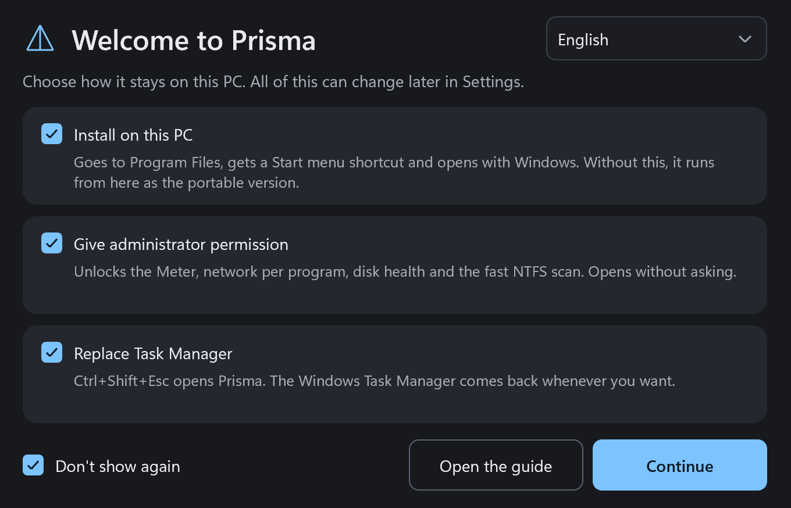
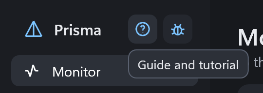
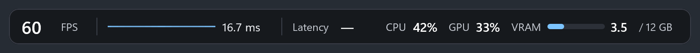
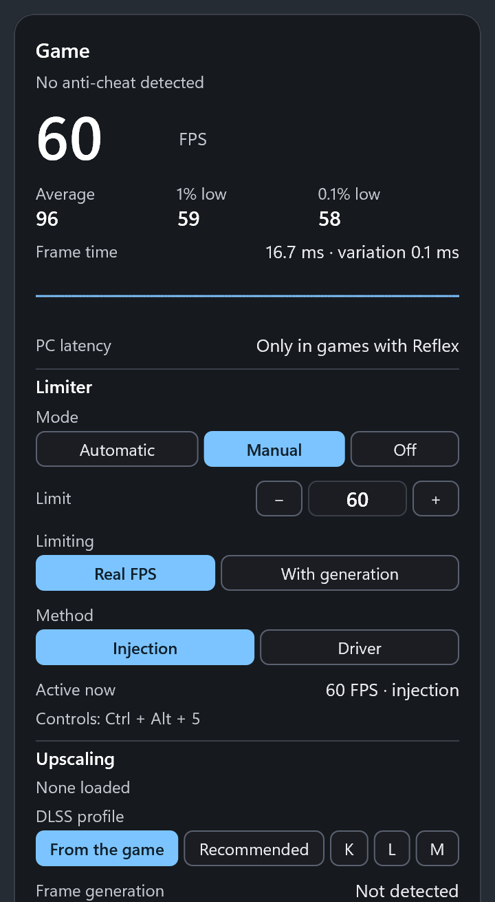
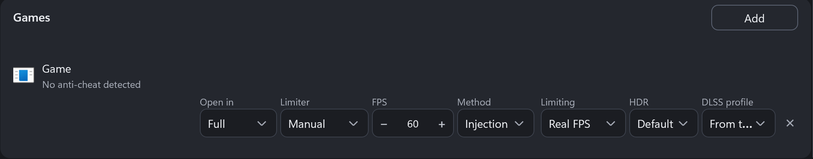
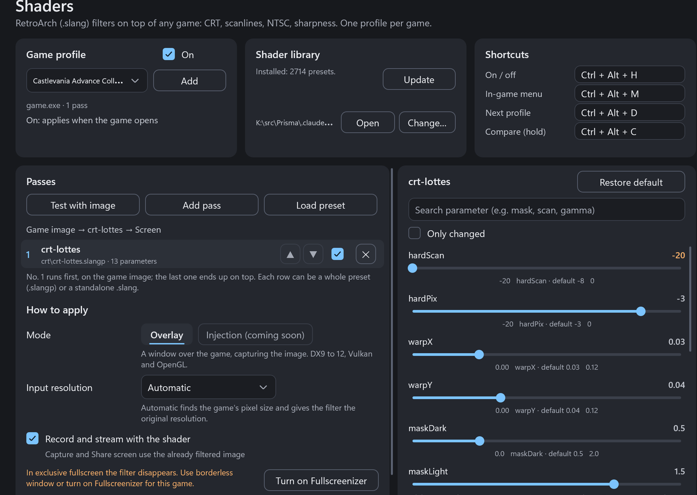
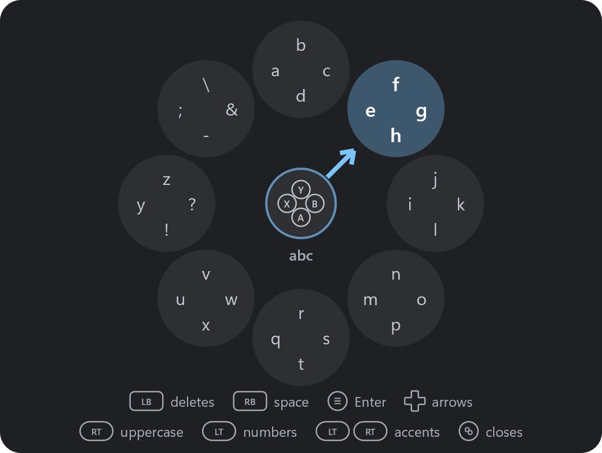
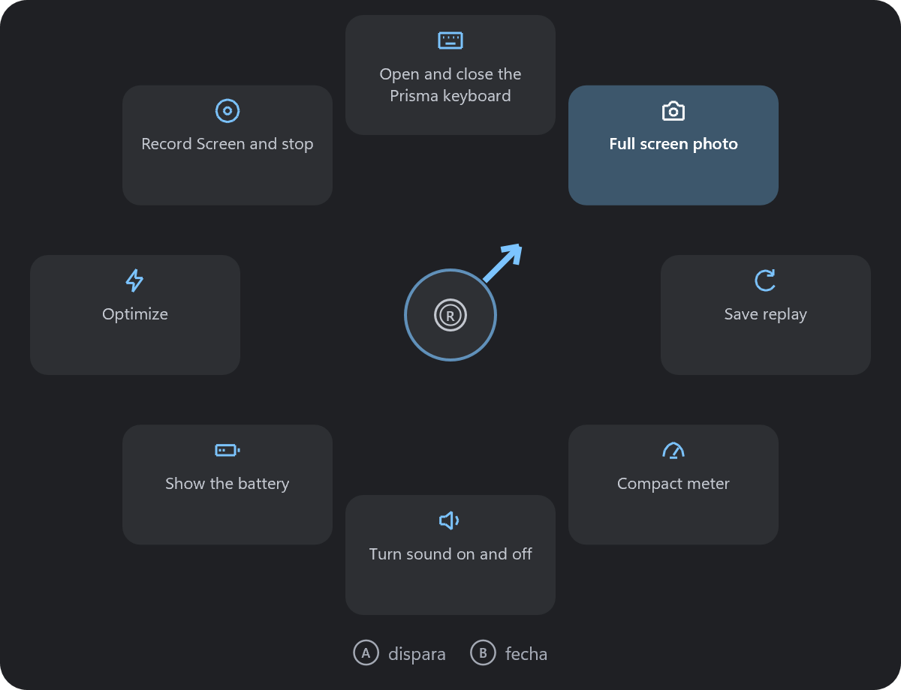

# Prisma Guide

[Português](GUIA.md)

## Getting started

Prisma is a single file, Prisma.exe. The first time you open it, the welcome screen shows four choices. The first three come checked; **Replace the Windows copy** (Explorer's Ctrl+V through the Prisma copy window) comes unchecked. Uncheck what you don't want and click **Continue**. The second step, **Prisma features**, lists the features with what each one does, all on: uncheck the ones you won't use (each mark applies right away) and click **Continue** again. Windows asks for administrator permission once and applies everything together.

- **Install on this PC:** copies Prisma to Program Files, creates a Start menu shortcut, adds it to the Windows program list and makes it start with Windows. Without this, it runs from its current folder as the portable version, and settings stay in PrismaData, next to the file.
- **Give administrator permission:** the Meter, the network column, disk health and the fast NTFS scan need it. Installed, Prisma opens as administrator without asking. Portable, Windows asks every time, because a file outside Program Files can be replaced by another program.
- **Replace Task Manager:** Ctrl+Shift+Esc opens Prisma. It works only in the installed version: in an ordinary folder, any program could swap the file the shortcut opens, and the shortcut applies to every account on the PC. Without Install on this PC checked, this option is grayed out.
- **Don't show again:** checked by default, so the screen appears once. Unchecked, it appears every time the program opens again. You can change this in Settings.

The screen also has the language selector. Prisma starts in the Windows language: Portuguese, English, Spanish, Russian or Simplified Chinese, following Windows, and English on all others.

All of this can be changed later in **Settings**. Prisma stays in the Windows tray: closing the window does not end the program. To exit, use the menu on the tray icon.

The sidebar splits the pages into five groups: **System**, **Maintenance**, **Games and display**, **Input and sound** and **Prisma**. The open page is marked with a blue line on the left and a blue icon. In a short window the group names go away and only a gap is left between groups.

## Guide and Report a bug

Both sit next to the Prisma name, at the top of the window, always in view, together with the Ko-fi button to support Prisma. Hover over a button to see what it does. In the guide, clicking a topic on the left jumps straight to it.

## Monitor

Shows what is using your PC right now: CPU per core, GPU, RAM and VRAM, plus the CPU, RAM, GPU, VRAM, disk and network use of each program.

- **You can:** end a task, go to details, open the file location, search online and see properties with the right mouse button. The PID column shows each program's number; a program with several processes shows a dash, and the Details tab lists each process with its own PID.
- **Search:** the field next to the tabs filters the list by program or file name. Type only numbers to find a PID.
- **Sort by name:** clicking **Program** sorts by name and splits the list like Task Manager: **Apps** (programs with an open window) on top, then **Background processes** and **Windows processes**, each group with its count.
- **Restart Explorer:** for when the taskbar, the Start menu or the desktop freezes. Prisma asks first, ends Explorer by its PID and it comes back on its own in a few seconds. Open folder windows close.
- **Performance:** clicking a CPU, GPU, RAM or VRAM card opens the Performance page on that section.
- **You can't:** see CPU power, because it requires a kernel driver. CPU temperature shows on the Performance page, with PawnIO. The network column requires Prisma as administrator. GPU temperature depends on the NVIDIA driver.

## Performance

Shows GPU, CPU, RAM and VRAM in four sections, chosen in the selector at the top of the page. Each one has its use, charts of the last 60 seconds, and the list of programs that use that part of the PC.

- **GPU:** total use, core and memory clock, temperature and power, and the reason the clock is below its maximum. Clock, power and reason show only with an NVIDIA card; with AMD or Intel a dash shows. Besides the use chart, 60-second charts show the core clock (NVIDIA only; on other cards a dash shows) and the temperature. It also shows the use of each engine (3D, Copy, Encode, Decode and Compute).
- **CPU:** total use, clock, processes, threads and uptime, with the use and clock of each thread. In the program table, **Busiest thread** shows how much of one core the program's busiest thread uses, and **Priority** shows the process's base priority, from Low to Realtime. Temperature needs PawnIO: without a reading a dash shows, plus a button to install it if PawnIO is missing.
- **RAM:** a bar with memory in use, modified, standby (cache) and free. It also shows committed, cache, paged and non-paged pools, available, and the memory sticks (type, speed and slots).
- **VRAM:** dedicated, shared (shared comes from RAM) and how many programs use the card. The bar shows each program's dedicated memory, and the table shows the dedicated and shared memory of each one. A **GPU budget** card shows how much VRAM Windows lets each program use on that card (it comes from DXGI). The **Peak (session)** column holds the program's highest dedicated VRAM since the readings started; it resets when the readings stop, that is, when the page closes with **Measure with the window closed** off.
- **Program detail:** click a row in the table to see everything measured for that program, including its busiest thread, priority and VRAM peak. There you find **Open in Meter** (sends the program to the Meter, where the FPS limit is) and **End task** (asks first). Clicking the row again closes the detail.
- **Measure with the window closed:** keeps the extra readings running all the time, so the charts are ready when you open the page. Off by default: then these readings run only while the page is open.

## Games

Each game's settings in one place. The tab does not launch the game: it gathers what the other tabs keep for it and saves to the same place they do, so changing it here or in the source tab is the same.

- **List:** **With profile** has the games with any setting, with the names of the adjusted functions on the right and, under the name, tags with the graphics API and the anti-cheat; **No profile**, the others. You can search by name and sort by name, store or size. An exe that is gone from its path shows **exe not found**.
- **Where games come from:** with the Prisma Launcher open, Steam, Epic, GOG and Xbox games arrive by themselves, with a notice when new games arrive. Without it, the list has the games added by hand and those that already have a setting in some tab. **Add .exe or .dll…** adds one file; **Scan folder…** looks for the games in a folder, suggests each one's exe (with the reason, the graphics API and whether it is an emulator or has anti-cheat) and only adds the ones checked in **Is a game**, with the name you type. When the Search file index is already loaded for that drive, the scan is instant; without it, Prisma walks the folders.
- **When the game runs through another exe:** if a game added by hand opens through a launcher and the Meter sees another exe from the same folder running, Prisma switches the game's exe to that one and lets you know.
- **The open game:** click a game to see its folder, the graphics API (DirectX 9 to 12, Vulkan or OpenGL; **probable** when it comes from the folder's files, without reading the exe; **seen running** when the Meter saw the game load the API, which beats the guess) and whether it has anti-cheat, with its name when known. Below comes one section per function: **Meter and FPS limiter**, **HDR**, **Sound**, **Power**, **Controller**, **Shader**, **Fullscreenizer** and **NVIDIA driver**. Each one says whether it is at default or adjusted, has **Open in the … tab** and, where possible, **Reset to default**, which clears only that function for the game; for **Shader** and **NVIDIA driver** Prisma asks first. The section of a function turned off in Settings does not show. In **Controller**, when the game is in more than one profile, the section lists the others.
- **Copy settings from…:** opens a window with a search field; typing filters the games with settings, and clicking one asks to confirm. Where the other game has a setting (Meter, Power, HDR, Sound, Controller, Shader and Fullscreenizer), this game's is replaced by it; the NVIDIA driver is not copied.
- **Ask the AI:** shows when there is a Gemini key in Safe updates. The AI looks the game up on PCGamingWiki and answers with the exe, the APIs, the anti-cheat and whether the game has its own HDR. Nothing changes by itself: **Accept** marks whether the game has its own HDR and, for a game added by hand, switches the exe when the suggested one is in the game's folder; **Discard** clears the answer.
- **NVIDIA driver:** if the driver already has a profile for the game, the section shows its name. Without one, **Create profile (follows global)** creates an empty one that keeps following the global; **Create with a copy of global** saves the global's current values in the new profile, and from then on changing the global no longer changes that game.
- **Remove from list:** only for games added by hand. The settings in the other tabs stay saved.
- **Delete:** for a game with **exe not found** (uninstalled). After you confirm, the game leaves the list and its settings in every tab are deleted. Until then, they stay saved.

## Meter

Shows performance over the game and limits FPS. Readings come from Windows events, with nothing inside the game. It needs Prisma as administrator.

It only shows up through the shortcut, and measures the program in focus when you press it. Turning it on by shortcut in a game adds that game to the list, to keep its limit, HDR and profile; pressing the same shortcut again hides the meter, and the game stays on the list. **Add from the program list** also brings the games installed through Steam and Epic.

- **Automatic HDR:** turns on Windows HDR when the game opens and off when it closes. If HDR was already on, it stays on. **Only for listed games** covers the games on the list; **All** covers every game the Power game mode recognizes, and **Do not turn on**, in the list, leaves a game out.

### Compact bar

Sits at the top of the screen and shows FPS, the frame time line, latency, CPU, GPU and VRAM. Choose left, center or right. Shortcut: Ctrl + Alt + 1.

In **Extra in the compact bar**, on the Meter page, you add RAM, CPU temperature, GPU temperature and the power plan. Each temperature sits next to its usage.

With a listed game in focus, the bar shows the limiter mode: **No limit**, **Auto** with the limit (or **Auto: measuring** in the first 5 minutes) or **Manual** with the limit. It lights up when the limit is acting, by injection or by the driver, and stays dim when it is not. With a Prisma shader on screen (Overlay or Injection), the **Shader** badge shows; with Prisma HDR acting on the game, including when it improves the game's own HDR, **Prisma HDR** shows. No numbers: the cost of each is in the full panel.

The line shows how frames vary. A straight line means even frames. Variations up to 1 ms are ignored, and large spikes point to stutter.

### Full panel

Sits on the right or left of the screen and shows everything in one column. Shortcut: Ctrl + Alt + 2. In the Meter page you choose what appears and the opacity.

- **FPS and averages:** the big number is the current FPS. 1% low and 0.1% low show the worst moments. The closer they are to the average, the steadier the game.
- **Frame time:** the time of each frame, in milliseconds. Low variation is good.
- **PC latency:** appears only in games with Reflex.
- **Upscaling, frame generation and Reflex:** shows what the game loaded.
- **CPU temperature:** appears below the CPU. Windows does not give this reading by itself, so it needs PawnIO, a free, open driver signed by Microsoft, the same kind of driver Steam uses. On the Meter page, **Install PawnIO** downloads the official installer, checks its signature and opens it for you to accept. To remove it later, use Windows Installed apps. Without it, the line says Needs PawnIO.
- **Power plan:** shows the Windows plan in use. With the controls open, click it (or press Enter) to open the list and pick another; the arrows switch to the next one.
- **Prisma shader and HDR:** with a game open, **Shader menu** opens the in-game shader menu (with no profile it creates one, like Ctrl + Alt + M) and **HDR menu** opens the in-game Prisma HDR menu, like Ctrl + Alt + I (if the game is not running with Prisma HDR, it opens the HDR page, where you turn it on). With the arrow keys (after Ctrl + Alt + 5), left opens the shader one and right the HDR one. With a shader or Prisma HDR on screen, each gets a line with the profile, the GPU time in ms and the share of the GPU, for example **Shader · game-crt: 1.20 ms · 7.5% of GPU**.

The panel buttons work right away: with the cursor over the panel, clicks go to it, and outside it the mouse and keyboard stay with the game, which stays in front. To use the keyboard in the panel, press **Ctrl + Alt + 5**, which unlocks the keyboard too: arrows move through the options and change the chosen one, and clicks work too. To write the limit, type the number and press Enter; clicking the limit number unlocks the keyboard too. Press the shortcut again, or Esc, to go back to the game. For the old way, where the panel takes the mouse only after the shortcut, turn on **Use the full meter only after the Controls in the meter shortcut** in the Meter page. Ctrl + Alt + 0 hides the meter and resets the readings.

### FPS limiter

With the limiter on, each game keeps its own limit. In the game list on the Meter page you choose the mode, limit, method and what is being limited.

- **Limiter:** Manual uses the number you choose. Automatic measures 5 minutes of play and picks a limit the game can hold.
- **Injection method:** the default. A small Prisma module enters the game and the limit changes right away, in DirectX 10, 11 and 12.
- **Driver method:** writes the limit to the NVIDIA driver. It applies only the next time the game opens.
- **Limiting:** Real FPS counts the frames the game makes. With generation counts the frames that reach the screen.
- **DLSS profile:** chooses the profile the NVIDIA driver uses for that game. It applies on reopening the game. It only appears for games that ship DLSS; for the others, the column says No DLSS.
- **Auto HDR:** the same Auto HDR per game choice as the HDR tab (Default, Off, Auto HDR, Auto 10 bits, RTX HDR or Prisma). Changing it here changes it there.
- **Power:** the Windows power plan that turns on when the game opens. When it closes, the previous plan comes back, unless someone changed it in between. **Don't change** leaves it as it is, and then automatic Power applies.
- **Remove from the list after not opening for:** a game unused for 7, 14, 30, 60 or 90 days leaves the list, so it doesn't grow too long. Its choices stay saved and apply when it opens again, and it comes back to the list. **Show all** also shows the unused ones. The default is never.
- **Shortcuts:** Ctrl + Alt + 3 switches the mode of the game in focus: Automatic, Manual, No limit and back to Automatic. The meter shows the chosen mode. Ctrl + Alt + up or down arrow changes the limit. The limit goes from 20 to 1023.

If injection fails, the game crashes or an anti-cheat is detected, Prisma moves to the driver on its own and tells you. Without Windows frame readings, injection still goes in after 8 seconds of the game in focus, and the reason the readings did not open goes to the actions log.

- **Do not use injection in online games.** Anti-cheat detection recognizes known files and titles, but finding nothing does not prove a game has none. In those games, choose the Driver method.
- **You can't:** use injection in DirectX 9 and Vulkan. Those games use the driver limit, which applies on reopening. The driver limit requires an NVIDIA card. In exclusive fullscreen, the bar may not appear.

### Data log

Records performance to study later. It only runs if you turn it on, on the Meter page or with Ctrl + Alt + 4. Type how many minutes of play to record (5 is the default, 0 is no limit). While it records, the meter says so: the compact bar shows a red dot with **Recording** and the time at its start, and the full panel shows a red band right below the game name.

Files go to Documents, Prisma, Logs: every frame, every second, the CPU of each game thread and a summary at the end. On NVIDIA cards, each second also carries the GPU for optimization work: memory controller use, power against the limit, what held the clock back (power, temperature), PCIe traffic and total VRAM; the top of the file has the driver, the maximum clocks, the power limit and the PCIe link, and the summary says whether the limit was power, temperature or VRAM. The summary also says which limit was in force (by injection or by the driver) and the frame generation: which one the game loaded (DLSS, FSR or XeSS), for how many seconds it was on and by how many times, and whether Lossless Scaling was open. With PawnIO installed, each second also carries the CPU temperature (cpu_c column). Knowing whether it was on depends on Reflex markers; without them, the summary says it was loaded, without measuring. In games with a detected anti-cheat, the thread reading stays off.

## Disks and networks

Shows speed, active time and space of each disk, with a SMART health grade: Good, Warning or At risk, including USB drives. Each network shows speed, address and total transferred.

- **You can't:** treat the grade as a guarantee. A disk can fail without warning. Health requires Prisma as administrator.

## Disk space

Scans a whole disk and shows folders, largest files, types and a visual map.

- **You can:** open items in Explorer and, as administrator, send them to the Recycle Bin.
- **Refresh a folder:** in Folders, **Update** reads only the open folder again, without scanning the whole disk. The new size applies to it and to the folders above it, up to the disk.
- **Files of one type:** click a type in **File types** to see every file of that type on the disk, largest first, with each one's folder. Ctrl + click adds or removes a file from the selection, Shift + click picks a run of files. Right-click opens in Explorer or deletes.
- **Delete permanently:** the selected files are deleted without going to the Recycle Bin and cannot be recovered. First Prisma says how many there are and how much space they free. A file in use or without permission stays and is listed at the end. Windows files, program folders and the page and hibernation files are left out.
- **From Explorer:** with the option on in Settings, right-click a folder, the background of a folder or a drive and choose **See disk space with Prisma**. Prisma scans the disk and opens on that folder. On Windows 11 the entry is under **Show more options**.
- **You can't:** use the fast scan without administrator or on a disk that is not NTFS.

## Search

Finds files and folders by name on all your disks, as you type. It comes off: press **Turn on** in the Search tab.

Prisma keeps the names of every file in an index, in memory and on disk, so it answers instantly and is ready as soon as it opens. The index uses about 70 MB per million files: a system disk with 2 million files comes to about 140 MB. After 10 minutes without a search, the index leaves memory and stays only on disk; the next search brings it back in one to four seconds. With Prisma as administrator, it reads the NTFS table in seconds and updates the moment a file is created, renamed or deleted. Without administrator, or on a disk that is not NTFS, it walks through the folders, which takes longer, and updates every 15 minutes.

- **Pop-up:** Ctrl + Alt + Space opens a search box on top of any program, with up to eight results. Enter opens, Ctrl + Enter shows in folder, Ctrl + C copies the path and Esc closes. The arrows move through the list.
- **In the tab:** the full list, with name, folder, size and date. Click a column title to sort, again to reverse and a third time to go back to relevance. Double-click to open. Right-click opens, shows in folder or copies the path.
- **How to search:** case and accents don't matter, so "relatorio" finds "Relatório". Several words must all appear. Use quotes for a phrase with spaces, `ext:pdf;docx` for types, `folder:` for folders only, `file:` for files only, `*` and `?` as wildcards on the whole name, `!word` to exclude and a backslash, like `photos\2024`, to search the path.
- **Programs:** Start menu programs that match the text, up to three, appear at the top, including Microsoft Store ones. Enter opens, Ctrl + Shift + Enter opens as administrator and Ctrl + Enter shows in folder. On by default.
- **Web and AIs:** the text becomes a row to search in the default browser or ask an AI. If it looks like a question, because it ends with "?" or starts with how, what, why and the like, these rows come at the top; otherwise, after the first files. In Options, choose which ones appear: Google, Bing, DuckDuckGo and Brave Search, and the AIs Claude, ChatGPT, Gemini, Copilot, Perplexity, Grok and DeepSeek. Without a choice, Google and the installed AIs appear. An installed AI opens in its app; otherwise, the site opens. When the question can't be sent ready, it is copied and you just paste it with Ctrl + V. On by default.
- **Commands:** start with `>` to run a command, like `>ipconfig /all`. Run in PowerShell and Run in CMD appear: Enter runs without administrator, even with Prisma as administrator, and Ctrl + Shift + Enter runs as administrator, asking Windows for permission. The command opens in the Windows default terminal, which stays open. As you type, suggestions for commands, parameters and folders appear; Tab accepts the selected one or the first. The list comes from Windows itself the first time (PowerShell commands with their parameters, CMD commands with their description and the programs on the PATH), takes a few minutes and is saved. Off by default.
- **Complete like the terminal:** with commands on, a hidden PowerShell completes like the terminal, with paths, parameters and PowerShell history. It closes by itself after 2 idle minutes. Off by default.
- **Options:** choose the disks and the shortcut, what else appears in search, read the disks again or turn it off. Reading the disks again also rebuilds the command list. Turning off removes the index from memory and disk.
- **Disk with problems:** disks rated below Good in Disks and networks stay out, so the index doesn't strain a failing disk. You can include one by clicking it in Options.
- **From Explorer:** with the option on in Settings, right-clicking a folder, the background of a folder or a drive offers **Search here with Prisma**, which opens the tab with the folder path in quotes in the field: just type the name after it. On Windows 11 the entry is under **Show more options**.
- **Opening:** files open through Explorer, with the default program and without inheriting Prisma's administrator rights.

## Startup

Turns on, turns off, adds and removes what opens with Windows, and shows who signed each program. Sorts by name, enabled or disabled.

## Services

Shows the description of each service. You can start, stop and restart. The right mouse button opens properties in the Windows window itself.

## Uninstall

Removes programs in batches, creates a restore point, looks for leftovers and reports what was deleted.

- **Safety:** only exact name matches come checked. Similar names appear for you to review, folders go to the Recycle Bin and the registry gets a backup first.

## Windows tweaks

First an audit that only reads the PC. Then the Game, Development and Privacy profiles, in layers, with documented tweaks only. The Left out tab explains what stayed out and why.

- **You can:** undo. Each change keeps the previous value, and Undo only restores what nothing else touched afterwards. **Show log** shows each change, with before and after.
- **You can't:** expect more FPS: the gain is privacy and less noise. No profile touches updates, antivirus, UAC, Memory Integrity or virtualization. Removed apps come back through the Store, and that can fail.

## Tools

Brings together Windows repair (DISM then SFC), crash history, Windows Update, disk check, network, DNS, cleanup, winget, diagnostics and advanced restart. Each tool keeps its own step log, with the exact command, output, errors and the time of each step.

- **You can't:** use modes that write on a suspect disk. They stay blocked.

## Copies

The Copies page is in the sidebar, in the Maintenance group, after Tools, with two tabs: **History** and **Copy lists**. At the bottom of the page is the **Ctrl+V in Explorer folders pastes through Prisma** box, the same one as in Settings. The **New copy** button at the top opens a new list already holding the files copied in Explorer.

- **History:** the last 500 copies made by the Prisma copy window, with date, whether it was copied or moved, what, where to, size, number of files and result: Verified, Done, errors, Canceled or No space. **Search history** filters the list. Each row has **Open destination** and **Copy again**, and **Clear history** erases everything. It keeps only paths, sizes and results, in Prisma's data folder (in the portable version, next to Prisma.exe), in the file copias_historico.txt.
- **Copy lists:** one list gathers files and folders from several places into one destination. Fields: **Name**; **What to copy**, with **Add files**, **Add folder** and **Remove from list**; **Where to**, with **Choose**; **When**: **Only when I start it**, **Once** (with day, month, hour and minute), **Every day** or **Days of the week**; **If the file already exists at the destination**: **Skip**, **Replace** or **Keep both**; **Verify with hash (SHA-256)**; and **Move instead of copying**. The buttons are **Copy now**, **Save** and **Delete list**. Lists are kept in the file copias.txt.
- **Scheduled:** a scheduled copy runs only while Prisma is open, in the tray. If the PC was off at the set time, it runs when Prisma opens. Nothing is added to the Windows Task Scheduler, and the scheduled copy window opens without taking focus.

## Safe updates

The Updates page is in the sidebar, in the Maintenance group, after Copies. At the top, **Check now** checks right away. It has three cards: **NVIDIA driver**, **Windows Update** and **Options**.

- **NVIDIA driver:** shows the installed driver and the newest one, from NVIDIA's driver search site, using your graphics card's name. Without an NVIDIA card, the card says so. Next to it are **Download**, **Release notes** (NVIDIA's PDF) and **Reddit discussion** (search for the Game Ready driver megathread on r/nvidia).
- **Windows Update:** lists the pending Windows updates, with title and KB. Blocked ones are marked **Blocked**. Defender definitions don't count as news. Check one or more and use **Block** (hides it from Windows Update until you unblock it), **Unblock** or **Install** (downloads and installs; may ask to restart). **Reddit discussion** searches for the "Cumulative Updates" megathread on r/Windows11 (r/Windows10 on Windows 10).
- **Options:** settings for checking and waiting, described below.

### Verdict

When a new driver or update comes out, Prisma shows a notice at the bottom of the screen. It doesn't judge right away: it waits for the time set in **Wait for reports for** (24 hours, **3 days** by default, or 4 days). Then it searches and shows:

- **Recommended: install** or **Better to wait**.
- **N% without problems (estimate)**. This is an AI estimate from complaints on forums. There are no official statistics, and the screen says so.
- The bugs, each marked **Severe**, **Medium** or **Low**. On the driver card, **Problems NVIDIA admits to** (the Open Issues in the release notes); on the Windows card, **Problems Microsoft admits to** (the known issues on the release health page for that version).
- **Sources**, with links.

**Search now** skips the wait and shows while there is no verdict (and, after a verdict made without a key, when a key is saved). If the search fails, the screen shows the reason and asks you to try again in an hour.

With a Gemini key, the search uses Google, in the r/nvidia and r/Windows11 megathreads, in tech news from the last month (TechPowerUp, Wccftech, Tom's Hardware, Windows Latest, BleepingComputer and others) and in the forums (NVIDIA, Guru3D, Overclockers). It also lists problems that started in earlier versions and remain in the new one, such as excessive SSD writes or high CPU use at idle, even ones the company has not confirmed (marked as unconfirmed). The free quota is over 500 searches per day.

With a DeepSeek, Claude or ChatGPT key, that AI searches with its own web search, in the same sources. DeepSeek, Claude and ChatGPT have no free quota: each search uses a little of the balance in that platform's account.

Without a key, the verdict uses only the official sources: Microsoft's known issues and NVIDIA's Open Issues.

With more than one AI ticked and with a key, all of them search at the same time and Prisma merges them: the problem list from all of them, without repeats (if the merge fails, Prisma merges them itself, severe first); the percentage without problems is the average; and it only says **Recommended: install** if all of them recommend it. Under the verdict, one line per AI: "Gemini: recommends install, 80% without problems" or "DeepSeek: failed (reason)". If one fails, the others count. With only one ticked AI that has a key, only that one is used.

Reddit doesn't allow reading without logging in, so Prisma reaches it through one AI's search and the **Reddit discussion** buttons.

### Options

- **Search with:** four tick boxes, one per AI: **Gemini**, **DeepSeek**, **Claude (Haiku)** and **ChatGPT**. Tick any combination (or none: then only the official sources count). Only Gemini has a free quota; an unticked paid AI is never called (see Verdict).
- **Check:** **Off** (default), **Every day**, **Every 2 days**, **Every 3 days** or **Every week**. Checks run only while Prisma is open or in the tray; no task is added to the Windows Task Scheduler.
- **Wait for reports for:** 24 hours, **3 days** (default) or 4 days.
- **Gemini key**, **DeepSeek key**, **Claude key** and **ChatGPT key:** one key row for each ticked AI, with **Paste key** (uses the clipboard), **Delete key** and the link to get a key: **Get a free key** opens aistudio.google.com/apikey (Gemini); **Get a key** opens platform.deepseek.com/api_keys (DeepSeek), console.anthropic.com/settings/keys (Claude) or platform.openai.com/api-keys (ChatGPT). Only Gemini has a free quota. Keys stay in Prisma's settings and are not written to the action log.
- **Warn before downloading Windows updates and don't replace the video driver through Windows Update:** writes Windows' own policy. Asks for administrator permission. Unchecking it removes those values.

### Permission and undo

- Each Windows Update action asks for administrator permission (UAC) right away. Prisma opens a copy of itself as administrator only for that action. It does not use the Share screen service.
- Everything is reversible: **Unblock** releases a blocked update, and unchecking the policy box removes the values it wrote.
- The Windows Update service (wuauserv) stays on.

## Optimize

Suggests what to close before playing and always asks. Blacklist never closes, Whitelist always closes, and automatic detection suggests names for both lists. Shortcut: Ctrl + Alt + O.

If you want, a small question appears in the top right corner when a game opens, and leaves after 10 seconds. It comes off: turn it on in Power, in the When entering game mode box, with Ask whether to optimize.

## Power

Detects a game or high load and switches the power plan. It goes back to rest after 60 seconds without load. You choose the percentage and time that count as load.

With **Automatic switching** off, the **Fixed plan** box picks a plan that turns on right away and stays until switching comes back, also after restarting Prisma or the PC. If a game changes the plan in between (the Meter's per-game plan, for example), the fixed plan comes back when it closes. With **No fixed plan**, Prisma doesn't change the plan.

A game is the program in focus that covers the screen and uses the GPU itself, or that lives in the Steam, Epic, GOG or Xbox game folders. Browsers, video players, remote access like Parsec, Discord, OBS and launchers never count, even in full screen.

- **You can:** edit a plan with every option Windows registers, including hidden ones, and import or export .pow files. The first edit keeps a copy of the original plan.
- **Plan names:** Prisma's plans are named in the chosen language and are renamed when it changes, without duplicates.
- **Limit:** Prisma's plans are created only in the installed version.

## Fullscreenizer

Makes the window in focus borderless fullscreen. Shortcut: Ctrl + Alt + F. Anything you use it on goes into a saved list, where you can check Automatic to apply it whenever the program opens.

- **Aspect ratio:** **Keep (black bars)**, the default, centers the game on the monitor in its own shape, with black bars in the leftover space (an 800×600 game on a 16:9 monitor gets bars on the sides); a game whose window can change size fills the whole monitor and draws in its own aspect ratio (on a 21:9 ultrawide, no 16:9 bars). **Stretch** covers the whole monitor, as before. **Integer scale** uses the largest multiple of the game's size that fits (640×480 becomes 1280×960 on 1080p), with every pixel the same size; a game larger than the monitor falls back to Keep.
- **Upscale filter:** when the windowed game is smaller than the monitor, Prisma can enlarge the image with a filter instead of the blurry Windows stretch. Each kind of game has its own filter, and you pick each program's kind in the **Saved programs** list (3D by default):
  - **3D:** **AMD FSR 1** and **NVIDIA NIS** (sharp) or **Lanczos** (smooth).
  - **2D + 3D** (sprites over 3D scenery): **AMD FSR 1**, **Lanczos** or **Sharp pixels**.
  - **2D** (pixel art): **Sharp pixels**, **xBR** or **ScaleFX** (smooth corners).

  The filters do not ship with Prisma: the page's **Download filters** button fetches RetroArch's shader library from GitHub once (the same one as **Download** on the Shaders page), and they all come from it. The filter is a shader profile for the game, named **Fullscreenizer · <game>**, that turns on with the Fullscreenizer and off when it ends or the game closes. Prisma reads the image at the size the game had in a window and filters it from there up to the monitor.
- **Filter settings:** the **Settings** button next to each filter opens its parameters (FSR and NIS sharpness, for example) with sliders; right-click resets a value and **Restore default** resets them all. The settings apply to every game with that filter and, with the game open, show up right away. A filter with no parameters says so.
- **Tune one game:** the **Tune** icon (sliders) in the **Saved programs** list opens that game's shader profile on the Shaders page (greyed out until the filter has run in that game once). What you change there applies only to that game and is saved; from then on the filter's **Settings** leave that game alone. Put every value back to the filter's default and it follows the filter again.
- **From the driver (graphics panel):** NVIDIA NIS (with its own sharpness slider), AMD Radeon Super Resolution and NVIDIA, AMD and Intel integer scaling only turn on in the graphics card's panel, and they only enlarge a game in exclusive fullscreen at a resolution below the monitor's; in the Fullscreenizer's borderless window they do nothing. Picking this option shows where in the panel; Prisma turns nothing on.
- **You can't:** use it with a game in exclusive fullscreen. Put the game in windowed mode first. The upscale filter does not start in a game with anti-cheat or in a game that already has your own shader profile (add FSR to that profile). In a game with a resizable window, which usually draws at the new size, the filter only shrinks the image back when it finds pixel blocks.

- **You can't:** use it with a game in exclusive fullscreen. Put the game in windowed mode first.

## Shaders

RetroArch filters (.slang and .slangp), like CRT, scanlines, NTSC and sharpness, over any game. Each game has its own profile. Prisma does not ship the shaders: the page downloads the library.

- **Library:** **Download** fetches the libretro/slang-shaders library from GitHub, and then the button becomes **Update**. The library lives in `shaders\shaders_slang\` inside Prisma's data folder, the same name RetroArch uses. **Open** shows the folder in Explorer.
- **Game:** **Add** adds a game from **From the program list** or **Choose .exe file**. The profile starts on, and the **On** box turns it on and off.
- **When it runs:** the filter starts by itself when the game opens and stops when it closes.
- **Passes:** **Add pass** puts a pass at the end of the chain, picked from the library. **Load preset** replaces all passes with a preset. In the library window, pick a file and click **Add to end** or **Load**; a double click on the same file also adds it. Pass 1 runs first, on the game image, and the last one sits on top. ▲ and ▼ change the order, the box turns only that pass on or off, and ✕ removes it. A preset (.slangp) enters as one pass with all its passes; a .slang enters as one pass. At the bottom of the **Load preset** window, **Import preset…** opens a .slangp from anywhere (for example from RetroArch's `shaders\` or `config\<core>\` folders, even without RetroArch installed), copies it to Prisma's `shaders\` folder, sets its paths to Prisma's library, and swaps the passes for it, like **Load preset**. If a file is missing (for example the library is not downloaded yet), the page says which. Your presets, imported or saved, show in the library window under **My presets**.
- **Parameters:** each pass has its own sliders, with min, max and default. Search looks at the name and the description, and **Only changed** shows only what changed. Orange means different from the shader's default; values a preset brings also turn orange. Right-click puts one value back, and **Restore default** puts back all values of the chosen pass to the shader's original values. Changes show in the game at once.
- **Input resolution:** the size of the image the filter gets from the game. **Automatic** finds the game's pixel size and gives the filter the original resolution. You can also pick Original, 240, 480 or 720 lines, or ÷2, ÷3 and ÷4.
- **Mode:** **Overlay** (default) puts a window over the game that captures its image, for DX9 to DX12, Vulkan and OpenGL. **Injection** runs the filter inside the game, when it shows each frame: no overlay window and no extra frame of delay, and it also works in exclusive fullscreen. It covers DirectX 9 (including 9Ex), DirectX 10, DirectX 11, DirectX 12, OpenGL and Vulkan, in 32-bit and 64-bit games. In Vulkan, if the filter starts with the game already open, the game rebuilds its own output image once (it may flicker) and then the effect shows; this was tested only on NVIDIA cards. Everything else works the same; the in-game menu is still a Prisma window, so in exclusive fullscreen it does not appear (the effect does). Changing the mode restarts the filter. In short: **Injection** has less delay, but it does not work in every game or with anti-cheat; **Overlay** works on any window.
- **Download Injection mode:** Injection does not come inside Prisma. When you pick **Injection** for the first time, the page shows the **Download Injection mode** button, which downloads a file for the same Prisma version from the Prisma releases page on GitHub and checks its signature before using it. Until it is downloaded, the game uses **Overlay** and the page shows a warning. After you update Prisma, the file for the new version downloads on its own.
- **Recording:** **Record and stream with the shader** makes recording and streaming use the filtered image. When it is off, a screen recording shows the game without the filter.
- **Saving:** changes save by themselves within moments. **Save profile** marks the point that **Discard** goes back to. **Save as preset** asks for the preset name (the profile name comes filled in; a name that already exists is not accepted; Enter saves and Esc cancels) and joins the enabled chain into one .slangp file, written to `shaders\<name>.slangp`, with relative paths, the way RetroArch writes them. The file works in RetroArch's `shaders\` folder (with the shaders in `shaders_slang`) and comes back to Prisma without changes. The page shows "Preset saved to shaders\<name>.slangp".
- **Test with image:** opens a preview window with the saved profile, over **2D scene (320×240)**, **Color bars and grid**, or your own image (**Open image or capture…**).
- **Shortcuts:** four, changeable on the page. **On / off** (Ctrl + Alt + H) only exists once there is a profile; it turns the focused game's profile on or off; in a game with no profile (when other profiles already exist), it warns that Ctrl + Alt + M opens the menu and creates one. **In-game menu** (Ctrl + Alt + M) opens the menu; in a game with no profile, it creates one (on, in **Overlay** mode, named from the Steam or Epic list, otherwise the window title) and opens the menu right away. With the filter running, it opens and closes the menu as before. In a game with anti-cheat, it only warns that the shader does not run there. It does nothing in Windows, Explorer or Prisma itself. **Next profile** (Ctrl + Alt + D) switches to another profile of the same game, if there is one. **Compare (hold)** (Ctrl + Alt + C) hides the filter while the keys are held.
- **In-game menu:** Ctrl + Alt + M opens and closes it. With the menu open, ↑ and ↓ pick a line, ← and → change the line picked (turn the filter on or off, switch profile, or turn a pass on or off), Enter opens the parameters of a pass, and Backspace goes back or closes it (Esc stays with the game). Inside the parameters, ← and → adjust and Enter goes back to the default. Right below **Shader** and **Profile** are **Presets** (your presets, in the `shaders\` folder) and **Library** (the `shaders\shaders_slang\` library, browsed folder by folder: Enter opens a folder, Backspace goes up one folder and, at the root, goes back to the menu). Enter on a preset replaces all passes with it, like **Load preset** on the page; the choice is saved to the profile and shows on the page. **Insert** adds a pass without replacing the others: on a pass line, it opens the library (or your presets, if the library is not downloaded) and the preset you pick goes right after that pass; on **Presets** or **Library**, it opens that list and the preset goes at the end. Inside a list, Insert on a preset also adds it at the end. **Delete** removes the selected pass (outside a pass line, it does nothing). At the top, right of the title, the menu shows how much the shader costs: the chain's GPU time in ms (averaged over a few frames) and its share of the GPU in % (that time divided by the time between frames), like "GPU 1.20 ms · 7%". In Injection mode the measure comes from inside the game on DirectX 10, 11 and 12; on DirectX 9, OpenGL and Vulkan it shows "GPU —". If the library is not downloaded, the list says "Download the library on the Shaders page". The menu's footer hints are "↑↓ choose · ←→ change · Enter open" and "Ins add pass · Del remove pass · Backspace close". On a controller, Select + L1 opens and closes the menu, the D-pad picks, A confirms, B goes back, X adds a pass (like Insert) and Y removes the selected pass (like Delete). If the game loses focus, the menu closes.
- **You can't:** use it with a game that has anti-cheat: the filter does not start, and the page shows a warning. In Overlay mode, in exclusive fullscreen the filter disappears: use borderless windowed mode, or the **Turn on Fullscreenizer** button in the warning. With an HDR monitor, the image becomes SDR before the filter and brightness above white is cut. **Injection** covers DirectX 9 (including 9Ex), DirectX 10, DirectX 11, DirectX 12, OpenGL and Vulkan, in 32-bit and 64-bit games. Outside that, the option stays off with the tip **Not supported in this game: injection covers DX9 to 12, OpenGL and Vulkan**, or, if Prisma only finds out when the game opens that it does not work, the profile goes back to **Overlay** by itself. The reasons are: API not covered, DLL did not get in, no game frame went through Injection, or the game closed with an error. The Shaders page shows a warning with the reason until the player picks the mode again. Anti-cheat blocks Injection. In a game in HDR (10-bit or 16-bit back buffer), the effect turns off and the log says why, in `shaders\logs\<profile>-injecao.log`.

## Sound

Controls the volume of each program. The keyboard volume keys, with a modifier (Ctrl by default), change only the program in focus. Prisma remembers the volume of each program.

- **You can:** choose the output and input device of each program, and add programs by hand.
- **Pin:** the pin next to the name keeps the program on the list even when closed, saving its volume, output and input. When it opens, it comes back at the saved volume.
- **Default device shortcuts:** each shortcut switches the Windows default output and input at once, for example Ctrl + Alt + Num 1 for the TV and the headset. **Add** creates a shortcut; pick the output, the input and the output's EQ profile (each can stay on Do not change) and click the field to record the keys. The X deletes it.
- **Keep the sound awake:** plays a stream with no audible sound, so HDMI and Dolby don't cut the start of the next sound. It stops on its own after 10 minutes without use.
- **Limit:** switching devices uses an internal Windows feature, and some programs only switch on reopening.

The Sound page has two tabs at the top: **Programs** (what is above in this section) and **Equalizer**. The equalizer changes the sound of each output device. It is separate from the volume per program.

- **Output device:** picks the device. Shows whether it is mono, stereo or how many channels, the rate in kHz, and whether the equalizer is on for it.
- **Device profile:** lists the device's saved profiles, plus **Flat (off)** and **+ New profile…**. The **More ▾** button has Rename, Duplicate, Import…, Export… and Delete. Delete asks first, the device goes back to the plan, and the file is removed from disk. Profiles are stored in `C:\ProgramData\Prisma\eq\perfis\`, one folder per device. The profile in use is also copied to `C:\ProgramData\Prisma\eq\perfil-<guid>.txt`. Import accepts .txt files from Prisma and Equalizer APO, up to 256 KB; lines that cannot be read are left out, and Prisma says how many. Changes save by themselves, a quarter second after you stop editing.
- **Equalizer engine:** Prisma's engine (APO) is what processes sound in Windows. It shows one of four states: not installed, installed but off on this device, on for this device, or waiting for Windows. The buttons are **Turn on the equalizer…** (or **Turn on here** if already installed), **Turn off here** and **Remove from all**. Each one asks first. Windows asks for administrator rights (UAC). Prisma copies the engine to `C:\Program Files\Prisma\eq\`, puts it on the device and restarts Windows sound, so there are a few seconds of silence. The device's original setup is saved and comes back the same when the engine is removed. Nothing is downloaded. Install errors go to `C:\ProgramData\Prisma\eq\instalar.log`.
  - **Warning:** the engine is not signed yet. For Windows to load it, the audio engine protection is turned off, as Equalizer APO does too. Protected content, such as some streaming movies, may play at lower quality or not play at all.
  - With spatial sound (Windows Sonic, Dolby Atmos, etc.) on for the device, the button is locked with a warning: Windows does not send that sound through the equalizer.
  - Without the engine, profiles can be built, but the sound only changes with the engine on. Uninstalling Prisma also removes the engine from all devices.
- **Equalizer:** the curve. The modes are **Parametric** and **Graphic** (10, 15 or 31 bands, with **Reset**). Pick whether the curve shows all channels or one. **Compare without EQ** turns the effect off while it is on, for comparison. On the curve, from 20 Hz to 20 kHz and ±15 dB, drag a point to change frequency and gain, use the mouse wheel on a point to change Q, and double-click the curve to create a band.
  - **Band table:** up to 10 bands, with On, Type (Peak, Bass (shelf), Treble (shelf), Low-pass, High-pass), Frequency (Hz), Gain (dB), Q, ✕ to delete and **Add band**.
  - **Preamp (dB)** with a field and slider, **Limiter** (holds the peaks at full volume) and **Protection** (cuts below 20 Hz and above 20 kHz). The "May distort" warning appears when the curve goes above 0 dB without the limiter.
- **Channels** (only on devices with more than 2 channels, such as 5.1 and 7.1): gain in dB and delay in ms for each channel (1 ms ≈ 34 cm), to line up the speakers in the room. A button opens the Windows speaker setup.
- **Profile per game:** unchanged; works as in 1.4.0.
- **Not yet:** an emergency button, a profile per program, and filters per channel (only per-channel gain and delay).

## HDR

A reading panel with the display mode, the active calibration profile, the brightness each source declares, what Windows tells games, the declared Dolby Vision and the accepted sound formats. It warns when something doesn't match.

- **Calibration:** opens fullscreen test patterns and saves one profile per TV picture mode.
- **Game HDR:** one HDR per game, only one on at a time: Windows default, Off, Auto HDR, Auto HDR 10 bits, RTX HDR (NVIDIA cards only, and the driver only accepts it with Prisma running as administrator) or Prisma HDR. Games sit in a dropdown list: pick one and only its settings show. Auto HDR and RTX HDR apply the next time the game opens, without injecting anything.
- **Prisma HDR:** Prisma enters the game (DirectX 9, DirectX 11, DirectX 12, OpenGL or Vulkan, windowed or borderless) and turns the SDR picture into HDR using the display calibration. Peak, paper white, gamma, saturation, highlight boost and black change live with the game open; "Back to calibration" undoes them. The game must open through Prisma: on Steam, paste the line shown into Properties > Launch Options and open the game from Steam (the Steam overlay keeps working); outside Steam, use "Open with HDR". From Prisma Launcher, a game set to Prisma HDR is opened by Prisma on its own, and the launcher overlay keeps working. Games with anti-cheat are blocked (see Anti-cheat below). Needs Windows HDR on. The game runs without Prisma HDR (it opens normally, without it) in exclusive fullscreen; in DirectX 9, games that use D3D9Ex; in DirectX 9 and OpenGL, games with MSAA on the back buffer (MSAA antialiasing on in the game); and in OpenGL, only one game window at a time. In DirectX 9 and OpenGL, Interface brightness doesn't set the HUD apart: the interface follows the scene. On Vulkan, it doesn't work with a game that ships its own vulkan-1.dll or with a very old Vulkan loader, the Prisma folder must have an ASCII-only path, and the display must accept FP16 (scRGB) output.
- **Anti-cheat:** games with anti-cheat show a checkbox "I open it without anti-cheat (offline, mods); if it runs, Prisma can't get in". Checking it unblocks Prisma HDR for that game, and the "Open with HDR" button opens the game's own executable directly, without going through Steam. Through Steam, a game with anti-cheat starts through start_protected_game, and then Prisma stays out. With EasyAntiCheat or BattlEye running, or the game started through start_protected_game, Prisma still stays out and opens the game without its HDR. Mod launchers that open the game themselves and load their own DLLs (example: ELDEN RING Reforged, which uses me3) don't let Prisma in from outside; for those there is the **Mods folder** button.
- **Mods folder:** for a game opened by a mod launcher that loads DLLs from a folder. Click **Mods folder** and pick its DLL folder; in ELDEN RING Reforged it is `dll\offline` (offline or Seamless mode). Prisma writes the file `prisma_hdr.dll` there, and the launcher loads it with the game, like its other DLL mods; Prisma injects nothing. Open the game through the mod launcher with Prisma open: when the game comes to the front, Prisma passes the HDR settings, and they keep changing live. With Prisma closed, the picture looks the way Windows would show it. The **Remove from folder** button deletes the file (close the game first). Each new Prisma version updates the file when it opens. If another mod changes the picture format, Prisma steps aside, the game opens with that mod's HDR, and the HDR tab says so: in ERR, turn off ERSS **ForceHDR** (`ForceHDR = false` in `dll\offline\ERSS\ERSS.toml`) to use Prisma's HDR.
- **Interface brightness:** 0 to 400 nits, sets the brightness of the HUD and menus apart from the scene; at 0 it shows "Linked" and the interface follows the scene. It only works when the game draws its interface after the last full-screen pass; if the game composites the interface into the image, it stays with the scene.
- **Games with their own HDR:** games that already output HDR10 or scRGB (DirectX 11, 12 or Vulkan) also go through Prisma HDR, which readjusts their output with the calibration: real peak with a soft roll-off, black, saturation, paper white and interface brightness. Gamma and highlight boost don't apply to them.
- **Own HDR per game:** each game in the HDR tab gets an **Own HDR** line with its state: **yes, seen in the game** (Prisma saw the game output HDR10 or scRGB), **not seen** (the game only came out in SDR with Prisma HDR), **not known yet** (opening the game once with Prisma HDR finds out; until then all options show) or the value marked by hand. Next to it, the **Detect automatically**, **Has its own HDR** or **Has no HDR of its own** dropdown changes that value. The HDR choice list follows it: a game with its own HDR shows only **Keep native** (Windows default) and **Improve with Prisma** (**Prisma HDR** readjusts its output); a game without its own HDR shows Auto HDR, Auto 10-bit, RTX HDR (NVIDIA cards only) and **Prisma HDR**; an unknown game shows all. A choice made before stays visible even outside the list.
- **HDR10 without a color-space flag:** some games send HDR10 in a 10-bit image without telling Windows its color space (example: ELDEN RING). Prisma HDR now reads them correctly in two ways: when the game is marked "Has its own HDR"; or by itself. While the game runs, Prisma measures the image in the background, and after about 10 to 20 seconds in game it recognises HDR10, marks the game as "seen in the game", and the washed-out image turns correct. Games that are really SDR are not changed.
- **Automatic and Manual:** **Prisma HDR** has **Automatic** (default) and **Manual**. Automatic uses the display calibration plus the game's analysis; moving a setting there saves a fine-tune on top of it, and under each setting a **+N** or **−N** shows how far it is from automatic. **Back to automatic** clears the fine-tune and returns to Automatic mode. Manual keeps fixed values; switching to it starts from what Automatic was giving. Games that already had their own Prisma HDR values before this version open in Manual with those values.
- **Analyze:** **Analyze** button in the in-game menu (Ctrl+Alt+I). It measures what the game outputs for about 10 seconds and needs 60 frames that count; menu, pause, loading and nearly-black or still frames are left out. It reads the game's image before Prisma's readjust. In an HDR game it measures peak, black and interface (HUD) brightness in nits, and Prisma's curve (BT.2390 roll-off) maps exactly that range to the display, with no highlight boost. In an SDR game it measures how much of the scene is at paper white or above; a bright scene gets less highlight boost (full boost up to 2% of the scene; from 12% up, it drops to 40% of the boost). The result is saved in the game's profile, shown in the HDR tab ("Game HDR analysis: peak X nits, black Y nits"; SDR: "% of the scene at paper white or above") and Automatic is redone with it, keeping the fine-tune. If it cannot measure, it shows: "Could not measure: play a few seconds with the scene moving and try again." Works in DirectX 11, DirectX 12 and Vulkan; its GPU cost is included in the Prisma HDR GPU time shown in the Meter.
- **In-game menu:** Ctrl+Alt+I (change it next to "Back to calibration") opens the same live settings and "Back to calibration" over a game running Prisma HDR. Closing it (Close or the shortcut again) after a change asks whether to save to the game's profile; Discard goes back to the previous values. With the keyboard: up and down pick a setting, left and right change its value, Esc or Enter close the menu, and at the question Enter saves and Esc discards. "Back to calibration" uses the calibration of the display the game is on. If the game closes or leaves the foreground, the menu goes away and the settings stay in effect, unsaved. The menu doesn't show in screenshots or videos.
- **Sound delay test:** plays a click with a flash, to compare with and without spatial sound.
- **You can't:** change what the TV does: the profile only informs Windows, and Windows may keep telling games the old values for a while. Direct reading of the display data exists only on NVIDIA cards.

## NVIDIA driver

Only shows up with an NVIDIA card. Changes the driver options in the global profile or in a game's profile, like NVIDIA Profile Inspector, with only the options that still do something on today's cards and drivers.

- **Profile:** All games (global) or a game from the list. The list has the Meter's games and the ones you add from the program list or by their .exe. A game with no driver profile gets one on the first change; a game that already has an NVIDIA profile uses that one. **Remove from list** only takes the game off the list: what was saved stays in the driver.
- **Groups:** Sync and FPS, DLSS, Anti-aliasing, Textures, Picture and indicators, and System. Hover over a name to see what the option does. The blue dot marks what is saved in this profile. **Default** shows the value that applies with nothing saved here and goes back to it.
- **Backups:** before the first change each time Prisma opens, it saves a copy of all the driver profiles; the 10 newest stay in the data folder, under `nvidia`. **Backups** puts every profile back to one of them, and anything changed since is lost.
- **Left out:** SLI, 3D Vision, Ansel, CSAA, MFAA, debug options and the old OpenGL-only ones, which do nothing on current cards. Options that need a newer driver than the installed one don't show up.
- **When it applies:** the next time the game opens. The FPS limit and the DLSS preset are the same options the Meter saves for its games.

## Capture

Takes photos with annotations and records video in AV1, HEVC or H.264. With the display in HDR, it records in SDR or HDR10. Video goes to the folder you choose.

- **Record Window and Record Screen:** Ctrl + Alt + R records the window in focus and Ctrl + Alt + T records the whole screen. With System sound on, it records every sound on the PC. Off, Record Window records only that window's sound. If the window changes size along the way, the video keeps the size it started with: the window shows in the corner, cut if it grew, with the rest black if it shrank.
- **Photo:** Ctrl + Alt + P selects an area, Ctrl + Alt + A takes the whole screen and Ctrl + Alt + J takes the window in focus. Enter or Ctrl + C copies, Ctrl + S saves, Ctrl + Z undoes and Esc cancels.
- **Replay:** in game mode, keeps the last seconds in memory. Ctrl + Alt + B saves.
- **You can't:** capture protected content, such as Netflix, which comes out black. H.264 has no 10 bits: recording in HDR10 uses HEVC. Recording requires a video encoder on the GPU.

## Share screen

In testing. Shows and controls another PC over the internet, for remote access or to play local co-op from a distance, with no account and no Prisma server. The picture comes from the graphics card with little delay, and the PC's sound comes along. The page has six tabs: **Share**, **Host**, **Viewer**, **Network**, **Shortcuts** and **Controllers**. With someone connected to this PC, a seventh one shows up, **Connected**.

- **Pair, once:** on the PC that will be seen, choose what whoever pairs can do and click **Create invite**. Next to it, **Invite lasts** picks for how long: 5, 10 or 30 minutes or 1 hour. The pairing stays for good; the invite only needs to last until the other PC pairs. A window shows a short code, like `K7M2-QX9P`, that works once, with the time left counting down. **Revoke** cancels the invite right away, before it expires. In it, **Copy code** copies the code, **Copy link** copies a link and **Share** opens the Windows share window, to send it by email, Discord, WhatsApp and others. The link is short (`prismashare.github.io/c/#K7M2-QX9P`). Whoever opens the link on a PC with Prisma sees Prisma open on the right page and ask whether to pair; without Prisma, the page goes to the downloads on GitHub. On the other PC, you can also type the code under **Pair with another PC** and click **Pair**. Each device gets 5 tries with the same invite. Both show the same six-digit confirmation code: check it before accepting. When someone asks to join, a notice shows for 5 seconds and the question stays in the top right corner, in Prisma's look, with the device name and the permissions, until you choose. When pairing, **Pair** (recommended) pairs and asks on every connection, **Pair and trust** pairs and trusts the device without asking, and **Decline** declines. On a connection, **Allow** or **Decline**. If Prisma is not open in the tray, the question comes in the Windows box, as before.
- **Code and long invite:** the code is kept for the chosen time on three public name relays (the same system iroh uses to find PCs), signed and with nothing that identifies you. If no relay answers, the window says so, and **Copy long invite** copies the full invite, which works without any relay.
- **Connect:** with sharing on at the host, click **Watch** on the device in the list. The connection tries the direct path first, then your VPN (Tailscale, ZeroTier) and, if nothing gets through, iroh's public relays. Everything is end-to-end encrypted.
- **Only one window:** on the **Share** tab, the **What people see** list has **Whole screen** (the default, with the monitor from the Host tab) and the windows open on this PC, by title; Prisma's own windows, hidden ones and tool windows are left out. With a window chosen, viewers see only that window, and the mouse and keyboard of whoever has permission work only in it: before each input the window comes to the front (and back from minimized), a click or wheel over another program is ignored, and if Windows does not let the window come to the front, the input is not sent. Switching windows, or back to the whole screen, applies right away, with the video restarting for a moment; resizing the window also restarts the video, half a second after it stops changing. If the window closes, sharing stops for everyone and a notice shows on this PC; it never switches to the whole screen by itself, and the list goes back to **Whole screen** when the page opens. Viewers' controllers still become virtual controllers for the whole PC (Windows has no per-window controller): they go to whatever program is in front. Sound and copy and paste also stay the PC's; to send only the program's sound, pick it in **Sound that is sent**, on the Host tab. With the Windows service, the window goes through window capture, and the lock screen and UAC do not show while a window is chosen.
- **Mouse and keyboard:** for up to three PCs side by side, each with its own screen, like Deskflow. In the **Client** tab, under **Screens side by side**, pick who is on the left, in the middle and on the right (this PC and the PCs it watches); then click **Mouse and keyboard** on the device in the list. A PC with no position goes to the first free one next to this PC. The mouse goes past the edge of one screen to the next and the keyboard goes along, with no video or sound; copied text, images and files go across with the copy and paste permission. Turning it on for more than one PC puts them all in the same connection. **Scroll Lock** locks the mouse to the screen it is on and unlocks it (change the shortcut in the **Shortcuts** tab). Only a key pressed by a person does this: a Scroll Lock sent by another program is ignored, and the mouse lock notices no longer appear on their own. While a mouse button is held, the cursor doesn't cross. While the mouse is on another PC, this PC's cursor hides, and a PC's cursor hides when the mouse leaves it; it comes back when the mouse returns or when someone moves that PC's own mouse. When on, the button is colored and becomes **Stop mouse and keyboard**, which takes that PC out. Each other PC must be sharing and must have given this one the mouse permission (and the keyboard one, for the keyboard to go along); the mouse and keyboard land on the monitor picked in its Host tab. Only between PCs with Prisma, and windows opened as administrator on this PC don't let the mouse leave through them.
- **Sound only:** the other PC's sound plays on this one, with no video, like AudioRelay: to hear the living room PC on the laptop's headphones, or the sound of a PC with no speakers. Click **Sound only** on the device in the list; when on, the button is colored and becomes **Stop sound**, which ends it. The other PC must be sharing and must have given this one the sound permission; the sound follows the Host options over there (one program only, or without call apps). It works together with **Mouse and keyboard**. Only between two PCs with Prisma.
- **Paired devices:** two tabs split the PCs this one watches from the ones watching this one. **Rename** gives the device another name, on this PC only; the original name stays below, smaller. Saving with the field empty goes back to the original.
- **Online and Turn on (Wake on LAN):** in the tab of PCs this one watches, each PC shows **Online**, **Offline** or **Checking**. Prisma asks every 30 seconds only while the page is open and the Prisma window is visible; the check opens no session, asks no approval and starts no capture. A PC on the sign-in screen, with the service installed, counts as Online. On every connection the host sends the MAC addresses of its physical network adapters and its network. With the PC Offline and a MAC stored, **Turn on** takes the place of **Watch** and sends the Wake on LAN packet over this PC's network. From another network, it asks another paired PC that is Online on the same home network to send the packet; that PC must also watch the PC being woken. With none, the notice says: leave another PC with Prisma on in the same home network. The motherboard and network adapter of the PC being woken need Wake on LAN turned on (in the BIOS and in the adapter's properties); Prisma doesn't touch that. A 1.8.0 host shows only as Online, without **Turn on**.
- **Permissions per device:** sound, controller, keyboard, mouse, copy and paste (text, images and files, both ways; images and files up to 64 MB and 2000 files at a time, and pasted files come from a Prisma temporary folder, emptied each time a new copy arrives; what you copy on this PC only goes to the host while the viewing window is in front), secure screen and microphone (see Viewer's microphone, below). Tick and untick them in the list; if the device is connected, they apply right away. With none, the device only watches.
- **Host tab:** this PC's name for others, the monitor, the graphics card that encodes (the monitor's, or the other one on a laptop with two cards), the maximum resolution, frames per second, priority (lowest delay, balanced or quality), the codec (AV1, HEVC, H.264 or PyroWave), the bandwidth limit (up to 150 Mbit/s, or up to 700 with PyroWave), 10 bits (HDR10 when both screens are in HDR, and 10 bits on a regular screen for viewers who ask) and 4:4:4. The automatic values follow the viewer. It also picks the sound that is sent (the whole PC or a single program), leaves the call app out of the sound (it then also leaves the list of sounds to send), limits how many people can join, keeps one person at a time on the mouse and keyboard, gives the host's mouse and keyboard priority and refuses connections while this PC is viewing another. **GPU at maximum performance while sharing** (off by default, applies to every device) locks the NVIDIA card's clock while someone is watching so it doesn't drop below its base clock (the maximum stays free), and the card doesn't sit at its lowest clock with NVENC slowed down; it takes effect right away and needs the Prisma service or Prisma running as administrator. Afterwards the clock is free again, and if Prisma crashes it's unlocked the next time Prisma opens. To check, watch the GPU **Core clock** on the Performance page while someone is watching: it doesn't drop below the card's base clock. NVIDIA cards only: on others, the option says it has no effect. Without the Prisma service, the driver may need Prisma opened as administrator. Changes apply during the connection: picture changes restart the video for a moment, and the rest changes without restarting. Windows only allows leaving one program out of the sound: the call app that is playing is the one left out (Discord in a call, not Telegram open and silent), and the choice follows along during the connection.
- **Host sound:** **Captured output** picks which sound output is sent (the Windows default or another one, like a sound card or the TV's HDMI, for when the PC's sound doesn't play on the default). **Mix in input** mixes a microphone or another input of this PC into the sound that is sent. Leaving the call app out only works on the default output.
- **Per-device settings:** at the top of the Host tab, the list next to **Picture** picks **All devices** or one device that watches this PC. For a device, tick **Own settings for this device** and change what you want (codec, resolution, bandwidth, sound and the rest): it applies when that device connects, such as PyroWave for the laptop on the local network and AV1 for someone over the internet. With more than one person at once, the settings of whoever connected first apply. Name, people, network, controllers and shortcuts are always shared by all. Devices with their own settings show a * in the list. Only what you set differently from **All devices** is kept for the device; the rest keeps following All devices (changing the codec or the frames per second in **All devices** also reaches the devices that did not change them, and with the stream live the video restarts with the new value). A device with its own settings saved before 1.9.1 goes back to following **All devices** on its own for what did not change, with no need to untick and tick **Own settings for this device**.
- **PyroWave (experimental):** a codec that barely compresses: the picture comes out almost identical to the original and each frame stands on its own, with no wait for a key frame when a packet is lost. In exchange it needs about 200 Mbit/s at 1080p60, and more at 4K or at higher frame rates, so it only works on the local network or over a VPN (ZeroTier, Tailscale), never through the relay. The PyroWave library comes inside Prisma and is written to AppData\Local\Prisma\pyrowave, with its license, the first time the codec is used. If the viewer has a Prisma version without it, or someone joins through the relay, automatic applies; the Host tab warns in orange. It does HDR10 under the same conditions as the other codecs, and 4:4:4 on any graphics card when the viewer asks for it and the host allows it; with 4:4:4, the automatic bandwidth goes up to about 300 Mbit/s at 1080p60.
- **Viewer tab:** open in borderless fullscreen, VSync, G-SYNC or FreeSync screen (each frame shows as soon as it arrives, without waiting for the refresh and never faster than the screen's Hz, so the picture does not tear; it wins over VSync), graphics card super resolution (NVIDIA RTX VSR or Intel's sharpen the video when it is enlarged to the window; off by default, it uses more of the card and on NVIDIA also needs the option on in the NVIDIA control panel; AMD has none), immersive mode (the mouse stays inside the window, and the Windows key and Alt + Tab go to the other PC; with **Everything**, every key goes, even the ones a program on this PC would take, and only the viewer window's own shortcuts stay here), ask for 4:4:4, ask for 10 bits (the host encodes in 10 bits even on a regular screen, so gradients in skies, shadows and backgrounds show no banding; needs a host with NVIDIA, HEVC or AV1, and the 10-bit option on there; otherwise, or with 4:4:4 on the air, it stays at 8 bits), start muted, the latency meter (off, simple or detailed; on simple, the warning becomes a symbol after the ms: ⚠ for an unstable connection, ↑ for latency going up), the frames per second asked of the host (Automatic follows this screen's Hz), the frame pacing (**When the screen changes** or **Constant**, right below frames per second; **Constant** repeats the last frame while the screen is still, to keep the rhythm; with several people, whoever connected first decides; a viewer on an earlier version keeps only **When the screen changes**), the graphics card that decodes and shows the picture (applies on the next connection) and the warning when the connection gets worse.
- **Meter and warning:** simple shows the end-to-end delay with a green, yellow or red dot. Detailed also shows the network, the video with the host's priority (lowest delay, balanced or quality), frames per second, bandwidth, the video's colour on the air (4:4:4 or 4:2:0), whether it is 8 or 10 bit (what the host sends, not what was asked), decoding, the queue (frames waiting to be decoded), lost frames, the GPU use of the host and of this PC (total and what Prisma spends on 3D, encoding, copy and decoding; only with the detailed meter open; the host must run this version) and the route. The warning shows for a few seconds when the network loses more than 2% of frames, when latency varies by more than 10 ms or rises for 3 seconds in a row.
- **Shortcuts during remote access:** with the viewer window in front (or Parsec, Remote Desktop, Moonlight, RustDesk, AnyDesk or TeamViewer), Prisma on this PC lets go of its shortcuts and the keys go to the PC on the other side: the capture shortcut, for example, takes the picture there. They come back when another window comes to the front.
- **Keyboard on the viewer's side:** the host follows the viewer's Caps Lock and Num Lock. On connect, when the window gets focus back, and when Caps or Num Lock is pressed, the host sets its own to match; before, they could differ and letters came out in capitals by mistake. The viewer's shortcuts (menu, disconnect, fullscreen, immersive mode, meter, sound and Ctrl + Alt + End) do not switch the keyboard language on the host (Alt + Shift and Ctrl + Shift) and do not leave Shift, Ctrl or Alt stuck there. Holding one of these shortcuts does not repeat the action. In immersive mode **Everything**, these shortcuts stay with the viewer, and every other key goes to the host. This is automatic; there is no option for it.
- **Connection menu:** Ctrl + Alt + Shift + P, in the viewer window, opens the menu with the connection's video, fullscreen, immersive mode (off, mouse, keyboard, both or everything), frames per second, meter, warning, sound, VSync, ask for 4:4:4, ask for 10 bits, **Constant frame pacing**, controller in the background, keyboard as controller, Ctrl + Alt + Del and **Disconnect**, each with its shortcut beside it. The mouse and the arrows, Tab, Enter and Esc work. Everything applies right away; changing the frames per second, 4:4:4 or 10 bits restarts the video; the frame pacing does not. Pressing the menu shortcut again closes the menu. If the host caps the frames per second, it sends the lower of the two. The Client tab has the same options: a change there reaches the open connection within a second, with the same notice the menu shows.
- **Network tab:** **Fixed port (UDP)**, empty by default (automatic). With a number from 1024 to 65535, the host uses that port on IPv4 and IPv6; open that UDP port on the router to the host PC, or let the router request open it by itself (UPnP, NAT-PMP, PCP). With CGNAT (the provider shares one IP among several homes) opening the port does not help: use a VPN or IPv6. If the port is taken, the host uses a random one and notes it in the log. With the host on, the tab shows the port in use, the public IP (IPv4 and IPv6) the host sees and whether the router opened the port. It also shows the route of the last connection: direct on the local network, direct over the internet (with IPv6 when it is), through the VPN or through the n0 relay; through the relay, a tip suggests the fixed port or a VPN. The detailed meter shows the same route and tip.
- **Virtual display (optional):** the **Virtual display** card, on this tab, installs the Virtual Display Driver (VirtualDrivers) and NefCon (Nefarius), from their official pages on GitHub. Prisma checks the SHA-256 sums and asks for administrator rights. None of it comes with the installer. **Install…** asks for confirmation first; **Check again** looks at the system once more; **Remove…** takes out only what Prisma put in: the device, the driver, its certificate (if it was not in Trusted Publishers before) and the folder `C:\VirtualDisplayDriver` (if it did not exist before). If the driver came from another installer, the card does not show **Remove…**. With the driver installed, the **Monitor** picker (Host tab, or the own settings of one device) gets **Virtual display** and **Virtual display, screens here turned off**. In privacy mode only the virtual display stays on, and the monitors here go dark. When someone connects, the host turns the virtual display on at their size and refresh rate, and tries HDR if they see HDR. It is streamed, and when they leave Windows goes back to the saved screen layout. If the Prisma host crashes or is force-closed, a watcher copy brings the screens here back right away; if even that does not run, they come back at the next Prisma start. Without the watcher copy, privacy mode does not turn on. It takes effect on the next connection. Through the Windows service, which handles the lock screen, it does not work: the usual monitor is used.
- **What could not be confirmed without the driver:** whether HDR turns on in the virtual display, whether Windows shows the driver with the expected name, and removal through `pnputil`.
- **Viewer's microphone (optional):** on the **Client** tab, **Send my microphone to the other PC (if it allows)** sends this PC's default sound input to the host. On the host, programs hear that voice on the **CABLE Output** microphone, as in a game or a call. The host needs two things: VB-CABLE, and the **Microphone** permission on the viewer's device. VB-CABLE is by VB-Audio, third-party donationware: personal use is free, with an optional donation, and professional or company use needs paid licenses from the VB-Audio shop. It does not come with Prisma's installer. The **Viewer's microphone (VB-CABLE)** card, on the Network tab, asks for confirmation, downloads the package from the official page (vb-audio.com), checks its SHA-256 sum and opens VB-Audio's installer as administrator: click **Install Driver**, and the PC may ask to restart. **Remove…** opens the same installer (click **Remove Driver**) and only shows up if Prisma installed it. One person talks at a time: whoever started keeps the turn until they stay quiet for 1 second. Silence is not sent over the network. A host on version 1.8.0 or older ignores the microphone.
- **What could not be confirmed without VB-CABLE:** the sound on CABLE Output, removal through its installer, and how much delay the microphone adds.
- **Shortcuts tab:** changes the shortcuts for the menu, fullscreen, immersive mode, the meter, sound, Ctrl + Alt + Del, disconnecting and the emergency key. Click the shortcut and press the new combination; Esc cancels. The immersive mode shortcut turns it on and off only for the open connection; the mode that stays is the one on the Viewer tab.
- **Co-op and Controllers tab:** up to 4 people at once. Each person's controller becomes a virtual Xbox controller on the host. This needs ViGEmBus (Nefarius) or VIIPER installed on the host; Prisma installs VIIPER when asked, through the Xbox controller bridge in the Controllers page, and ViGEmBus through the **Drivers** card. The controllers leave on their own when the game in front has an anti-cheat. The tab shows the controllers connected here, with battery, and the viewers' virtual ones. It also lets you send the controller while the window is in the background and use the keyboard as a controller.
- **HDR:** the host converts the HDR picture for viewers without an HDR screen. If you prefer, tick **Turn off HDR when the viewer has no HDR**: HDR comes back when the room empties, or the next time Prisma starts if something fails midway.
- **Windows service:** optional. With it, whoever has the **Secure screen** permission sees and uses the UAC prompt, the lock screen and the PIN screen, even after the PC restarts on its own. **Install** asks for administrator and shows what changes before installing. **Remove** undoes everything. The service runs a copy of Prisma, which is swapped for the new version when the updated Prisma opens as administrator. If the service keeps crashing, the page warns you. With the service installed, changing who watches this PC (permissions, Forget, invites, host settings) needs Prisma open as administrator; the PCs you watch change without administrator.
- **Connected tab:** shows each device connected to this PC, with its route and latency. The access type changes right away and is saved for the next connections. **Disconnect** drops only that connection. **Ban** asks first, then drops and forgets the device, which only comes back with a new invite.
- **Notifications:** Prisma shows a notice at the bottom of the screen when someone connects to this PC or leaves. Every option changed in the connection menu or by shortcut shows for a few seconds on the viewer's window, and when the host changes the video or the access during the connection, the viewer sees it too. On the host, Prisma tells when someone changes the frame rate, 4:4:4 or 10 bits, when the Host options are applied, when someone's access changes, when the panic key disconnects everyone and when the mouse is locked or unlocked.
- **Latency:** with **Watch**, **Mouse and keyboard** or **Sound only** on, the device card shows the latency of each mode, and below the list there is the **Latency** log, with one line every 5 seconds: the network (average, minimum and maximum round trip) and, when there is one, the end-to-end delay of the video or of the sound.
- **Safety:** Ctrl + Alt + Shift + Q, on the host, disconnects everyone at once. **Forget** removes a device, which only comes back with a new invite; if it is watching, it leaves the room at once.
- **It cannot:** work without Prisma open on the host (unless you use the service); capture protected content, which comes out black; hear the viewer's microphone.

## Controllers

Shows the controllers connected over USB or Bluetooth, live, and can use the controller as keyboard and mouse. Nothing is written to the controller. Reads DualSense, DualShock 4, 8BitDo (Pro 3 tested), Switch Pro Controller (not tested on hardware), Xbox controllers and the ones that present themselves as Xbox, and generic controllers, with numbered buttons. With no controller connected, Prisma spends nothing on them.

- **List:** name, connection (USB or Bluetooth), battery and report rate of each controller. Click one to see it live.
- **Layout:** at the top, the **Profiles** row picks a profile; beside it, **New profile** creates one under a new name, starting as a copy of the open one (linked to the same programs) or **Factory** (Base: nothing mapped, no program linked), and **More ▾** holds Rename, Import, Export, **Back to default** (for every profile, after asking), Delete profile and the templates. Right after **More ▾** comes **Opens with** (explained below). The profile editor is always on the page. Below, the controller card has one chip per connected controller; click a chip to pick it. Under **How the game sees this controller**, **Native: controller name** lets the game get the controller as it is, with the profile working on top (see **Mapping** below), and **Keyboard and mouse** turns mapping on. **Become an Xbox controller** is greyed out for a later phase. The choice applies to all controllers, and a line under the buttons explains the current choice. In the third row, **This controller's profile**, the list picks the profile for that controller only: **Program profile** (it follows the program in focus, as before) or any profile, which applies only to it, with its light bar, triggers and vibration. With several controllers, each can have its own. Switching profile from the radial, or from a binding on a controller that has its own profile, changes only that controller's profile, and it is saved. The editor opens on the profile the selected controller is using (its own, or the program's) and follows it when that changes; a profile you pick by hand in the **Profiles** row stays open until then. On the same row, **Disconnect** is always enabled and disconnects the selected controller from Bluetooth; over cable nothing happens. With two Xbox controllers, one wired and one on Bluetooth, it finds the Bluetooth one. The same exists under **Prisma action** as **Disconnect Bluetooth**, and in the radial. Then come four tabs, **Mapping**, **Macros**, **Radial menu** and **Settings**. Mapping shows the selected controller's drawing on the left, with the button test and the **What changed in layer X** card, and the profile editor on the right, with layers, **Bindings**, turbo, sticks, dead zones and the Accessible wizard; with no controller connected, the editor takes the full width. Macros has the Macros section and the profile's **Quick text**. Radial menu has the **Prisma radial** card. Settings has three columns that scroll together. The first has the **Notices**, the **Mapping** card and the conflict and paired-without-controller warnings; the middle one has **Copy diagnostics** and the **Test sticks and triggers** card, short while no measurement or result is on screen, with the **Prisma keyboard** card below it; the third has **DSX mods**, **Xbox controller bridge**, **Hide from game** and the drivers. In a narrower window the third column moves below the first, and in a very narrow one everything stacks in a single column. LT and RT also change tabs. While a macro is recorded, the tabs and the profile list stay put, and **Delete profile** and **Import** are disabled. Choosing the **Accessible** template switches to the Mapping tab, where its wizard is. In the **Profiles** row, after **More ▾**, **Opens with** picks the program that turns this profile on: **No program**, the profile's current game, the Meter games, **Choose program**, which opens the program list, or **Other programs…**, which opens Explorer to pick any .exe file. A game picked turns the profile on when that game is in focus; a program picked from the list stays linked to any other profile it is in. The list shows only the profile's first program, and picking another replaces it. When this profile's program is also in another profile, the row shows a **Program default** checkbox (one default per program) and a list, **Opens with default** or **Opens with last used**. With last used, opening the program picks the profile used last in it, remembered even after a restart; otherwise its default, and with no default, the first one. Going back to a program that was already open (Alt+Tab) keeps the profile you were using in it. While the same program stays in focus, Prisma keeps the profile you chose. In Base only **Games without their own profile** shows, with no list; on Desktop it is **Outside games**. While a macro is recorded, the list shows only the current game.
- **Live:** the controller drawn as DualSense, DualShock 4 or Xbox. Pressed buttons light up, triggers light when pressed, and each stick shows a dot that moves with it. The button chosen in the profile editor has an outline on the drawing. Click a button on the drawing to choose it in the editor (if the editor source was **Keyboard and mouse**, it switches to **Controller buttons**). If the chosen button is a stick or a trigger, the editor shows at the top, before **Bindings**, a panel for it alone: for a stick, its mode in this layer (directions as buttons, mouse, scroll, or the same as the parent layer, with speed) and its dead zone, start and end; for a trigger, only its dead zone. That stick or trigger is not repeated in the sticks and dead-zone list further down. Hover a button to see its name. Above the drawing: connection, report rate and battery. When the profile has more than one layer, chips with the layer names appear just below that line, above the drawing: the chosen one is highlighted, and clicking one chooses that layer in the editor. Chips that don't fit stay only in the editor's layer list. The drawing is Prisma's own, with no brand logos. Generic controllers keep the live view with sticks, triggers and button chips.
- **Button test:** under the drawing, a card shows the last button pressed (while held, "held"; after release, how many ms it was held), **Responded X of N** (triggers count past halfway), the buttons still **Missing** and the **History** of the last 6 presses, with how long each one lasted. It marks **double press** when the same button is pressed again less than 60 ms after being released, a sign the button may be failing. **Clear** starts over; picking another controller also starts over. Generic controllers have no test card.
- **Gyro and touchpad:** only on DualSense and DualShock 4, under the button test. A card shows live, in °/s, the **Tilt**, **Turn** and **Roll** bars (from -360 to 360, zero in the middle) and a touchpad box with a dot per finger, up to two. The controller calibrates itself whenever it stays still for 1 s; **Calibrate** asks for a calibration right away (leave the controller still on a table for 1.5 s), and a line says whether it is calibrated, waiting, or not yet calibrated. Over USB the gyro and touchpad always arrive; over Bluetooth Prisma asks for the full report mode on connect; if they don't show up, turn the controller off and on again, as the card says. The scale is nominal (±2000 °/s), not the controller's factory calibration.
- **Gyro per layer:** in the profile editor, the **Gyro** row of each layer picks **Same as parent layer**, **Passes to game** or **Mouse**; with Mouse, the turn moves the cursor, in px/° (1 to 60, 10 by default). When a layer uses Mouse, **Turn** appears (**Local space** or **Player space**, which follows gravity: turning the controller standing or lying down moves the same) and the boxes **Invert horizontal**, **Invert vertical** and **Smooth jitter**. Only on DualSense and DualShock 4 with the full report: over USB, or over Bluetooth Prisma asks for full mode on connect. Example: a layer named **Aim** with Gyro on Mouse, held with L2, aims with the controller.
- **Passes to game, test and macros:** on gyro and touchpad, **Passes to game** lets the game read the controller directly (Prisma neither uses nor hides it). The open profile's light bar shows on the controller as you edit, also on Native. **Test** on the button test card lets you press any button without Prisma navigating; **Stop** ends it. Macro recording: controller buttons and triggers are recorded in any mode, even with Prisma in focus; keyboard and mouse only outside Prisma.
- **Touchpad per layer:** in the profile editor, the **Touchpad** row of each layer picks **Same as parent layer**, **Passes to game** or **Mouse**; with Mouse, one finger moves the cursor, in px across the whole touchpad (200 to 4000, 1200 by default), and touching down does not jump the cursor. With two fingers, Mouse scrolls the page, following the fingers. The touchpad click stays a button like the others. Same conditions as the gyro: only on DualSense and DualShock 4 with the full report.
- **Touchpad gestures:** on DualSense and DualShock 4, the gestures bind like any button, in the button row of the profile editor: **Touchpad ↑**, **Touchpad ↓**, **Touchpad ←** and **Touchpad →** (swipe one finger, up to 0.8 s), **Touch the touchpad** (touch and lift quickly without pressing; with Double it becomes a double tap) and **Click left half** and **Click right half** (the physical click, by the side of the finger). The whole click still exists. With the layer's Touchpad set to Mouse, swipes go to the mouse and only the tap counts as a gesture.
- **Touchpad regions and stick:** the four corners of the touchpad, **Touchpad corner ↖**, **↗**, **↙** and **↘**, hold the button while a finger rests there (they work in any touchpad mode). In the **Touchpad** row of each layer, **Left stick** and **Right stick** make the finger act as the stick: the deflection from where it touched down, full at a quarter of the touchpad's width; lifting returns it to center. Whichever is further out, the real stick or the finger, counts, and in this mode swipes are not gestures (the tap and the half clicks still work).
- **8BitDo:** the Pro 3 (and, through the SDL driver, also Pro 2, Ultimate 2, Ultimate 2C and Ultimate 3, not tested on hardware) is read through the maker's own channel when it is in D mode (D-input). Prisma reads the controller's full report on open, as SDL does. Buttons show by the name printed on the 8BitDo (B, A, Y, X in the Nintendo layout: B at the bottom, A on the right; L, R, Select, Start, Home), plus the back buttons L4, R4 and the two paddles PL and PR, which can be bound in profiles like any button. It reads gyro and accelerometer (gyro as mouse works on it) and the battery in %. The confirmation rumble and the profile rumbles go to the Pro 3 through the maker's rumble report. The Mapping tab has no drawing of its own: a live list of the buttons with icons shows instead. SF30 Pro and SN30 Pro stay as a generic controller. Rate measured on the Pro 3 over Bluetooth (2026-11-14): in use, 79 reports per second, median 7.6 ms between reports and p99 of 45 ms. The controller's own clock gives the same pace (78 per second), so the pauses come from the controller, not the PC. Idle on the desk, it drops by itself to about 58 per second. Over the cable it was not measured. If the Manba One USB receiver is plugged in, the Pro 3 in S (Switch) mode connects to it (the receiver acts as a Switch for the controller) and reaches the PC as an Xbox 360 controller through XInput; Prisma then reads it as Xbox, with no gyro, back buttons or % battery. For the 8BitDo's own features, use D mode.
- **Switch Pro Controller:** the Nintendo Switch Pro Controller (USB/Bluetooth 057E:2009) and controllers that present themselves as one are read through the Switch protocol. Not tested on hardware: it was only checked with automated tests. On open, Prisma turns on the controller's full report (input mode 0x30), reads the factory stick calibration from the controller memory (read only, nothing is written), turns on gyro and accelerometer and lights player LED 1. Buttons show by Nintendo names (B, A, Y, X with B at the bottom and A on the right; L, R, ZL, ZR, -, +, Home, Capture). The sticks use the factory calibration. It reads gyro and accelerometer (gyro as mouse works) and the battery in % (in 8 levels). ZL and ZR are digital (on/off). Vibration is not sent to this controller yet.
- **Generic controllers (DirectInput):** common controllers, flight sticks and wheels that belong to no family above show up to 32 numbered buttons, the d-pad (the first hat) and each axis as a live bar with its name (X, Y, Z, Rx, Ry, Rz, Slider, Wheel, Rudder, Throttle, Accelerator, Brake, Clutch, Steering). In profiles, buttons 1 to 32 bind like any button. Axes become sticks and triggers: X and Y are the left stick, Z and Rz the right one, Rx and Ry the triggers; the steering wheel becomes the left stick horizontal, accelerator and throttle the right trigger, brake the left one, the rudder the right stick horizontal and a second hat the right stick, when those places are free. Not tested on hardware: it was only checked with automated tests.
- **Battery:** in % on DualSense, DualShock 4 over USB, 8BitDo, in 8 levels on the Switch Pro Controller (not tested on hardware), in four levels on Xbox, and "wired" on controllers without a battery. Over Bluetooth, DualSense and DualShock 4 only send the battery in a mode that needs writing to the controller, so it shows "unknown".
- **Rate:** how many reports per second the controller sends, with the average, p99 and maximum interval between them, measured every 2 seconds. On Xbox, Windows doesn't hand over the reports: the rate comes from the XInput counter while you move the controller and shows "while moving", without p99. An Xbox One S over Bluetooth gives about 120 per second.
- **Measure sticks and triggers:** **Start** takes 13 seconds, in three stages: let go of the controller, turn the sticks against the edge and press the triggers all the way. It shows drift at rest, noise, reach, how far the outline is from a circle, turn coverage and each trigger's travel. Bad values turn orange.
- **Notices:** Prisma's own notice (the same as the volume one) shows when a controller connects or disconnects, when the battery drops below the limit (10% by default, once per discharge; 0 turns it off) and, if you turn it on, when the jitter between reports goes above the value you pick (once per connection). With **Controller speaker sound** on (off by default), a DualSense or DualShock 4 on the cable plays a short sound on its own speaker when it connects, disconnects, switches profile, has low battery or high jitter, and the limits still apply. Over Bluetooth the sound is off for now: in testing, it made the DualSense send packets that Steam reads as pressed buttons. The **Test speaker** button, on the same card, plays a short sound on the speaker of each DualSense and DualShock 4 connected by cable, even with the **Controller speaker sound** box off; with none of them connected, the page shows a notice instead.
- **Conflicts:** with Steam, reWASD, DS4Windows or DSX open, the page explains in one sentence what each one can change on the controller.
- **Paired without the controller part:** if a Bluetooth controller shows as connected but Windows didn't turn on its controller part, the page tells you to remove it and pair again with the classic Windows wizard (Win + R, `devicepairingwizard`). This happened with a DualSense paired from Settings.
- **Copy diagnostics:** copies a text with the controllers, connection, battery, rate and conflicts, to paste in a report.
- **Mapping:** **Keyboard and mouse** under **How the game sees this controller** makes the controller send keys and mouse to Windows, and **Become an Xbox controller** (below) makes the game see an Xbox; by default it is **Native**. Outside games the **Desktop** profile applies in any mode (Native, Keyboard and mouse or Xbox), to move around Windows: the left stick moves the mouse, the right one scrolls, A clicks, B right-clicks, X is Esc, a tap on Y is Enter and holding Y brings the Prisma window to the front, a tap on Select is Win + Tab and holding it opens the Prisma radial, Start opens the Start menu, the D-pad is the arrows, LB and RB go back and forward in the browser, the triggers lower and raise the volume, clicking the right stick opens the Prisma keyboard and the DualSense Mute button mutes the sound. In games (the Meter ones, the ones in the Steam, Epic, GOG or Xbox games folder, and any full-screen program, except the desktop and maximized windows with a title bar) the game's profile or **Base** applies (Base changes nothing): without a driver, the game still sees the controller. Browsers, video players, remote access, Discord, OBS and launchers never count as games, even in full screen. On Native, with the factory Base, not even the radial button or Win + G do anything. If detection gets it wrong, hold the guide button (PS or Xbox) and press LT and RT together: the controller switches between Desktop and Base, with a notice on screen, until you move to another program. Because of that, the guide button with a trigger can't be a binding in any profile. On Native, the game gets the controller as it is and the profile works on top, so key bindings can give both commands at once. On the **Mapping** card in the Settings tab, with mapping off, the **Turn on: keyboard and mouse** button turns it on there, with a note: in Native the game gets the controller as it is.
- **DSX mods:** in the **DSX mods** card, at the top of the third column of the Settings tab, the **Accept mods on UDP port 6969** box (off by default) makes Prisma accept, only on this PC, the mods made for DSX: light bar colour, adaptive triggers and return to user settings. What a mod asks passes ahead of the profile, also over Bluetooth, and lasts until the mod says to return, until the box is turned off or Prisma closes. If DSX is open and using the port, close it first. The player LEDs, the mic LED and the trigger threshold are ignored.
- **Become an Xbox controller:** the third option of **How the game sees this controller** makes the game see an Xbox controller in place of this one (DualSense, DualShock 4 or any other), and the game's vibration comes back to the controller; on DualSense it becomes haptics. It needs the VIIPER bridge, free third-party software that Prisma does not ship: the first time, Prisma asks first, says what will be installed (VIIPER, downloaded from its official GitHub page, and the usbip-win2 driver, with administrator permission; Windows may ask to restart) and how to undo it. Without the bridge, nothing changes on the PC. The **Xbox controller bridge** card on the Settings tab shows the state and has **Install the bridge**, **Check again**, **Remove the bridge** (removes VIIPER, its autostart and the usbip-win2 driver when it came with it) and the **Merge all controllers into one Xbox** box: everyone's buttons count together, on each stick and trigger the one pushed furthest wins, and vibration goes to all. The bridge pauses in games with anti-cheat and on the emergency stop. Prisma is the one that opens VIIPER: only in Xbox mode with a controller connected (or for co-op), and it closes it in the other modes, after 30 s without a controller and when Prisma closes; VIIPER no longer starts on its own at login, and in the other modes the controller is not hidden either. Prisma Launcher can also turn the bridge on and off. To keep the game from also seeing the physical controller, tick it in **Hide from game** (HidHide, see below).
- **Hide from game (HidHide, optional):** in the **Hide from game** card, below **DSX mods** on the Settings tab, tick the controllers games should not see while the bridge is on; Prisma keeps reading them. HidHide is a free driver by Nefarius (MIT licence) and does not come with Prisma: without it, the card explains what it is and points to the **Drivers** card, right below. Prisma never replaces HidHide's lists: it adds only its own entries, records what it added and removes exactly that. **Show controller** appears next to each hidden controller. **Undo all** puts the lists back as they were. Without the bridge, when Prisma closes, or on the next start after a crash, the controller shows up again. Uninstalling Prisma removes what it added, and removes HidHide only if Prisma installed it. Xbox controllers read through XInput are left out.
- **Drivers (HidHide and ViGEmBus):** the **Drivers** card, below **Hide from game**, shows for each driver the installed version and the newest one on Nefarius's GitHub. **Install** shows when it is missing, **Update** when GitHub has a newer version and **Uninstall** whenever it is installed, with confirmation, for any installation. Prisma downloads the official installer from the project's GitHub releases, checks the Nefarius signature and opens the installer, which asks for administrator permission and may ask to restart; Prisma itself never runs as administrator. If HidHide is installed but its filter is not active in Windows, hiding has no effect: the card warns and offers **Repair HidHide**, which reinstalls the newest version (the installer removes the current one, may ask for a restart and installs again).
- **Profile switch:** the profile follows the program in focus, checked every 0.25 second while the controller sends reports, after 0.4 second and never with a button held. The notice shows the new profile, and the connect notice shows the active one.
- **Emergency stop:** hold Guide (or PS) + Select + Start for 2 seconds and mapping stops at once, releasing everything. The same combination turns it back on.
- **Game as administrator:** Windows doesn't let keys from a regular program reach a program opened as administrator. Prisma warns once per program.
- **Internal time:** the page shows how long Prisma takes from the controller's report arriving to the key going out, median and p99.
- **Profiles:** the profile row, at the top of the Mapping and Macros tabs, picks profiles, and the editor is in the Mapping tab (macros and quick text in the Macros tab). Pick the profile, or create one with **New profile**, which starts as a copy of the open profile (linked to the same programs) or as **Factory** (Base: nothing mapped, no program linked), and you give it the name; **Create** confirms, **Cancel** backs out, and **That name already exists** warns of a repeated name. Under **More ▾**, **Rename** (not for Desktop or Base) also updates the bindings of other profiles that switch to the old name. **Back to default** (for every profile, after asking) puts Desktop and Base back to their factory version; one of yours becomes like Base, keeping its name and linked programs. **Delete profile** deletes one of yours, separately. Every change applies at once. On the Controllers page, the button row in the profile editor and the live buttons of each connected controller show each button's icon instead of its name; hover over one to see the name. The icons follow the controller in use: Xbox (A, B, X, Y, LB/RB, LT/RT), PlayStation (cross, circle, square, triangle, L1/R1, L2/R2), Nintendo (the Xbox letters in Nintendo positions, L/R, ZL/ZR, − and +), and numbers on a generic controller; they are one-color line drawings with no brand logos. The button lists of **Confirm** and **Back** on the radial, the **Together with** of the bindings and the two fields of the **Turbo shortcut** also show the button's icon beside its name.
- **Profile type:** each profile is marked as **DualSense**, **DualShock 4** or **Xbox** (any other controller counts as Xbox). A new profile gets the type of the controller selected on the page. In **More ▾**, the row shows the current type (**DualSense profile**) and **Mark as Xbox profile** (or DualSense or DualShock 4) changes the mark. Older profiles without a mark count as DualSense if they use any part that only DualSense or DualShock 4 has, otherwise as Xbox. When a profile is loaded on a controller that lacks some part it uses, a notice lists those parts (touchpad, gyro, light bar, mute button, adaptive triggers; mute and adaptive triggers exist only on DualSense), and the profile loads anyway: those bindings do nothing there. To get an Xbox profile, select the Xbox controller and use **New profile** to make a copy; the copy is marked Xbox, and you fill in what was lost.
- **Layers:** Base and the ones you create, which inherit from it what they don't define. A "Layer while held" binding switches layer only while the button is held; "Toggle layer" switches until pressed again. With Hold, the layer starts right on the press, and a Tap on the same button still fires if you release quickly. A pressed key always releases in the layer it was pressed in.
- **Sticks and dead zone:** in each layer, each stick can become the mouse (with its speed), scroll the page or have its directions as buttons. Each stick and trigger dead zone has a start and an end: below the start counts as at rest, from the end on as full travel.
- **Flick stick:** each stick in a layer can be **Flick stick**, next to **Directions as buttons**, **Mouse** and **Scroll**. Pushing the stick all the way turns the camera to that direction (up is forward, right is 90° to the right) in 0.1 s; with the stick held at the end, turning it turns the camera along, by the shortest way. Letting go does nothing. It engages at 90% of travel and releases below 80%. The value is how many mouse pixels make one full turn in the game (500 to 60000, 6000 by default). With flick stick in a layer, the editor shows **Test full turn**: after 3 s, Prisma moves the mouse that many pixels to the right in 1 s; in the game the camera should make one full turn and stop where it was. If it overshoots, lower the value; if it falls short, raise it.
- **Mouse curve, hair trigger and full pull:** in each stick's panel, the **Mouse curve** row picks **Linear**, **Smooth** (the default, as before) or **Strong**; it applies to the stick in Mouse mode, for the whole profile. In each trigger's panel, the **Hair trigger** box makes a short pull (4% of travel) press and release, at any point of the travel; letting go all the way always releases. **L2 full pull** and **R2 full pull** (on Xbox, **LT full pull** and **RT full pull**) are buttons that press with the trigger at 95% and release below 90%; they bind like any button, so one action can sit mid-travel and another at the end.
- **Adaptive trigger (DualSense only):** in each trigger's panel (L2 and R2), under **Hair trigger**, the **Adaptive trigger** list has **Game reads it** (the default), **Free** (no effect, even one the game set), **Resistance** (the trigger resists from a point of the travel to the end), **Weapon** (resists and gives way at once) and **Vibration** (vibrates from the chosen point to the end). With **Game reads it**, Prisma does not touch the trigger and the game's own effects stay. With an effect chosen, **Starts at** (0 to 90%, in steps of 10) and **Strength** (1 to 8) appear; on Vibration, **Vibrates** (1 to 40 Hz) also appears. While the profile editor is open, the controller plays the effect of the profile being edited, which is how to test it. When the editor closes, the profile switches, the emergency stop runs or Prisma closes, Prisma releases only the triggers it was driving; **Game reads it** triggers are left to the game. Profiles without this setting work as **Game reads it**.
- **Light bar:** in the profile editor, for DualSense and DualShock 4, the **Light bar** row picks **Leave as is** (the default, where Prisma does not touch the light), **Off**, **By battery** (a smooth gradient, with the colors and step you pick) **Color**, **Blink** or **Rainbow**. For **Color**, the **Pick color…** button opens a window with a color square, a hue strip beside it, the color sample and the values in hex and in R, G and B; **Confirm** closes it, and the color shows as a sample beside the list. While you move the picker, the controller already lights up with the color; **Cancel** gives back the color it had before. Choosing **Color** starts at light blue. For **By battery**, the **Adjust colors…** button opens a window with the full gradient preview and three colors, for empty charge, half charge and full charge; each has its own sample and a **Change…** button that opens the same color picker. The **Color step** field, from 1 to 25 %, sets how many percent apart the color changes, and **Close** closes the window. With **By battery**, the gradient preview shows beside the list. It applies to the profile in use and, by default, only over the cable; the **Also over Bluetooth** box turns it on over Bluetooth. It also works on Native, without changing what the game receives. When Prisma closes, the light goes back to a default blue. **Blink** lights the chosen color for half a second and turns it off for half a second, nonstop; it starts at light blue, and beside the list the color sample and the **Pick color…** button appear, the same picker as **Color**. **Rainbow** runs through all the colors every 3 seconds. Both change the light at most 20 times a second, and two controllers on the same effect blink together. The same rules apply: cable only by default, the **Also over Bluetooth** box turns it on over Bluetooth, and it works on Native.
- **Confirm vibration:** beside the **Light bar**, the **Vibrate on confirm** list picks **No**, **Light** or **Strong**, with a **Test** button. The controller vibrates for a moment when you switch to that profile and when the emergency stop turns on or off. Works on DualSense and DualShock 4.
- **Vibration per button, trigger and stick:** under **Vibrate on confirm**, three fields from 0 to 8: **Button rumble**, **Trigger rumble** and **Stick rumble**. 0 turns it off. Buttons give a short tap (40 ms) on each press; triggers vibrate more the deeper they are pressed; sticks vibrate more the farther they are from the center, and the rest (up to 15% of the travel) stays silent. Over Bluetooth, DualSense sends it to its haptic actuators, the controller's real haptics; if the controller does not accept that send, Prisma goes back to the common vibration motor on its own. Over the cable and on DualShock 4, it uses the controller's common vibration motor, the lighter of the two. The emergency stop turns it off. The fourth field, **PC sound rumble** (0 to 8; 0 turns it off), makes the controller vibrate with the sound the Windows default output is playing: only bass and mids pass, and 8 doubles the sound, which usually comes in low. Over a DualSense cable, the sound goes to the haptic actuators through channels 3 and 4 of the controller's sound output, in shared mode, so the controller's headphone and speaker stay free for other programs; over Bluetooth, Prisma makes the haptics from the sound at low fidelity. On DualShock 4, and on a DualSense without that 4-channel output, the strength moves the weak motor.
- **Buttons:** click a button (with your controller's name) to see what it does in the layer. A binding combines when (press, tap, hold, double, release or toggle), alone or together with another button, and the target: a key (click the field and press the key, with Ctrl, Shift, Alt or Win), a special key (Esc, volume, media, browser), a mouse click, the wheel, a layer, a Prisma action, another profile or a program. Tap and double only respond after the button is released, up to 0.3 s later, and the page warns.
- **Assistance:** **Toggle** latches the key or click on the first press and releases it on the second, for anyone who finds holding hard.
- **Turbo:** sits apart from the bindings, in **Turbo for button**, and applies to the chosen button in every layer of the profile. It comes off, at 2x and with a 500 ms wait. When on, what the button presses starts pressing and releasing on its own after the wait, 8 (2x) to 20 (5x) times a second. The **Turbo shortcut** (RS + RT by default) turns turbo on and off from the controller: hold the shortcut and press the button; Prisma says which button changed. In a game with anti-cheat, turbo stays paused and the button works normally; Prisma warns once per game.
- **Macros:** each profile has its own, up to 32 per profile and up to 2000 steps each, and they travel with the profile when you export and import it. In the profile editor, the **Macros** section sits below turbo: pick a macro, create one with **New macro** or delete it with **Delete macro**, which also removes the buttons bound to it. Each macro has a mode: **Once**, **Repeat while held** (repeats while the button stays pressed and stops when released) or **Repeat until pressed again**. **Record** records keyboard keys, mouse clicks (left, right, middle and side buttons) and the mouse wheel, with the waits between them in steps of 10 ms; mouse movement is not recorded. To record and stop without opening Prisma, there are three ways that do the same thing: the keyboard shortcut in the **Macros** section (**Keyboard shortcut to record and stop, in any program**, with no default key), the **Record macro and stop** option in the radial menu and the **Record macro and stop** action bound to a controller button or combo. With the Prisma window closed or behind other windows, a small notice at the top center of the screen shows the recording time and the last key or button pressed, with its icon; when you stop, the notice says the name the macro was saved under. Recording through these shortcuts, the new macro goes into the profile in use with the next free number (with **Macro 1** and **Macro 2**, it becomes **Macro 3**); to rename it, use the Prisma window. With the editor's **Record** button, the recording goes into the chosen macro (with no macro chosen, it creates a new one). While recording, the steps show up in the list right away. Nothing typed or clicked in the Prisma window itself is recorded, and keys Prisma sends are ignored. Controller buttons and triggers are recorded as controller buttons, in any **How the game sees this controller** mode and with any controller, also with Prisma in focus; sticks and gyro are not recorded. When it runs, the macro presses those buttons on the controller that started it, as if you pressed them: in **Keyboard and mouse** and in Native with your own profile, the profile does with them what it does with the button; in **Become an Xbox controller**, the game gets them through the virtual Xbox. In Native the game reads the controller directly, so it does not see the macro's buttons. Recording replaces the macro's steps. Controller buttons show with the icon and name of the controller the macro was recorded on (DualSense, DualShock 4, Switch, 8BitDo or Xbox). In the step list, each step is shown (Press, Release, Wheel or Wait, with an adjustable time) with **Remove**; **Add step** adds a key (with modifiers), a click or a wait from 10 ms to 60000 ms. In the binding, the **Macro** target picks the macro the button runs; it works with any "when" and with "together with". A macro also stops, releasing anything it is holding, with the emergency stop, when the profile changes, when the Prisma keyboard opens and when the controller disconnects. In a game with anti-cheat, macros don't run, as with turbo; Prisma warns once.
- **Keyboard and mouse:** in the profile editor, the selector under **Bindings** switches **Controller buttons** to **Keyboard and mouse**. Then pick the source: **Key** (click the field and press the key) or one from the list: left or right Ctrl, Shift or Alt, Windows, Esc, Backspace, the middle mouse button or side buttons 1 and 2. Left and right clicks never change. The rules use the same layers, the same **when** and the same destinations as buttons, and **Together with** makes a chord with another key. Example: Caps Lock tapped = Esc, held = Ctrl. The rules belong to the profile, follow the automatic per-program switching and travel with export. Each profile uses up to 17 different keys. Keys pass through unchanged while the Prisma window is in focus, in programs running as administrator and while mapping is stopped or off. The keyboard hook only exists while the profile in use has a key rule. In a game with anti-cheat, keys pass unchanged, because the keyboard hook is turned off.
- **Quick text:** in the profile editor, the **Quick text** section sits below **Macros**. Each item has an **Abbreviation (optional)** and a **Text**; use **Add** to create one and **Remove** to delete it. The abbreviation has 2 to 16 letters and numbers, with no accents or symbols, and cannot repeat in the same profile. The text has up to 500 characters, on one line. Each profile takes up to 64 texts. In any program, type the abbreviation as a whole word and press Space, Enter or Tab: the abbreviation is erased and the text is typed in its place, followed by the Space, Enter or Tab. For example, with obg, pressing Space turns it into Obrigado pela partida! Upper or lower case doesn't matter. It doesn't happen with Ctrl, Alt or Windows held, nor in the middle of a longer word. The text is typed as text, so it works with any Windows keyboard language. A text without an abbreviation only comes out through a binding with the **Quick text** destination, on a controller button or a key. The texts belong to the profile, follow the automatic per-program switching and travel with export. It does not work with the Prisma window in focus, in programs running as administrator, with mapping stopped or off, and in games with anti-cheat. Limitation: clicking with the mouse elsewhere in the same window does not reset the word being typed; switching windows does.
- **Repeated combination:** when choosing "together with" or the turbo shortcut, the page warns if the same combination is already used by another binding, the turbo shortcut or the emergency stop. It doesn't block it: it only warns.
- **Templates:** in the **More ▾** menu, as **Template: Mouse only** and so on. A template replaces the layers, bindings and dead zones of the open profile, after asking; the programs linked to it stay. Mouse only (mouse, scroll and clicks), Game without controller (WASD on the left stick, camera on the right, clicks on the triggers), Racing (accelerate and brake on the triggers), One side (the left side does the mouse) and Accessible, which asks the side, whether the click toggles instead of holding, and the mouse speed.
- **Import and export:** **Export** saves the open profile to a .txt file; **Import** reads one. The file is checked line by line and refused whole if anything doesn't make sense. If the imported profile opens programs or links, Prisma asks about each one, including bindings on keyboard keys; refused ones leave the profile. A name equal to one of your profiles gets "(imported)".
- **Prisma actions:** **Prisma action** lists every function that has a shortcut (screenshots, recording, replay, the Meter and its log, FPS limit, volume, borderless full screen, widget, Optimize, Force close, Restart Explorer, search and each sound combination), plus turning HDR on and off, opening Prisma, switching to one of the three power plans (automatic, game or rest), creating a Screen share invite and opening each Prisma page (for example **Monitor page** or **Copies page**). Each function first shows, in parentheses, the section it comes from, as in **(Meter) Compact meter** or **(HDR) Turn HDR on and off**; the pages and **Open Prisma** have no prefix. **Disconnect Bluetooth**, **Show the battery** and **Prisma radial** are destinations of their own in the binding list, next to **Prisma keyboard**. **Switch profile** moves to another profile until the program in focus changes. **Open program** opens the program you choose from the list or by its .exe file. **Open link** opens a web address in the default browser. The address starts with https:// or http://, has no spaces and is up to 500 characters. If it does not, a warning shows and **Add** stays disabled. **Prisma keyboard**, at the end of the same list, is the shortcut to open and close the on-screen keyboard. Long lists show up to 10 options and scroll with the mouse wheel; the two columns of the Settings tab on the Controllers page scroll together.
- **Prisma keyboard:** a keyboard made for controllers, shown at the bottom of the screen without taking focus from the program. It opens by clicking the right stick in the Desktop profile, with the **Open and close the Prisma keyboard** action in any profile or from Prisma Launcher, and works even with **How the game sees this controller** on **Native**. The left stick picks one of 8 groups, with an arrow in the middle that follows where it points, and A, B, X or Y types the letter in the same position as the button. LB deletes, RB adds a space, Start is Enter and the D-pad moves the cursor; holding any button repeats its key, like a keyboard (see **Repeat while held** below). Holding RT gives uppercase; LT, numbers and symbols; both, accented letters. Letters, symbols and buttons sit in the same places as on the old Steam Big Picture wheel keyboard; the accents and the last number group are Prisma's own. Select, or B with the stick released, closes it; calling the keyboard again also closes it (the button bound to it in the profile, like the right stick click in Desktop, or the radial's button). While it is open, the controller only serves the keyboard: the profile in use (Desktop or another) pauses and comes back as it was when the keyboard closes, once the buttons are released. Only the first controller that moves types. When it opens and closes, the Prisma notice says **Keyboard on** and **Keyboard off**. Letters go as text, so they work with any Windows keyboard language. It only types Latin letters: for Russian or Chinese, use the Windows keyboard. **Use both sticks**, in the **Prisma keyboard** card in the Settings tab, puts two circles side by side: one with the letters, where RT gives uppercase and LT alone gives accented letters, and one always with the numbers and symbols. On the left stick, A, B, X or Y types; on the right one, the D-pad types the character in the same position as the arrow, and with the right stick released the D-pad goes back to being the arrows. **Letters on stick** picks whether the letters are on the left stick (default) or the right one. Programs running as administrator don't receive the letters, as with mapping. The help lines at the bottom show each button's icon next to what it does, and the middle of the left circle shows the four face buttons that type there; with two sticks, the middle of the right circle shows the D-pad. The mode (abc, ABC, 123, áç) sits just below the middle circle. **Dodge the cursor**, in the same card and on by default, moves the keyboard to the top of the screen when the text cursor of the program in focus is behind it, and moves it back down when the cursor leaves that spot. It works with one stick and with two. It finds the cursor in classic Windows text fields (like Notepad) and in programs that expose the cursor to accessibility tools (most browsers and current programs); in a program that doesn't show where its cursor is, the keyboard stays at the bottom. **Repeat while held** is on by default and repeats the key of any button while it stays pressed, like a real keyboard. **Delay before repeating** sets how long to wait before the repeat starts, from 200 to 2000 ms, 500 ms by default; with the option off, only LB and the arrows repeat, after the same delay. With more than one controller connected, the keyboard and the radial menu answer only the controller that opened them.

- **Navigating Prisma with a controller:** with the Prisma window in focus, a connected controller navigates it, even with **How the game sees this controller** on **Native**. Only the D-pad moves the cursor from control to control (buttons, checkboxes, lists, fields and sidebar pages); holding a direction repeats it, and a scrolling list scrolls to the next control when it is out of view. A chooses the control under the cursor. After using the mouse, the first A press only shows where the focus is. On a text field, A also opens the Prisma keyboard. B goes back: it closes an open drop-down list or a question, or leaves a text field. LB and RB go to the previous or next sidebar page, wrapping around. LT and RT change tabs on pages that have tabs (NVIDIA driver, Share screen and Controllers). As in the Desktop profile, the left stick moves the mouse, X is the left click (holding X drags) and the right stick scrolls. Y hides Prisma (minimizes it), and focus goes back to the program behind it. While the controller is used, a ring marks the control under the cursor and a bar at the bottom shows what each button does, with the icons of the controller in use. They disappear when the real mouse or keyboard is used, and come back on any controller button with Prisma in focus. With Prisma in focus, the profile in use does not see the controller, except the emergency stop combination and the button that opens the Prisma radial, which keep working; the gyro and the touchpad, when they move the mouse, keep doing so. While a key field waits for a key ("Press keys"), a macro is being recorded, or the stick and trigger test (13 seconds) runs, controller navigation pauses by itself. During that time the controller doesn't move the cursor, click or change pages in Prisma; the emergency stop combination still works. Navigation comes back by itself when that ends.
- **Navigating Prisma with the keyboard:** outside a text field, the keyboard moves around the window the same way the controller does, taking the cursor to the chosen control. **Tab** goes to the next control in page order and **Shift + Tab** to the previous one, wrapping around; the **arrow keys** go to the nearest control in that direction. **Enter** or **Space** clicks the control under the cursor; after using the mouse, the first Enter only shows where the focus is. **Esc** closes an open drop-down list or a question. **Ctrl + Tab** and **Ctrl + Shift + Tab** change tabs on pages that have tabs, and **Ctrl + Page Down** and **Ctrl + Page Up** go to the next or previous sidebar page. While the keyboard is used, the same blue ring as the controller marks where the focus is, without the button bar at the bottom; it goes away when the mouse is used.
- **Narrator and screen readers:** Prisma talks to Windows Narrator (and other readers that use UI Automation). Every button, tab, checkbox, drop-down list, text field and sidebar page is read by name and type; a checkbox says whether it is checked, and a tab or page says whether it is the selected one. When you move with the keyboard or the controller, Narrator reads the control that got the blue ring. To click, use Enter or Space (Narrator's own activate command does not work yet). Icons without text are read by their tooltip; charts, plain text and numbers on a page are not read yet.

- **Prisma radial:** a circle with up to 8 Prisma actions in the middle of the screen, without taking focus from the program. Each slot's list shows its functions with the section prefix, as the Prisma action list does. The right stick points, with the same arrow as the keyboard; with a single circle, **Stick** in the card switches it to the left one. By default, hold Select (View on Xbox, Share on PlayStation) for 400 ms: it opens and stays open until A runs the chosen action or B closes without choosing (pressing the button that opened it again also closes it); a short tap on Select still does its normal function (Win + Tab in the Desktop profile). All of this is set in the **Prisma radial** card in the Radial menu tab: **Button** (None, Select or Guide), **Open with** (Hold or Tap; the other way does the button's normal function), **Hold for** (200 to 2000 ms), **Confirm** and **Back** (A, B, X, Y, LB or RB; A and B by default, and picking one button's choice in the other swaps them), **Choice stays with the stick centered** (on by default: letting go of the stick does not undo the choice, and the last slot pointed at stays marked until you point at another) and **Two circles (16 slots)**, optional: one circle on each stick, 8 slots each, side by side on screen (the left stick's on the left). The stick that pointed last picks. The card shows each stick's choices apart. It works with **Keyboard and mouse** chosen in **How the game sees this controller**. In games (Base profile) Select stays with the game; Guide opens it in any profile. You can also bind any button in a profile to **Open the Prisma radial**. The 8 actions are in the same card, from the top clockwise; by default: Prisma keyboard, full-screen screenshot, save replay, compact Meter, sound on and off, show battery, Optimize and record the screen. **Nothing** leaves a direction empty, and **Open a program…** picks a program from the list or an .exe file (to change it, **Pick another program…**); even with Prisma open as administrator, the program opens without administrator. Each spot has a **4 options** box. When it is on, the spot has no action of its own (its list stays put, showing **4 options on the D-pad**) and the four actions picked by the D-pad appear below, one on each arrow, each with its own action or program: up to 32 options with one circle and 64 with two. On the radial, that spot shows the 4 icons in a cross; when you point at it, the 4 options appear below, and the D-pad marks one (A and B stay Confirm and Back). None starts marked: Confirm only runs once the D-pad has chosen. Putting 4 options on a left-stick spot turns **Choice stays with the stick centered** on by itself, so you can let go of the stick and use the D-pad with the same thumb. On the radial, each direction shows the action's icon with its name below; a program shows with Prisma's program icon and its name. While it is open, the controller only serves it, as with the keyboard. The middle of each circle shows which stick points (L or R), and the hint line shows the Confirm and Back button icons. In a slot with 4 options, the strip of options shows a D-pad with the matching arm lit, and the hint says the D-pad picks among the 4. A slot can also be **Switch profile**, which sits right after **Nothing** in each slot's list: the D-pad picks one of up to 4 profiles of the program in focus (all profiles, if the program has none), and Confirm switches to it. The names show in the strip of options under the circle.
- **Prisma handles the Guide button** (off by default): without a driver, Windows and Steam still see Guide. With this option, Xbox Game Bar stops opening from the controller button (its option in Settings > Gaming) and Prisma does Guide's normal function, Win + G, in the way you picked. Turning the option off, or uninstalling Prisma, puts the Game Bar option back as it was. With Steam open, turn off its Guide button option, or it opens too.

## Widget

Shows on top of everything, in four styles: CPU and GPU usage, RAM, VRAM, CPU and GPU temperature, the active power plan, HDR on the screen the widget is on and VRR in use on that screen. In **What to show**, on the Widget page, you pick the items; the widget resizes to fit what is on. An item with no reading shows "—": CPU temperature needs PawnIO (the same one the Meter uses) and VRR is only read on NVIDIA cards. VRR "On" means the screen is running in VRR right now; "Off", that the screen supports VRR but is not using it; "—", that the screen has no VRR or it cannot be told. Drag it to move it. Shortcut: Ctrl + Alt + W.

**Pin to the taskbar (Pill style):** the widget goes into the Windows 11 taskbar, on the main monitor's taskbar. Next to it, choose where it sits: **Next to clock** or **Far left**. With centered icons, the far left usually has more room. If the Pill does not fit the free space, the last items in the list are dropped so it does not cover the icons. With left-aligned icons, use Next to clock. It moves with the taskbar, hides with it when it auto-hides or a game is full screen, and cannot be dragged. If Explorer restarts, the widget comes back by itself within a second. The other styles do not fit the taskbar and stay free on the screen. With the taskbar full of open apps, the widget may cover an icon. Docked, it shows up in captures and remote access (Parsec, Share screen) as it does on screen; floating, it stays out of photos and videos.

**Clicking the taskbar widget opens the detailed panel:** with the widget pinned, a click on it slides up a panel with CPU (speed, temperature, processes, threads, handles, uptime), memory (in use, available, committed), GPU (name, temperature, fan, dedicated memory, clocks, power), free space on each disk and the network in use (speed and total received and sent), with minimum, average and maximum over the last minute. It closes with another click, Esc or a click elsewhere. When off, the click opens Prisma on the Monitor page.

## Prisma Launcher

Prisma Launcher, the games launcher, talks to Prisma running on the same PC through a private channel that only your Windows user can open. From the launcher, without opening the Prisma window, you can:

- **Meter:** show the compact bar or the full panel, or hide it.
- **Power:** see the plans and pick a fixed plan, or go back to automatic switching.
- **Fullscreenizer:** make the game window borderless and back.
- **Sound:** raise, lower or set the game volume, or mute it.
- **HDR:** turn Windows HDR on or off.
- **NVIDIA driver:** read and change driver options in the game profile or the global one, with the same values as the NVIDIA driver page. The game joins the page list. Only with an NVIDIA card.
- **Capture:** take a photo of the game window only, even with the launcher on top (it goes straight to the capture folder and the clipboard, without opening the editor), and start or stop recording the game window. Saving the replay works too.
- **Share screen:** create an invite, lasting what the launcher picks (from 1 minute to 1 hour) or what the page says.
- **Controllers:** see the connected controllers, with connection, battery and report rate, turn controller as keyboard and mouse on or off, and open or close the Prisma keyboard. With it on, see the profile in use, switch profile (until the program in focus changes) and stop or resume mapping, like the stop combination on the controller.
- **Open a page:** Meter, Power, Fullscreenizer, Sound, HDR, NVIDIA driver, Capture, Share screen or Controllers.

The game the launcher opens also enters game mode at once, without waiting for detection. Nothing opens over the game: Prisma only shows a notice, as with the shortcuts. With Prisma closed, the launcher reaches none of this.

## Settings

- **Start with Windows and administrator:** turn them on or off whenever you want. Changing this in the installed version asks for Windows permission.
- **Replace Task Manager:** turns it on or gives it back. Uninstalling also gives it back. Some Windows versions protect this change even from administrators. Then Prisma tells you and catches Ctrl+Shift+Esc itself while it is open, and the card shows "On through the shortcut". Ctrl+Alt+Del and the taskbar menu still open the Windows Task Manager. In the portable version you can only turn it off.
- **Search and Disk space in the Explorer right-click menu:** adds both entries to Explorer's right-click menu on folders and drives. Off by default and only in the installed version. Turning it off, or uninstalling, removes the entries. On Windows 11 they are under **Show more options**: the new top menu only takes packaged programs.
- **Paste with Prisma:** off by default. Turned on, right-clicking a folder in Explorer, or the background of the open folder, gets **Paste with Prisma**. In Windows 11 it is under **Show more options** (or Shift + right-click). It pastes what was copied or cut in Explorer in a window of its own: progress, speed, time left and elapsed time, CPU use and the active time of the source and destination disks (just one when it is the same disk), as in Task Manager, **Pause** and **Resume** in the middle of a file, and **Cancel**, which deletes the half-written file. **Files that already exist at the destination** asks one choice for the whole batch: **Skip**, **Replace** or **Keep both** (the new one gets " (2)" in its name). **Verify with hash (SHA-256)** reads the source and the copy again after everything is copied, in the **Verifying the copies…** phase, with a bar and percentage; if everything matches, **Done, all verified** shows and the window closes; if a file does not match, it goes to the error list with **The copy's hash doesn't match** and the window stays open. Whatever fails (file in use, access denied, path too long) goes to the error list and the rest goes on. Folder links (junctions) are not followed: they go to the list as **Folder link, not copied**. **Replace** swaps the old file only after the new one arrived whole; if the copy fails or is canceled, the old one stays. Before starting, Prisma checks free space: without room for everything, nothing is copied. Cut moves: on the same disk it is instant; on another, each file leaves the source only after it is copied (and checked, if the option is on). When everything moved without errors, the clipboard is emptied, as in Explorer; with an error, you can paste again. Pasting into the same folder makes a copy next to it, as Windows does. With no errors, the window closes by itself right after **Done** (uncheck **Close when done** to keep it); with an error or a failed check, it stays open with the notice. It opens in front of the other windows, also through Ctrl+V; a scheduled copy opens without taking the focus. Files of 256 MB or more are copied without the Windows cache, as Explorer and TeraCopy do. Drag and drop and the normal menu Paste stay with Windows. It applies only to your Windows account, and uninstalling removes the item.
- **Ctrl+V in Explorer folders pastes with Prisma:** off by default, and turning it on asks for confirmation. The same box is on the welcome screen and at the bottom of the Copies page. Turning it off only releases Prisma's shortcut: nothing is left in Windows. With Prisma open, Ctrl+V in an Explorer folder with copied files opens the Prisma copy window. When renaming a file or in the address bar, Ctrl+V works as usual. In folders that are not on a disk (zip, phone), Ctrl+V goes back to Windows.
- **Force close:** a shortcut, Alt + F4 by default, ends the program in focus right away, even frozen in fullscreen. Anything unsaved is lost. The desktop, the taskbar and Windows processes keep the normal Alt + F4.
- **Restart Explorer:** choose a shortcut; there is none by default. Since it closes the taskbar, you press it twice within 4 seconds: the first press only warns you. The button next to the name restarts it right away, after asking.
- **Notice duration:** how long every Prisma notice stays on screen, from 2 to 30 seconds: the ones at the bottom of the screen (screenshot saved, volume, who connected, Safe updates), the macro saved one and the notes on the Share screen viewer's window. The default is 3 seconds, also after an update. Changing it shows a sample notice. Questions with buttons (closing programs, a request to join the share) and what stays on screen while something is on (recording, Meter, Widget) don't change.
- **Language:** Brazilian Portuguese, English, Spanish, Russian or Simplified Chinese. This guide and the version notes stay in English in the last three.
- **Updates:** see the section below.
- **Show the welcome screen on open:** brings the first screen back.
- **Features tab:** the same list as the second welcome step, with an on/off box for each Prisma page. All come on, also after an update. A feature that is off leaves the sidebar, the controller actions and the tray menu, releases its shortcuts and stops what it runs in the background: the Meter and the limiter leave the game, the Widget hides, recording and replay stop, the Search index leaves memory (the saved one stays), the equalizer and **Keep the sound awake** stop, Share screen closes its connections, shaders close, and the scheduled checks of Copies and Safe updates don't run. Monitor and Settings can't be turned off, and NVIDIA driver only shows on PCs with an NVIDIA card. What was applied to Windows (the Explorer item, the Share screen services, the sound routes) stays until you undo it on its own page.

Each page has a **Default** button that resets the options of that page only.

## Updates

With automatic search on, Prisma looks for a new version once a day on GitHub, without sending your data. When you open the window and there is a new version, it asks if you want to update. Minimized or in the tray, it does not interrupt you.

- **Yes:** downloads, checks the file, replaces the program and restarts, with your settings. The installed version asks for Windows permission if it is not running as administrator.
- **No:** it asks again the next time the window opens.
- **Don't show again:** turns automatic search off. To turn it back on, check the option in Settings, which also has **Check now**.
- **What's new:** after an update, Prisma opens with what changed in each version since the one you had, even if you skipped several. To see it again, click **What's new** next to the version in Settings.
- **GitHub and Made by Maliquem:** next to **What's new**, **GitHub** opens Prisma's page, and **Made by Maliquem**, next to the Updates title, opens the author's page.

## Report a bug

Click the bug button at the top of the window. Choose the feature, the severity, describe what happened and add a photo if you want. The browser opens GitHub with everything written and you just confirm.

- **Privacy:** you can include PC data and a short log, without user name, PC name or file paths. The GitHub page is public, and you see everything before sending.
- **Crashes:** if Prisma crashes, it keeps a report in the data folder and tells you the next time it opens. The file stays on your PC only.

## Shortcuts

All of them can be changed in the program. If the new combination already belongs to another Prisma function, it says which one and asks whether to swap; Yes removes it from there. If another program already uses it, it says so and offers to pick another.

**Shortcuts page:** your own shortcuts that open programs from anywhere in Windows. **Add** creates a row: record the combination (for example Ctrl + Alt + T), pick the program with **Choose program** (from the program list or an .exe file) and tick **As administrator** if it should open with administrator rights. With Prisma already running as administrator, Windows asks nothing; tick **Ask Windows for confirmation when opening shortcuts as administrator**, above the list, to always get the prompt. The X removes the shortcut. If another program already uses the combination, the row shows **Already used by another program** and the shortcut does not work until you change it. If the combination already belongs to another Prisma shortcut, it says which one and on which page and asks whether to swap: **Yes** removes it there and puts it here, **No** leaves everything as it was. A middle click on a key field clears the combination, on this and any other page. Up to 32 shortcuts.

- **Ctrl + Alt + F:** Fullscreenizer
- **Ctrl + Alt + H:** Shaders, on / off
- **Ctrl + Alt + M:** Shaders, in-game menu
- **Ctrl + Alt + D:** Shaders, next profile
- **Ctrl + Alt + C:** Shaders, compare (hold)
- **Ctrl + volume and mute keys:** volume of the program in focus
- **Ctrl + Alt + W:** Widget
- **Ctrl + Alt + O:** Optimize
- **Ctrl + Alt + Space:** search files, with search turned on
- **Alt + F4:** Force close
- **Ctrl + Alt + 1:** compact meter
- **Ctrl + Alt + 2:** full meter
- **Ctrl + Alt + 0:** hide the meter
- **Ctrl + Alt + 5:** meter controls
- **Ctrl + Alt + 3:** switch the limiter mode (Automatic, Manual, No limit)
- **Ctrl + Alt + up or down arrow:** raise or lower the limit
- **Ctrl + Alt + 4:** data log
- **Ctrl + Alt + P, A and J:** photo of an area, the screen and the window
- **Ctrl + Alt + R and T:** record window and record screen
- **Ctrl + Alt + B:** save replay
- **Show or hide Prisma** (in Settings, no default key): brings the Prisma window to the front, even when minimized or only in the tray; pressed again with Prisma in front and focused, it goes back to the tray

Share screen shortcuts are changed in the page's Shortcuts tab: Ctrl + Alt + Shift + Q on the host disconnects everyone; in the viewer window, Ctrl + Alt + Shift + P opens the connection menu, Ctrl + Alt + Shift + F toggles fullscreen, Ctrl + Alt + Shift + I turns immersive mode on and off, Ctrl + Alt + Shift + M switches the meter, Ctrl + Alt + Shift + S turns sound on and off, Ctrl + Alt + End sends Ctrl + Alt + Del and Ctrl + Alt + Shift + D disconnects.

## General limits

- 64-bit Windows 11.
- No CPU temperature or power.
- Text that comes from Windows itself, such as service descriptions, stays in the Windows language.
- Everything Prisma changes on the system is recorded in acoes.log, in the data folder.
- The file has no digital signature, so Windows may warn about an unknown publisher.
- Share screen is still in testing: the internet connection uses iroh, a third-party library, and goes through its public relays when there is no direct path.
