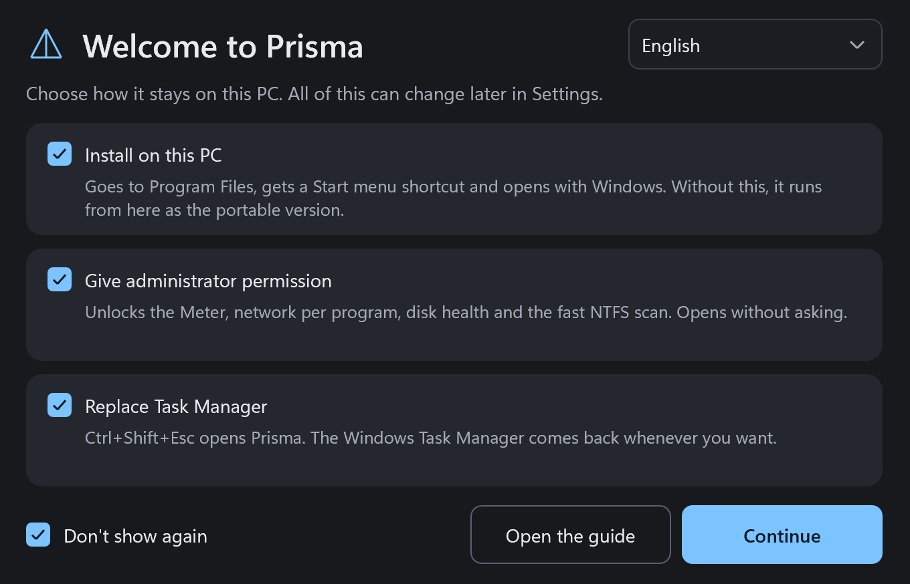
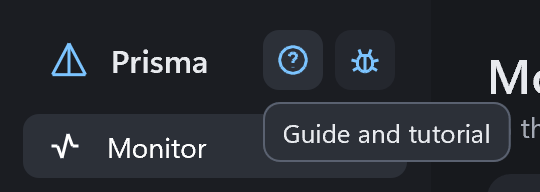
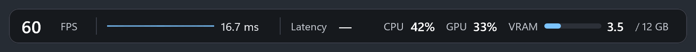
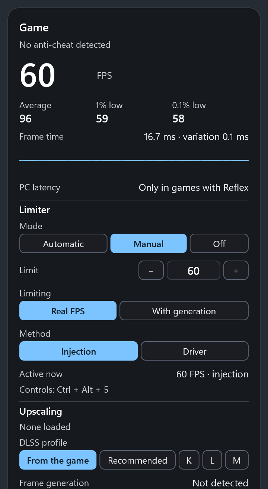
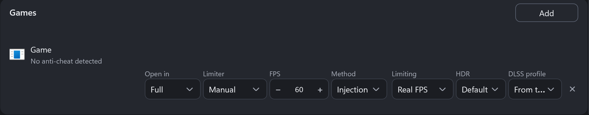

# Prisma Guide

[Português](GUIA.md)

## Getting started

Prisma is a single file, Prisma.exe. The first time you open it, the welcome screen shows three choices, all checked. Uncheck what you don't want and click **Continue**. Windows asks for administrator permission once and applies everything together.

- **Install on this PC:** copies Prisma to Program Files, creates a Start menu shortcut, adds it to the Windows program list and makes it start with Windows. Without this, it runs from its current folder as the portable version, and settings stay in PrismaData, next to the file.
- **Give administrator permission:** the Meter, the network column, disk health and the fast NTFS scan need it. Installed, Prisma opens as administrator without asking. Portable, Windows asks every time, because a file outside Program Files can be replaced by another program.
- **Replace Task Manager:** Ctrl+Shift+Esc opens Prisma. In the portable version, moving or deleting the file leaves the shortcut opening nothing until you turn the replacement off.
- **Don't show again:** checked by default, so the screen appears once. Unchecked, it appears every time the program opens again. You can change this in Settings.

The screen also has the language selector. Prisma starts in the Windows language: Portuguese on Windows in Portuguese and English on all others.

All of this can be changed later in **Settings**. Prisma stays in the Windows tray: closing the window does not end the program. To exit, use the menu on the tray icon.

## Guide and Report a bug

Both sit next to the Prisma name, at the top of the window, always in view. Hover over a button to see what it does.

## Monitor

Shows what is using your PC right now: CPU per core, GPU, RAM and VRAM, plus the CPU, RAM, GPU, VRAM, disk and network use of each program.

- **You can:** end a task, go to details, open the file location, search online and see properties with the right mouse button. The Details tab lists each process with its PID.
- **You can't:** see CPU temperature and power, because they require a kernel driver. The network column requires Prisma as administrator. GPU temperature depends on the NVIDIA driver.

## Meter

Shows performance over the game and limits FPS. Readings come from Windows events, with nothing inside the game. It needs Prisma as administrator.

### Compact bar

Sits at the top of the screen and shows FPS, the frame time line, latency, CPU, GPU and VRAM. Choose left, center or right. Shortcut: Ctrl + Alt + 1.

The line shows how frames vary. A straight line means even frames. Variations up to 1 ms are ignored, and large spikes point to stutter.

### Full panel

Sits on the right or left of the screen and shows everything in one column. Shortcut: Ctrl + Alt + 2. In the Meter page you choose what appears and the opacity.

- **FPS and averages:** the big number is the current FPS. 1% low and 0.1% low show the worst moments. The closer they are to the average, the steadier the game.
- **Frame time:** the time of each frame, in milliseconds. Low variation is good.
- **PC latency:** appears only in games with Reflex.
- **Upscaling, frame generation and Reflex:** shows what the game loaded.

To use the panel buttons inside a game, press **Ctrl + Alt + 5**. This unlocks the mouse and keyboard: arrows move through the options and change the chosen one, and clicks work too. To write the limit, type the number and press Enter. Press the shortcut again, or Esc, to go back to the game. Ctrl + Alt + 0 hides the meter and resets the readings.

### FPS limiter

With the limiter on, each game keeps its own limit. In the game list on the Meter page you choose the mode, limit, method and what is being limited.

- **Limiter:** Manual uses the number you choose. Automatic measures 5 minutes of play and picks a limit the game can hold.
- **Injection method:** the default. A small Prisma module enters the game and the limit changes right away, in DirectX 10, 11 and 12.
- **Driver method:** writes the limit to the NVIDIA driver. It applies only the next time the game opens.
- **Limiting:** Real FPS counts the frames the game makes. With generation counts the frames that reach the screen.
- **DLSS profile:** chooses the profile the NVIDIA driver uses for that game. It applies on reopening the game.
- **Shortcuts:** Ctrl + Alt + 3 turns it on and off. Ctrl + Alt + up or down arrow changes the limit. The limit goes from 20 to 1023.

If injection fails, the game crashes or an anti-cheat is detected, Prisma moves to the driver on its own and tells you.

- **Do not use injection in online games.** Anti-cheat detection recognizes known files and titles, but finding nothing does not prove a game has none. In those games, choose the Driver method.
- **You can't:** use injection in DirectX 9 and Vulkan. Those games use the driver limit, which applies on reopening. The driver limit requires an NVIDIA card. In exclusive fullscreen, the bar may not appear.

### Data log

Records performance to study later. It only runs if you turn it on, on the Meter page or with Ctrl + Alt + 4. Choose 1, 5 or 10 minutes of play, or no limit.

Files go to Documents, Prisma, Logs: every frame, every second, the CPU of each game thread and a summary at the end. In games with a detected anti-cheat, the thread reading stays off.

## Disks and networks

Shows speed, active time and space of each disk, with a SMART health grade: Good, Warning or At risk, including USB drives. Each network shows speed, address and total transferred.

- **You can't:** treat the grade as a guarantee. A disk can fail without warning. Health requires Prisma as administrator.

## Disk space

Scans a whole disk and shows folders, largest files, types and a visual map.

- **You can:** open items in Explorer and, as administrator, send them to the Recycle Bin.
- **You can't:** use the fast scan without administrator or on a disk that is not NTFS.

## Startup

Turns on, turns off, adds and removes what opens with Windows, and shows who signed each program. Sorts by name, enabled or disabled.

## Services

Shows the description of each service. You can start, stop and restart. The right mouse button opens properties in the Windows window itself.

## Uninstall

Removes programs in batches, creates a restore point, looks for leftovers and reports what was deleted.

- **Safety:** only exact name matches come checked. Similar names appear for you to review, folders go to the Recycle Bin and the registry gets a backup first.

## Windows tweaks

First an audit that only reads the PC. Then the Game, Development and Privacy profiles, in layers, with documented tweaks only. The Left out tab explains what stayed out and why.

- **You can:** undo. Each change keeps the previous value, and Undo only restores what nothing else touched afterwards. **Show log** shows each change, with before and after.
- **You can't:** expect more FPS: the gain is privacy and less noise. No profile touches updates, antivirus, UAC, Memory Integrity or virtualization. Removed apps come back through the Store, and that can fail.

## Tools

Brings together Windows repair (DISM then SFC), crash history, Windows Update, disk check, network, DNS, cleanup, winget, diagnostics and advanced restart. Each tool keeps its own step log, with the exact command, output, errors and the time of each step.

- **You can't:** use modes that write on a suspect disk. They stay blocked.

## Optimize

Suggests what to close before playing and always asks. Blacklist never closes, Whitelist always closes, and automatic detection suggests names for both lists. Shortcut: Ctrl + Alt + O.

When a game opens, a small question may appear in the top right corner. It leaves after 10 seconds.

## Power

Detects a game or high load and switches the power plan. It goes back to rest after 60 seconds without load. You choose the percentage and time that count as load.

- **You can:** edit a plan with every option Windows registers, including hidden ones, and import or export .pow files. The first edit keeps a copy of the original plan.
- **Limit:** Prisma's plans are created only in the installed version.

## Fullscreenizer

Makes the window in focus borderless fullscreen. Shortcut: Ctrl + Alt + F. Anything you use it on goes into a saved list, where you can check Automatic to apply it whenever the program opens.

- **You can't:** use it with a game in exclusive fullscreen. Put the game in windowed mode first.

## Sound

Controls the volume of each program. The keyboard volume keys, with a modifier (Ctrl by default), change only the program in focus. Prisma remembers the volume of each program.

- **You can:** choose the output and input device of each program, and add programs by hand.
- **Keep the sound awake:** plays a stream with no audible sound, so HDMI and Dolby don't cut the start of the next sound. It stops on its own after 10 minutes without use.
- **Limit:** switching devices uses an internal Windows feature, and some programs only switch on reopening.

## HDR

A reading panel with the display mode, the active calibration profile, the brightness each source declares, what Windows tells games, the declared Dolby Vision and the accepted sound formats. It warns when something doesn't match.

- **Calibration:** opens fullscreen test patterns and saves one profile per TV picture mode.
- **Auto HDR per game:** forces, turns off or leaves it to Windows, in DX11 and DX12 games, without injecting anything.
- **Sound delay test:** plays a click with a flash, to compare with and without spatial sound.
- **You can't:** change what the TV does: the profile only informs Windows, and Windows may keep telling games the old values for a while. Direct reading of the display data exists only on NVIDIA cards.

## Capture

Takes photos with annotations and records video in AV1, HEVC or H.264. With the display in HDR, it records in SDR or HDR10. Video goes to the folder you choose.

- **Record Window and Record Screen:** Ctrl + Alt + R records the window in focus and Ctrl + Alt + T records the whole screen. With System sound on, it records every sound on the PC. Off, Record Window records only that window's sound.
- **Photo:** Ctrl + Alt + P selects an area, Ctrl + Alt + A takes the whole screen and Ctrl + Alt + J takes the window in focus. Enter or Ctrl + C copies, Ctrl + S saves, Ctrl + Z undoes and Esc cancels.
- **Replay:** in game mode, keeps the last seconds in memory. Ctrl + Alt + B saves.
- **You can't:** capture protected content, such as Netflix, which comes out black. H.264 has no 10 bits: recording in HDR10 uses HEVC. Recording requires a video encoder on the GPU.

## Widget

Shows CPU, GPU, RAM and VRAM on top of everything, in four styles. Drag it to move it. Shortcut: Ctrl + Alt + W.

## Settings

- **Start with Windows and administrator:** turn them on or off whenever you want. Changing this in the installed version asks for Windows permission.
- **Replace Task Manager:** turns it on or gives it back. Uninstalling also gives it back.
- **Force close:** a shortcut, Alt + F4 by default, ends the program in focus right away, even frozen in fullscreen. Anything unsaved is lost. The desktop, the taskbar and Windows processes keep the normal Alt + F4.
- **Language:** Brazilian Portuguese or English.
- **Updates:** see the section below.
- **Show the welcome screen on open:** brings the first screen back.

Each page has a **Default** button that resets the options of that page only.

## Updates

With automatic search on, Prisma looks for a new version once a day on GitHub, without sending your data. When you open the window and there is a new version, it asks if you want to update. Minimized or in the tray, it does not interrupt you.

- **Yes:** downloads, checks the file, replaces the program and restarts, with your settings. The installed version asks for Windows permission if it is not running as administrator.
- **No:** it asks again the next time the window opens.
- **Don't show again:** turns automatic search off. To turn it back on, check the option in Settings, which also has **Check now**.

## Report a bug

Click the bug button at the top of the window. Choose the feature, the severity, describe what happened and add a photo if you want. The browser opens GitHub with everything written and you just confirm.

- **Privacy:** you can include PC data and a short log, without user name, PC name or file paths. The GitHub page is public, and you see everything before sending.
- **Crashes:** if Prisma crashes, it keeps a report in the data folder and tells you the next time it opens. The file stays on your PC only.

## Shortcuts

All of them can be changed in the program.

- **Ctrl + Alt + F:** Fullscreenizer
- **Ctrl + volume and mute keys:** volume of the program in focus
- **Ctrl + Alt + W:** Widget
- **Ctrl + Alt + O:** Optimize
- **Alt + F4:** Force close
- **Ctrl + Alt + 1:** compact meter
- **Ctrl + Alt + 2:** full meter
- **Ctrl + Alt + 0:** hide the meter
- **Ctrl + Alt + 5:** meter controls
- **Ctrl + Alt + 3:** turn the limiter on or off
- **Ctrl + Alt + up or down arrow:** raise or lower the limit
- **Ctrl + Alt + 4:** data log
- **Ctrl + Alt + P, A and J:** photo of an area, the screen and the window
- **Ctrl + Alt + R and T:** record window and record screen
- **Ctrl + Alt + B:** save replay

## General limits

- 64-bit Windows 11.
- No CPU temperature or power.
- Text that comes from Windows itself, such as service descriptions, stays in the Windows language.
- Everything Prisma changes on the system is recorded in acoes.log, in the data folder.
- The file has no digital signature, so Windows may warn about an unknown publisher.
